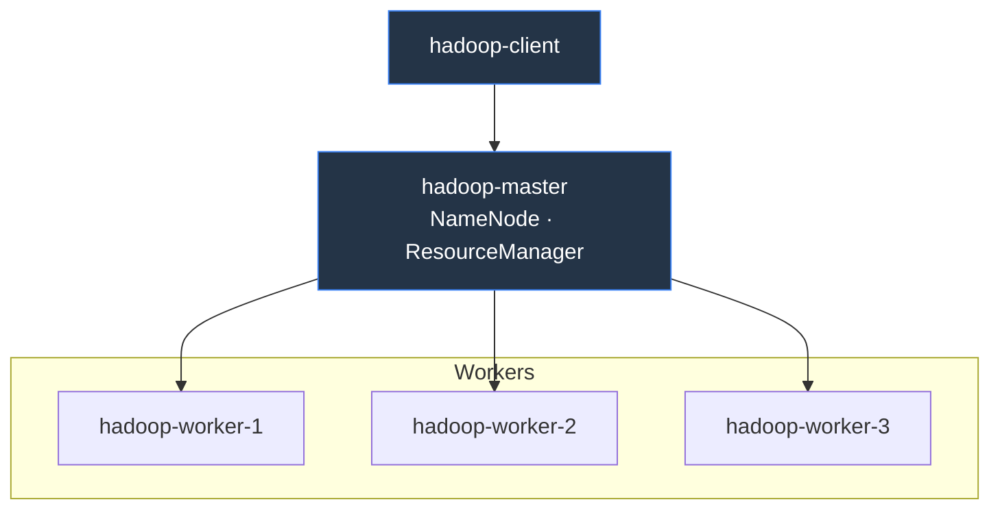
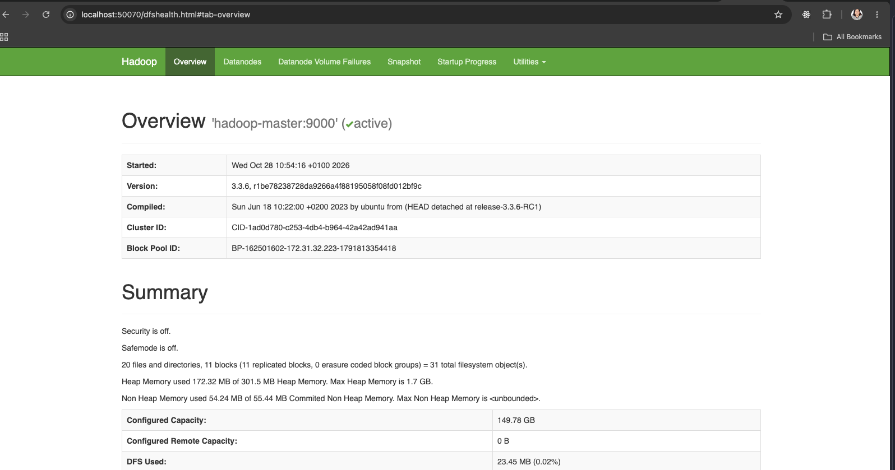
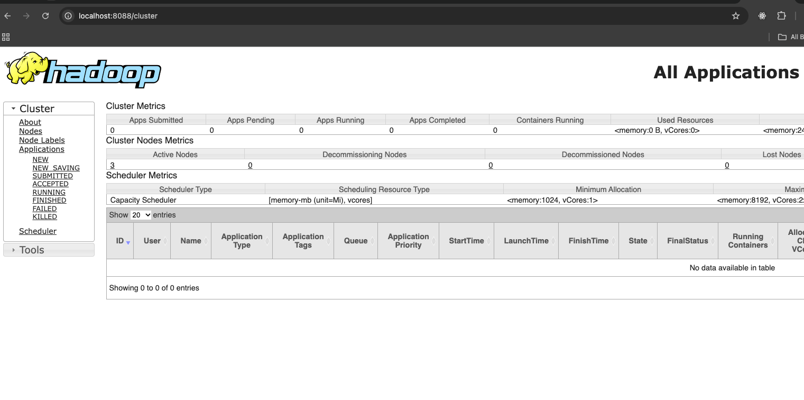
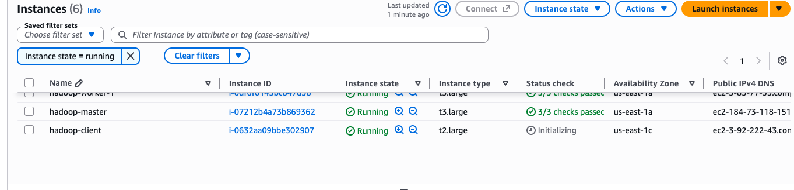
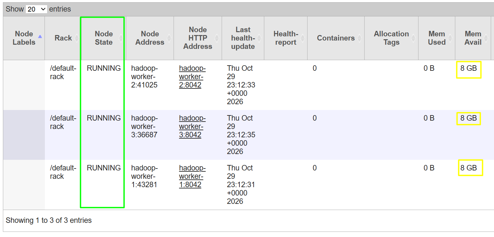
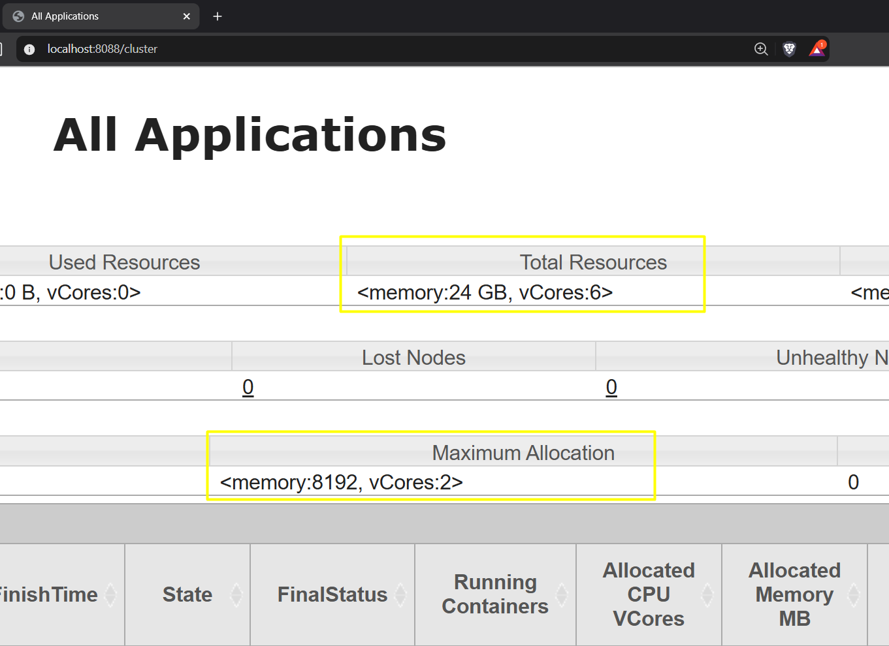
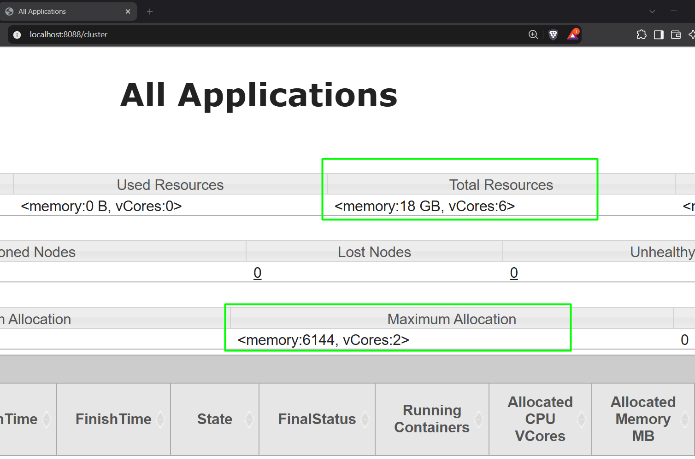

# Despliegue y preparación del clúster

Guía para crear el master, los tres workers y el cliente en AWS Academy, y preparar
la red, YARN, HDFS, los datos y Spark. Se realiza al crear un clúster nuevo.
Después, seguir las instrucciones para [sincronizar y ejecutar el código](README.md#sincronizar-y-ejecutar-el-código-de-src-en-master-y-cliente).

Antes de empezar, revisar los [requisitos del proyecto](README.md#requisitos).
Los comandos `apt` corresponden a Linux/WSL.

El contenido procede del trabajo documentado en [Semana 0](docs/Semana0.md).

## Atajo para recrear el clúster

Se añadió `scripts/cluster.sh` para poder repetir fácilmente el despliegue al recrear
el entorno en AWS. Todo el proceso está documentado paso a paso en las secciones
siguientes, con sus comandos y explicaciones.

El atajo requiere Git y Python 3.9–3.11 con venv. Prepara Ansible en `.deployment/`,
una carpeta local excluida de Git.

Preparar la configuración local una vez; también la utiliza `sync.sh`:

```bash
cp config/cluster.env.example config/cluster.env
nano config/cluster.env
```

| Variable | Para qué sirve |
|---|---|
| `AWS_REGION` | `us-east-1`, región de la AMI de clase |
| `AWS_PROFILE` | Perfil de `~/.aws/credentials`; por defecto `default` |
| `SSH_KEY` | Clave local del laboratorio; `$HOME/.ssh/vockey.pem` |
| `SSH_USER` | `ec2-user`, usuario del playbook de clase |
| `REMOTE_DIR` | Carpeta del proyecto dentro del home remoto |

Con las credenciales de AWS Academy y la clave SSH preparadas, ejecutar desde la
raíz del proyecto:

```bash
./scripts/cluster.sh deploy
```

Durante las descargas de Hadoop y Spark, ver el avance por nodo desde otra terminal:

```bash
./scripts/cluster.sh progress
```

Se actualiza cada 10 segundos. `Ctrl+C` cierra el visor y el despliegue continúa.

Usando el script de ansible `ansible/deploy.yml`,  crea las cinco EC2, prepara red, Hadoop, YARN y Spark, copia el código a su nodo,
carga Open Food Facts, genera la muestra y ejecuta las comprobaciones.
Se detiene si ya existe `hadoop-master`, incluso apagado. Si falla una etapa,
conserva los recursos creados; no elimina recursos ni reanuda automáticamente.

Si surge algun error se puede revisar los logs de la ejecución

```bash
tail -n 80 .deployment/deploy.log
```


## Índice

- [Atajo para recrear el clúster](#atajo-para-recrear-el-clúster)
- [Despliegue de EC2 y red](#despliegue-de-ec2-y-red)
- [Configuración de YARN](#configuración-de-yarn)
- [HDFS y exploración de datos](#hdfs-y-exploración-de-datos)
- [Spark en el nodo cliente](#spark-en-el-nodo-cliente)

## Despliegue de EC2 y red

Responsable inicial: Katherine (persona A).

### Checklist

- [x] [#16](https://github.com/albertxestrada/BigData-OpenFoodFacts/issues/16) Instancias EC2, red, SSH y `/etc/hosts` · 30 oct · cierra M2
- [x] Manual de red · 2 nov (documento a escribir una vez el clúster esté arriba, con topología e IPs)

### Diagrama de Client, Master, Workers creados en esta sección



### Comandos

Despliegue con el script de Ansible de clase (`hadoop-ansible-ec2`): crea 1 master + N workers en
EC2 y deja red, SSH y `/etc/hosts` configurados entre todos los nodos. El mismo playbook instala
Hadoop en master y workers, y Spark en el master. La preparación de Spark en el cliente se
explica en su propia sección. Katherine se encarga del despliegue inicial, aunque en el reparto
original la instalación estuviera dividida entre Alberto/Jorge/Mauro.

La creación inicial se hace una sola vez por clúster nuevo. Los scripts de este
repositorio se ejecutan desde `BigData-OpenFoodFacts`; el playbook de clase se ejecuta
desde la carpeta `hadoop-ansible-ec2`. Volver a la raíz de este proyecto para usar
`./scripts/cluster.sh` o `./scripts/sync.sh`.

#### 1. Credenciales de AWS Academy

Learner Lab → **AWS Details → AWS CLI → Show** → copiar el contenido en `~/.aws/credentials`
(`nano ~/.aws/credentials`)

#### 2. Dependencias y clave SSH (Linux/WSL)

```bash
sudo apt update
sudo apt install git python3-venv libffi-dev rsync
# Learner Lab entrega la clave como labsuser.pem; el playbook espera vockey.pem
cp labsuser.pem ~/.ssh/vockey.pem
chmod og-rwx ~/.ssh/vockey.pem
```

#### 3. Entorno de Ansible

```bash
python3.11 -m venv ~/ansible
source ~/ansible/bin/activate
git clone https://github.com/memaldi/hadoop-ansible-ec2 && cd hadoop-ansible-ec2
git checkout 354f82c2a8650f71470b768103ece5e8894daeff
pip install -r requirements.txt
# Descargar Hadoop desde el archivo de Apache
sed -i.bak 's|https://dlcdn.apache.org/hadoop/common/|https://archive.apache.org/dist/hadoop/common/|g' create-instances.yml
```

En `hadoop-master/yarn-site.xml` y `hadoop-worker/yarn-site.xml`, añadir o actualizar dentro de `<configuration>`:

```xml
<property>
  <name>yarn.log-aggregation-enable</name>
  <value>true</value>
</property>
```

Si el clúster ya existe, actualizar sus archivos y reiniciar ResourceManager y NodeManagers.

#### 4. Crear las instancias EC2 (red, SSH y `/etc/hosts`)

**El playbook inicial incluye `hdfs namenode -format -force`. Se ejecuta al crear un
clúster nuevo. `cluster.sh deploy` comprueba que el master no exista antes de ejecutarlo.**
[Código del playbook](https://github.com/memaldi/hadoop-ansible-ec2/blob/main/create-instances.yml).

Ejecutar el playbook original, conservando las reglas SSH con **My IP**.
Si se aplicó antes la sustitución con `sed`, restaurar
`cidr_ip: "{{ ipify_public_ip }}/32"` en ambos security groups antes de continuar.

```bash
ansible-playbook -i inventory.aws_ec2.yml --key-file=~/.ssh/vockey.pem --user ec2-user create-instances.yml
```

#### 4.1. Añadir SSH desde Anywhere al grupo del master

Después de que termine Ansible, ejecutar desde el equipo local:

```bash
aws ec2 authorize-security-group-ingress \
  --group-name hadoop-master-sg \
  --protocol tcp \
  --port 22 \
  --cidr 0.0.0.0/0 \
  --region us-east-1
```

Si aparece `InvalidPermission.Duplicate`, la regla ya existe.
El playbook retira al terminar el SSH público de los workers. La regla Anywhere
se añade a `hadoop-master-sg`; el cliente tendrá su propio grupo SSH.
[Referencia de AWS CLI](https://docs.aws.amazon.com/cli/latest/reference/ec2/authorize-security-group-ingress.html).

#### 5. Verificar red y SSH entre nodos

```bash
# desde el equipo local al master
ssh -i ~/.ssh/vockey.pem ec2-user@<master-public-dns>

# dentro del master: solo confirma que /etc/hosts tiene las entradas correctas
cat /etc/hosts
```

#### 6. Acceso a las UIs (opcional, cuando Ansible termine de instalar los servicios)

```bash
# correr en tu local: para ver los namenodes (HDFS)
# Abrir en el navegador: http://localhost:50070
ssh -i ~/.ssh/vockey.pem -N -L 50070:<master-public-dns>:50070 ec2-user@<master-public-dns>
```


```bash
# correr en tu local: Resource Manager (YARN)
# Abrir en el navegador: http://localhost:8088
ssh -i ~/.ssh/vockey.pem -N -L 8088:<master-public-dns>:8088 ec2-user@<master-public-dns>
```


#### 7. Creación de una nueva EC2 -> Nodo client

Misma AMI, clave y red que el resto. Después se instala Spark siguiendo
[Spark en el nodo cliente](#spark-en-el-nodo-cliente). El cliente usa `hadoop-sg`
para la red interna y `hadoop-client-sg` para SSH desde Anywhere (TCP 22).

```bash
# Crear el grupo SSH del cliente y permitir Anywhere
aws ec2 create-security-group --group-name hadoop-client-sg --description "SSH access to Hadoop client" --region us-east-1
aws ec2 authorize-security-group-ingress --group-name hadoop-client-sg --protocol tcp --port 22 --cidr 0.0.0.0/0 --region us-east-1

# Lanzar la instancia client
aws ec2 run-instances \
  --image-id ami-066784287e358dad1 \
  --instance-type t2.large \
  --key-name vockey \
  --security-groups hadoop-sg hadoop-client-sg \
  --count 1 \
  --region us-east-1 \
  --tag-specifications 'ResourceType=instance,Tags=[{Key=Name,Value=hadoop-client},{Key=Group,Value=hadoop-client}]' \
  --block-device-mappings '[{"DeviceName":"/dev/xvda","Ebs":{"VolumeSize":50,"DeleteOnTermination":true}}]'

# Obtener su IP privada/pública para corroborar su creación y detalles
aws ec2 describe-instances --filters "Name=tag:Group,Values=hadoop-client" \
  --query "Reservations[].Instances[].[InstanceId,PrivateIpAddress,PublicDnsName]" --output table
```

Esperar a que termine la inicialización antes de continuar.


#### 7.1. Resolver el master desde el cliente

Desde tu ordenador, registrar el master usando su IP privada de EC2:

```bash
eval "$(ssh-agent -s)"
ssh-add ~/.ssh/vockey.pem
ssh -J ec2-user@<master-public-dns> -i ~/.ssh/vockey.pem ec2-user@<client-private-ip> \
  "sudo sed -i -E '/[[:space:]]hadoop-master([[:space:]]|$)/d' /etc/hosts &&
   printf '%s hadoop-master\n' '<master-private-ip>' | sudo tee -a /etc/hosts"
```

#### 7.2. Autorizar el envío de trabajos del cliente al master

El cliente usa una clave SSH propia para copiar y ejecutar programas en el master.
Desde tu ordenador, con la clave del laboratorio cargada en el agente:

```bash
CLIENT_PUBLIC_KEY="$(ssh -J ec2-user@<master-public-dns> -i ~/.ssh/vockey.pem ec2-user@<client-private-ip> \
  'set -e; test -f ~/.ssh/id_ed25519 || ssh-keygen -q -t ed25519 -N "" -f ~/.ssh/id_ed25519; cat ~/.ssh/id_ed25519.pub')"
printf '%s\n' "$CLIENT_PUBLIC_KEY" | ssh -i ~/.ssh/vockey.pem ec2-user@<master-public-dns> \
  'cat >> ~/.ssh/authorized_keys'
```

#### 8. Preparar rsync en master y cliente

rsync debe estar instalado localmente y en los destinos. En Linux/WSL se instala localmente con `sudo apt install rsync`.
En los nodos Amazon Linux se instala con `sudo yum install -y rsync`.
Usar la IP pública del master y la IP privada del cliente obtenidas en EC2:

```bash
# En tu ordenador: cargar la clave permite autenticar también el salto SSH
eval "$(ssh-agent -s)"
ssh-add ~/.ssh/vockey.pem

# Instalar rsync en master y cliente; sustituir los marcadores de IP
ssh -i ~/.ssh/vockey.pem ec2-user@<MASTER_PUBLIC_IP> 'sudo yum install -y rsync'
ssh -J ec2-user@<MASTER_PUBLIC_IP> -i ~/.ssh/vockey.pem ec2-user@<CLIENT_PRIVATE_IP> 'sudo yum install -y rsync'
```

## Configuración de YARN

Responsable inicial: Jorge (persona C).

### Checklist

- [x] [#19](https://github.com/albertxestrada/BigData-OpenFoodFacts/issues/19) Configurar YARN · 5 nov

### 1. Comprobar lo que ya tenemos de YARN

- Ansible ya instala Hadoop con YARN configurado y arrancado: ResourceManager en el master, NodeManager en cada worker.
- Son servicios que arrancan solos con la instancia; no hay que instalar nada.
- Antes de tocar nada, comprobamos qué hay. Todo desde el master, entrando con `ssh -A` para poder saltar a los workers:

**a) En WSL: cargar la clave en el agente SSH**

```bash
# Arranca el agente SSH en esta terminal
eval $(ssh-agent)
# Carga la clave para poder reenviarla al master con -A
ssh-add ~/.ssh/vockey.pem
```

**b) Entrar al master**

```bash
# -A permite saltar desde el master a los workers con tu clave
ssh -A -i ~/.ssh/vockey.pem ec2-user@<DNS-DEL-MASTER>
```

**c) Ya en el master: preparar la sesión**

```bash
# Carga las variables que dejó Ansible (HADOOP_HOME, JAVA_HOME y el PATH con yarn y hdfs)
source ~/.bashrc
# Comprueba que la clave llegó al master: si sale "Could not open a connection", salir y repetir desde a)
ssh-add -l
```

**d) Ver los nodos de YARN**

```bash
# Nodos que ve YARN y cuántos recursos ofrece cada uno (si responde, el ResourceManager y los NodeManagers funcionan)
yarn node -list -showDetails | grep -E "Total Nodes|RUNNING|Configured Resources"
```

**e) Ver la configuración que dejó Ansible**

```bash
# Configuración del master
cat $HADOOP_HOME/etc/hadoop/yarn-site.xml
# Configuración de un worker (los tres son iguales)
ssh hadoop-worker-1 "cat ~/hadoop-3.3.6/etc/hadoop/yarn-site.xml"
```

**f) Abrir la web de YARN (opcional)**

```bash
# En otra terminal de WSL (se queda abierta mientras uses la web): reenvía el puerto 8088 del master a tu localhost
ssh -i ~/.ssh/vockey.pem -N -L 8088:<DNS-DEL-MASTER>:8088 ec2-user@<DNS-DEL-MASTER>
```

Lo que se ve:

- 3 nodos RUNNING con `<memory:8192, vCores:2>`: **24 GB y 6 vcores** en total ([web](http://localhost:8088/cluster/nodes)).
- El `yarn-site.xml` no fija la memoria, así que YARN usa los 8 GB enteros de cada worker.



### 2. Ajustar la memoria

Las 4 máquinas que crea Ansible son iguales:

| Nodo | Instancia | vCPU | RAM | Disco | Qué corre |
|---|---|---|---|---|---|
| `hadoop-master` | t3.large | 2 | 8 GiB | 50 GB | NameNode, ResourceManager, Spark (lanza los trabajos) |
| `hadoop-worker-1/2/3` | t3.large | 2 | 8 GiB | 50 GB | DataNode, NodeManager y los contenedores de los trabajos |

Por qué ajustar:

- **RAM por worker**: YARN usaría los 8 GB, pero el sistema y el DataNode también necesitan RAM. Le dejamos 6 GB
  (3 × 6 = **18 GB** en total) y quedan 2 GB libres para que el worker no se quede sin memoria.
- **Máx. por contenedor**: también 6 GB. Con 8 GB, un contenedor podría pedir más de lo que cabe en un worker.

| Qué | Propiedad (`yarn-site.xml`) | Dónde | Antes | Ahora |
|---|---|---|---|---|
| RAM por worker | `yarn.nodemanager.resource.memory-mb` | workers | 8192 | **6144** |
| Máx. por contenedor | `yarn.scheduler.maximum-allocation-mb` | master | 8192 | **6144** |

> [!WARNING]
> - Ejecutar **una sola vez por clúster**: si se repite, la propiedad queda duplicada en el `yarn-site.xml`.
> - Todo en la misma sesión del master.

```bash
# Master: máximo por contenedor y reiniciar el ResourceManager
sed -i 's#</configuration>#  <property><name>yarn.scheduler.maximum-allocation-mb</name><value>6144</value></property>\n</configuration>#' $HADOOP_HOME/etc/hadoop/yarn-site.xml
sudo systemctl restart resourcemanager

# Workers: memoria de cada uno y reiniciar su NodeManager
for w in hadoop-worker-1 hadoop-worker-2 hadoop-worker-3; do
  ssh $w "sed -i 's#</configuration>#  <property><name>yarn.nodemanager.resource.memory-mb</name><value>6144</value></property>\n</configuration>#' ~/hadoop-3.3.6/etc/hadoop/yarn-site.xml && sudo systemctl restart nodemanager"
done

# Comprobar: 3 nodos con <memory:6144, vCores:2>
sleep 30
yarn node -list -showDetails | grep "Configured Resources"

# Probar con un trabajo de ejemplo: debe terminar en SUCCEEDED
yarn jar $HADOOP_HOME/share/hadoop/mapreduce/hadoop-mapreduce-examples-3.3.6.jar pi 3 1000
```

> [!NOTE]
> **Qué es el `pi`**
> - Ejemplo de Hadoop que estima π con 3 tareas *map* de 1000 puntos cada una.
> - Solo sirve de prueba: si termina en `Job Finished` (≈ 3,14), YARN sigue ejecutando trabajos con la memoria nueva.

Comprobación en la web de YARN ([http://localhost:8088/cluster](http://localhost:8088/cluster)):

| Dato en la web | Antes | Después |
|---|---|---|
| **Total Resources** | `<memory:24 GB, vCores:6>` | `<memory:18 GB, vCores:6>` |
| **Maximum Allocation** | `<memory:8192, vCores:2>` | `<memory:6144, vCores:2>` |

| Antes | Después |
|---|---|
|  |  |

### Cheatsheet

| Para… | Comando |
|---|---|
| Ver nodos y su memoria | `yarn node -list -showDetails` |
| Ver aplicaciones | `yarn application -list -appStates ALL` |
| Matar una aplicación | `yarn application -kill <id>` |
| Reiniciar | master: `sudo systemctl restart resourcemanager` · worker: `sudo systemctl restart nodemanager` |

### Recursos para Spark (Mauro)

Para [#20](https://github.com/albertxestrada/BigData-OpenFoodFacts/issues/20):

- `--num-executors 3 --executor-memory 2g --executor-cores 1 --conf spark.executor.memoryOverhead=512m`:
  configuración base; el driver usa 2 GB en el master en modo `client`.
- La memoria de cada executor, incluido su overhead, debe caber en los 6144 MB permitidos por YARN.

### Defensa

- **RM / NM / contenedor:** el ResourceManager (master) reparte; el NodeManager (cada worker) ejecuta; un contenedor es
  un trozo de memoria y núcleos donde corre una tarea.
- **Memoria:** 8 GB − 2 GB = 6 GB por nodo. Pedir más de 6 GB: rechazado; si no hay hueco, espera en ACCEPTED.
- **Si cae un worker:** queda LOST y YARN relanza sus tareas en otro nodo; los datos siguen en HDFS (3 réplicas).

## HDFS y exploración de datos

Responsable inicial: Alberto (persona B).

### Checklist

- [x] [#17](https://github.com/albertxestrada/BigData-OpenFoodFacts/issues/17) Muestra del CSV y columnas que se usarán · 30 oct · cierra M2
- [x] CSV completo en HDFS (`/data/raw`) · parte de [#22](https://github.com/albertxestrada/BigData-OpenFoodFacts/issues/22)
- [x] HDFS verificado (3 DataNodes) y carpetas creadas · parte de [#18](https://github.com/albertxestrada/BigData-OpenFoodFacts/issues/18), porque el playbook de Ansible ya instala Hadoop

### Comandos

Cada integrante tiene su propio clúster, así que estos pasos se repiten en cada uno. Todo se
ejecuta **en el master**, salvo el paso 1. Los DNS públicos cambian al parar y arrancar las instancias.

#### 1. Entrar al master (desde el equipo local)

```bash
ssh-add ~/.ssh/vockey.pem
ssh -A -i ~/.ssh/vockey.pem ec2-user@<DNS-DEL-MASTER>
```

El DNS está en la consola de EC2 (instancia `hadoop-master`, "DNS IPv4 público"). En Windows, usar WSL
con la clave en `~/.ssh` (no en `/mnt/c`) y `chmod 600`. Errores: `Permission denied (publickey)` →
clave equivocada o comando lanzado dentro del master; `UNPROTECTED PRIVATE KEY FILE` → falta el `chmod 600`.

#### 2. Verificar HDFS y crear carpetas

```bash
source ~/.bashrc
hdfs dfsadmin -report | grep -E "Live datanodes|Configured Capacity"   # Live datanodes (3)
hdfs dfs -mkdir -p /data/raw /data/clean /results
```

`hdfs: command not found` → falta el `source ~/.bashrc` (hace falta en cada sesión nueva).

#### 3. Subir el CSV completo a HDFS

Unos 1,4 GB comprimido y 13 GB descomprimido; se baja, descomprime y sube en una tubería, sin pasar
por el disco del master.

```bash
nohup bash -c 'curl -L https://static.openfoodfacts.org/data/en.openfoodfacts.org.products.csv.gz | gunzip | hdfs dfs -put - /data/raw/openfoodfacts.csv' > put.log 2>&1 &
hdfs dfs -ls -h /data/raw      # durante la subida: openfoodfacts.csv._COPYING_ creciendo
hdfs dfs -du -h /data/raw      # al terminar: 13.0 G  38.9 G (tamaño y réplicas)
```

Tarda unos 10 minutos. Si `put.log` muestra `unexpected end of file` o `curl: (18)`, se cortó:
`hdfs dfs -rm -f /data/raw/openfoodfacts.csv*` y relanzar.

#### 4. Muestra aleatoria de 100.000 filas

El CSV está **ordenado por código de barras**: las primeras 100.000 filas (`head`) eran un 89 % de
EE. UU. y sesgaban todos los porcentajes. Se usa una muestra aleatoria (reservorio) de todo el archivo:

```bash
hdfs dfs -cat /data/raw/openfoodfacts.csv | awk -v K=100000 'NR==1{h=$0;next} NR-1<=K{a[NR-1]=$0;next} {j=int(rand()*(NR-1))+1; if(j<=K)a[j]=$0} END{print h; for(i=1;i<=K;i++)print a[i]; print "TOTAL_FILAS=" NR-1 > "/dev/stderr"}' > muestra.csv
wc -l muestra.csv                                       # 100001
awk -F'\t' '{print NF}' muestra.csv | sort | uniq -c    # 100001 211 (sin filas partidas)
```

Salida de `TOTAL_FILAS`: 4.879.512 productos. Para compartirla: `gzip -k muestra.csv` y `scp` al equipo local.

#### 5. Porcentaje de datos por columna

```bash
awk -F'\t' 'NR==1{h=NF; for(i=1;i<=NF;i++) n[i]=$i; next} {for(i=1;i<=NF;i++) if($i!="") c[i]++} END{for(i=1;i<=h;i++) printf "%d\t%s\t%.1f\n", i, n[i], 100*c[i]/(NR-1)}' muestra.csv > columnas_relleno.tsv
grep -w "iron_100g" columnas_relleno.tsv     # comprobar el nombre real de cada columna
```

El % de vacíos es 100 menos el último campo. Los nombres se copian de la cabecera real, no de la documentación.

#### 6. Leer la muestra con Spark (separador, cabecera, tipos)

```bash
cat > leer_muestra.py <<'EOF'
from pyspark.sql import SparkSession
spark = SparkSession.builder.getOrCreate()
df = spark.read.csv("file:///home/ec2-user/muestra.csv", sep="\t", header=True, inferSchema=True)
print("FILAS:", df.count(), "COLUMNAS:", len(df.columns))
print(df.select("code", "created_t", "nova_group", "energy-kcal_100g", "nutriscore_grade").dtypes)
EOF
spark-submit --master 'local[2]' --deploy-mode client --driver-memory 3g leer_muestra.py 2>/dev/null   # FILAS: 100000 COLUMNAS: 211
```

Con tabulador y cabecera basta: las comillas no rompen filas. Si no sale nada, repetir sin `2>/dev/null` para ver el error.

### Resultado: columnas (% de vacíos en la muestra de 100.000 filas)

La tabla completa está en el comentario de [#17](https://github.com/albertxestrada/BigData-OpenFoodFacts/issues/17).

| Columna | Tipo | % vacíos |
|---|---|---|
| `code` | string (forzar) | 0 |
| `created_t`, `last_modified_t` | long | 0 |
| `product_name`, `countries_tags` | string | 7 · 0,4 |
| `brands`, `categories_tags`, `labels_tags` | string | 36 · 60 · 74 |
| `nova_group`, `additives_n` | int | 76 · 72 |
| `energy-kcal`, `fat`, `carbohydrates`, `proteins` (`_100g`) | double | 28-29 |
| `sugars`, `saturated-fat`, `salt`/`sodium` (`_100g`) | double | 33 · 35 · 37,5 |
| `energy-kj_100g`, `fiber_100g` | double | 47 · 61 |
| `iron`, `calcium`, `vitamin-c`, `vitamin-a` (`_100g`) | double | 84-89 |
| `nutriscore_grade` | string | 71 (`unknown` 67 %, `not-applicable` 2,4 %) |
| `ingredients_from_palm_oil_n` | — | no existe en este CSV |

- `code` hay que leerlo como texto: Spark lo infiere como número y pierde ceros y dígitos.
- Una columna rellena no implica dato real: `unknown` y `not-applicable` son nulos para la limpieza.
- Sodio y sal aportan casi lo mismo; el resto de vitaminas y minerales está casi vacío.

_ La muestra (`muestra.csv.gz`) en drive compartido del grupo._

## Spark en el nodo cliente

El cliente desarrolla y envía los programas por SSH. El master ejecuta el driver
con `--master yarn --deploy-mode client`; los workers ejecutan los executors.

### 1.Conexión SSH al Nodo Cliente:Ubicación:
Tu ordenador local (WSL / Terminal).
Con la clave cargada en el agente SSH, conectarse a la IP privada del cliente pasando por el master:

```bash
ssh -J ec2-user@<master-public-dns> -i ~/.ssh/vockey.pem ec2-user@<client-private-ip>
```
### 2. Instalación de Java 8 y Apache Spark 3.5.5
Instala la versión de Java requerida por Hadoop/Spark y descarga el motor de Spark en /opt/spark:
```bash
# 1. Instalar dependencias del sistema
sudo yum install -y java-1.8.0-amazon-corretto-devel python3 wget tar rsync

# 2. Descargar y descomprimir Spark 3.5.5
cd /tmp
wget https://archive.apache.org/dist/spark/spark-3.5.5/spark-3.5.5-bin-hadoop3.tgz
tar -xzf spark-3.5.5-bin-hadoop3.tgz
sudo mv spark-3.5.5-bin-hadoop3 /opt/spark
sudo chown -R ec2-user:ec2-user /opt/spark
```
Verificación: Ejecuta /opt/spark/bin/spark-submit --version

Si aparece esto: version 3.5.5

👉 Pasa al Paso 3.


### 3. Configuración de Red y Variables de Entorno
Desde el cliente, comprobar el nombre del master y añadir las variables
de entorno en `.bashrc` una sola vez:

```bash
# 1. Verificar el punto de entrada a HDFS y YARN
getent hosts hadoop-master

# 2. Agregar variables de entorno al perfil
cat >> ~/.bashrc << 'EOF'
export JAVA_HOME=/usr/lib/jvm/java-1.8.0-amazon-corretto
export SPARK_HOME=/opt/spark
export HADOOP_CONF_DIR=$HOME/hadoop_conf
export YARN_CONF_DIR=$HOME/hadoop_conf
export PATH=$PATH:$SPARK_HOME/bin:$SPARK_HOME/sbin
EOF

# 3. Cargar las variables en la sesión activa
source ~/.bashrc
```
Verificación: Ejecuta echo $JAVA_HOME

Si aparece esto: /usr/lib/jvm/java-1.8.0-amazon-corretto

👉 Pasa al Paso 4.

### 4. Creación del Directorio de Configuración Hadoop (hadoop_conf)
Crea la carpeta ~/hadoop_conf con los descriptores XML que redirigen las peticiones de HDFS y YARN hacia el máster:
```bash
mkdir -p ~/hadoop_conf

# 1. Configurar YARN (yarn-site.xml)
cat > ~/hadoop_conf/yarn-site.xml << 'EOF'
<?xml version="1.0"?>
<configuration>
<property>
    <name>yarn.resourcemanager.hostname</name>
    <value>hadoop-master</value>
</property>
<property>
    <name>yarn.resourcemanager.address</name>
    <value>hadoop-master:8032</value>
</property>
<property>
    <name>yarn.resourcemanager.scheduler.address</name>
    <value>hadoop-master:8030</value>
</property>
<property>
    <name>yarn.resourcemanager.resource-tracker.address</name>
    <value>hadoop-master:8031</value>
</property>
</configuration>
EOF

# 2. Configurar HDFS (core-site.xml)
cat > ~/hadoop_conf/core-site.xml << 'EOF'
<?xml version="1.0"?>
<configuration>
<property>
    <name>fs.defaultFS</name>
    <value>hdfs://hadoop-master:9000</value>
</property>
</configuration>
EOF
```
Verificación: Ejecuta grep -q "hadoop-master" ~/hadoop_conf/yarn-site.xml && echo "OK"

Si aparece esto: OK

👉 Pasa al Paso 5.


### 5. Configuración de Spark sobre YARN (spark-defaults.conf)

El bloque siguiente corresponde al **master**. Para el **cliente**, omitir
`spark.driver.host` y mantener `SPARK_HOME=/opt/spark`.

```bash
# Solo en el master, después de source ~/.bashrc
export SPARK_HOME=/home/ec2-user/spark-3.5.5-bin-hadoop3
```

```bash
cat > "$SPARK_HOME/conf/spark-defaults.conf" << 'EOF'
spark.master                     yarn
spark.submit.deployMode          client
spark.driver.memory              2g
spark.driver.host                hadoop-master
spark.executor.instances         3
spark.executor.cores             1
spark.executor.memory            2g
spark.executor.memoryOverhead    512m
spark.pyspark.python             python3
EOF
```

Los workers deben usar la misma versión mayor y menor de Python 3.
Si falta, instalarlo con `sudo yum install -y python3`.

### 6. Prueba 1: Ejecución del Trabajo SparkPi en YARN

Desde el **cliente**, lanzar SparkPi en el master por SSH y anotar el `application_...`:

```bash
ssh hadoop-master 'source ~/.bashrc; spark-submit --master yarn --deploy-mode client \
  --class org.apache.spark.examples.SparkPi \
  $SPARK_HOME/examples/jars/spark-examples_2.12-3.5.5.jar 100'
```

### 7. Prueba 2: Lectura de HDFS desde PySpark

Desde el **cliente**, crear la prueba, copiarla al master y ejecutarla por SSH:

```bash
cat > /tmp/check_spark.py <<'EOF'
import socket
from pyspark.sql import SparkSession

spark = SparkSession.builder.appName("check-spark").getOrCreate()
driver = socket.gethostname()
workers = spark.sparkContext.parallelize(range(3), 3).map(lambda _: socket.gethostname()).collect()
assert all(host != driver for host in workers), "Las tareas no se ejecutan en los workers"
rows = spark.read.text("/data/raw/openfoodfacts.csv").limit(10).count()
assert rows == 10
print("DRIVER:", driver)
print("PYTHON_WORKERS:", workers)
print("HDFS_ROWS:", rows)
spark.stop()
EOF

scp /tmp/check_spark.py hadoop-master:/tmp/check_spark.py
ssh hadoop-master 'source ~/.bashrc; spark-submit --master yarn --deploy-mode client /tmp/check_spark.py'
```

### 8. Consultar los resultados

**Desde el master**, usar el ID de cada prueba:

```bash
yarn application -status <APPLICATION_ID>
yarn logs -applicationId <APPLICATION_ID>
```

Esperado: estado `SUCCEEDED`. La salida del driver aparece en la terminal del cliente:
`Pi is roughly 3.14...`, `DRIVER` del master, `HDFS_ROWS: 10` y `PYTHON_WORKERS`.
`yarn logs` muestra los logs de los executors.
[Ejecución y logs en YARN](https://spark.apache.org/docs/3.5.7/running-on-yarn.html).

Una vez completada la preparación, volver al README para [sincronizar y ejecutar el código](README.md#sincronizar-y-ejecutar-el-código-de-src-en-master-y-cliente).
