# Open Food Facts analytics

Preguntas analíticas con Spark sobre el CSV de Open Food Facts, en un clúster Hadoop en AWS Academy (Ansible de clase + nuestros scripts).

## Requisitos

- Windows: **WSL** (Ubuntu). Mac: **Terminal**.
- `git` y `python3`.
- Learner Lab arrancado
- `labsuser.pem` descargado (AWS Details, Download PEM).
- Scripts ejecutables. Si al lanzar uno sale `Permission denied`: `chmod +x cluster/*.sh tests/*.sh run.sh`.

Las capturas van en `docs/assets/` con el nombre que indica cada paso.

---

## Crear todo desde cero

### 0. Preparar tu equipo (una vez)

En tu equipo:

Dependencias (en Mac no hace falta: git y python3 vienen con `xcode-select --install`):

```bash
sudo apt update
sudo apt install -y git python3-venv libffi-dev unzip
```

Instalar AWS CLI siguiendo las [instrucciones oficiales de AWS](https://docs.aws.amazon.com/cli/latest/userguide/getting-started-install.html#getting-started-install-instructions).

Comprobar:

```bash
aws --version
```

Copiar la clave donde la espera el playbook (Learner Lab la da como `labsuser.pem`):

```bash
mkdir -p ~/.ssh
cp ~/Downloads/labsuser.pem ~/.ssh/vockey.pem
chmod og-rwx ~/.ssh/vockey.pem
```

> [!WARNING]
> Pegar las credenciales de AWS (Learner Lab, AWS Details, AWS CLI, Show).
> Caducan con cada sesión del lab: repetir este bloque cada vez que arranques el Learner Lab.

```bash
mkdir -p ~/.aws
nano ~/.aws/credentials        # pegar, guardar con Ctrl+O y Enter, salir con Ctrl+X
```

Instalar Ansible y clonar el playbook:

```bash
./cluster/00-prepare-local.sh
```

### 1. Crear master y 3 workers con Ansible (~10 min)

En tu equipo:

```bash
./cluster/01-create-cluster.sh
```

> [!TIP]
> `Download Spark` tarda 10-35 min sin mostrar progreso. Para verlo, en otra terminal de tu equipo sacar el comando ssh del master:
>
> ```bash
> ./cluster/ssh-commands.sh
> ```
>
> Conectarse al master con el primer comando que imprime (`ssh -i ... ec2-user@...`) y ejecutar:
>
> ```bash
> watch -n 5 'ls -lh ~/.ansible/tmp/*/'   # el archivo tmp... debe crecer
> ```
>
> 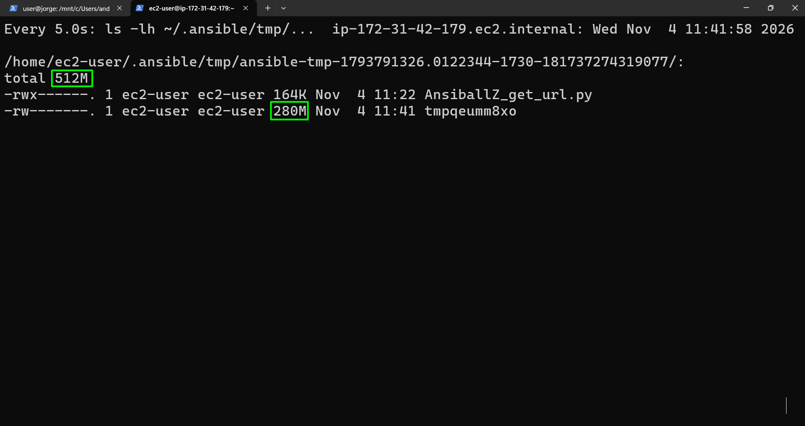
>
> Al terminar, el `tmp...` desaparece y queda `~/spark-3.5.5-bin-hadoop3.tgz` (383 MB) en el master.

> [!WARNING]
> Si el `.tgz` ya está en el master pero Ansible sigue parado en `Download Spark`, se cortó la conexión SSH (la descarga larga la deja inactiva). Los workers aún no están configurados. Cortar con Ctrl+C y seguir desde la tarea siguiente, en tu equipo:
>
> ```bash
> source ~/ansible/bin/activate
> cd ~/hadoop-ansible-ec2
> ansible-playbook -i inventory.aws_ec2.yml --key-file ~/.ssh/vockey.pem --user ec2-user \
>   create-instances.yml --start-at-task "Extract Spark"
> ```
>
> Esperar al `PLAY RECAP` con `failed=0` en las 4 máquinas.

Comprobar en AWS:

- EC2, Instances: `hadoop-master`, `hadoop-worker-1`, `hadoop-worker-2`, `hadoop-worker-3` en `Running`.
- EC2, Security Groups: `hadoop-sg` y `hadoop-master-sg`.


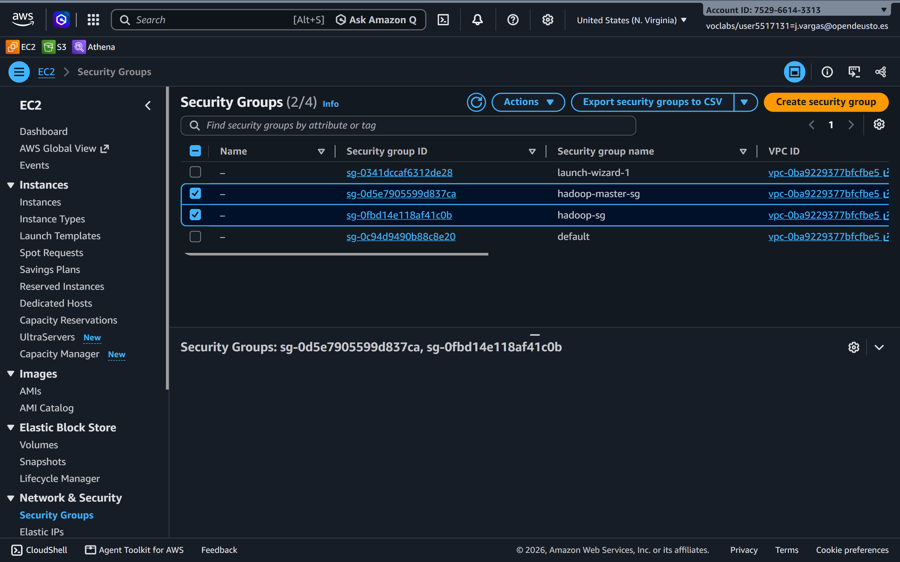

### 2. Abrir el SSH del security group a cualquier IP

Ansible solo deja entrar por SSH desde tu IP inicial. Este paso añade al security group `hadoop-master-sg` (el del master y el client) una regla que abre el puerto 22 a cualquier IP. En tu equipo:

```bash
./cluster/02-open-ssh.sh
```

Comprobar en AWS: EC2, Security Groups, `hadoop-master-sg`, Inbound rules: SSH, puerto 22, origen `0.0.0.0/0`.


### 3. Comprobar HDFS y YARN tal como los deja Ansible

En tu equipo, ver los comandos ssh:

```bash
./cluster/ssh-commands.sh
```

Abrir el túnel de HDFS en una terminal y el de YARN en otra, y dejar las dos abiertas.

HDFS: abrir http://localhost:50070. En Overview, `Live Nodes` es `3`. En la pestaña Datanodes salen `hadoop-worker-1`, `hadoop-worker-2` y `hadoop-worker-3` en `In Service`.

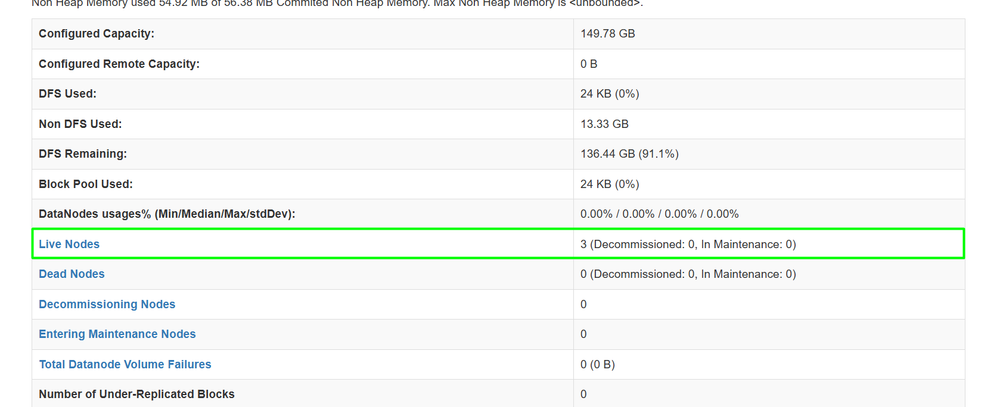

YARN: abrir http://localhost:8088/cluster/nodes. Salen los 3 workers en `RUNNING`.

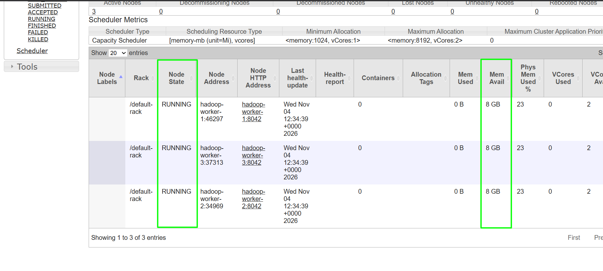

También por comando, en el master:

```bash
source ~/.bashrc
hdfs dfsadmin -report | grep "Live datanodes"   # Live datanodes (3)
```

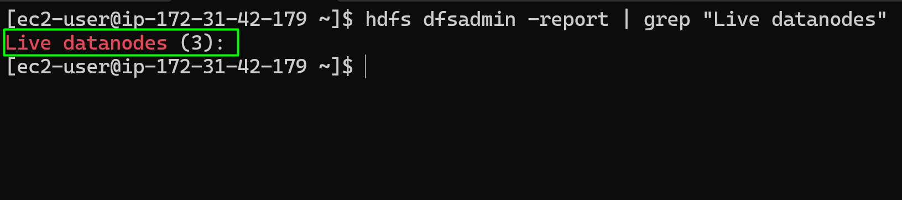

```bash
yarn node -list                                  # Total Nodes:3
```

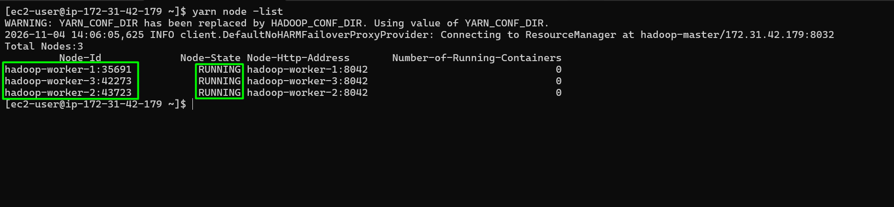

> [!WARNING]
> Si salen 0 nodos, el playbook no terminó. Puede cortarse en `Download Spark` del master por su límite de 60 s, y entonces nunca configura los workers. Repetirlo solo desde los workers, en tu equipo:
>
> ```bash
> source ~/ansible/bin/activate
> cd ~/hadoop-ansible-ec2
> ansible-playbook -i inventory.aws_ec2.yml --key-file ~/.ssh/vockey.pem --user ec2-user \
>   create-instances.yml --start-at-task "copy hdfs-site.xml file to hadoop-worker nodes"
> ```

### 4. Crear el client

En tu equipo:

```bash
./cluster/04-create-client.sh
```

Comprobar en AWS: EC2, Instances: `hadoop-client` en `Running` con `2/2 checks passed`.

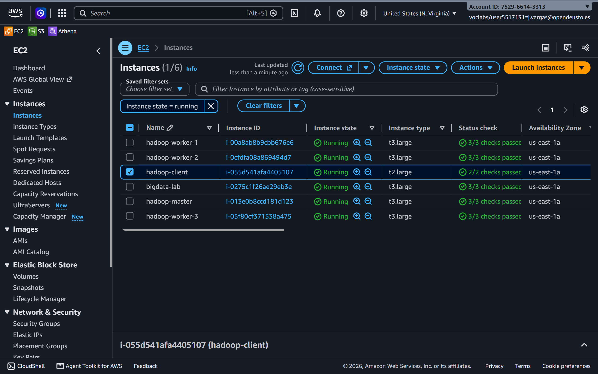

### 5. Copiar el proyecto al master

En tu equipo:

```bash
./cluster/05-copy-to-master.sh
```

Al final muestra los comandos ssh, igual que `./cluster/ssh-commands.sh`. Entrar al master con el de `Master` e ir al proyecto:

```bash
cd open-food-facts-analytics
```

Comprobar en la terminal: `ls` muestra `cluster`, `jobs`, `run.sh`...

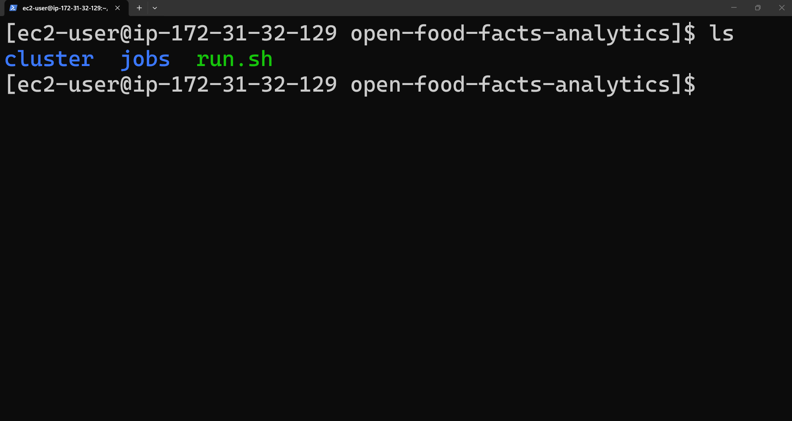

### 6. SSH entre nodos y /etc/hosts

En el master:

```bash
./cluster/06-setup-master.sh
```

Comprobar en la terminal: 4 líneas `hadoop-worker-1: ip-172-...` (una por nodo).

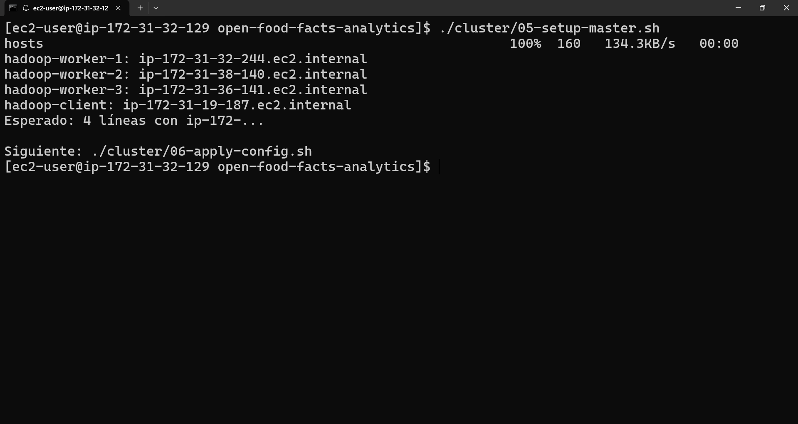

### 7. Configuración de YARN (6 GB por worker)

Con el túnel de YARN del paso 3 abierto (si se cerró, el comando lo da `./cluster/ssh-commands.sh`).

**Antes**, con la configuración de Ansible: abrir http://localhost:8088/cluster/nodes. Salen 3 nodos `RUNNING` con los valores por defecto de YARN, `8 GB` y `8` vCores cada uno, más de lo que tiene una t3.large (8 GB y 2 núcleos). En http://localhost:8088/cluster, Total Resources `<memory:24 GB, vCores:24>`.

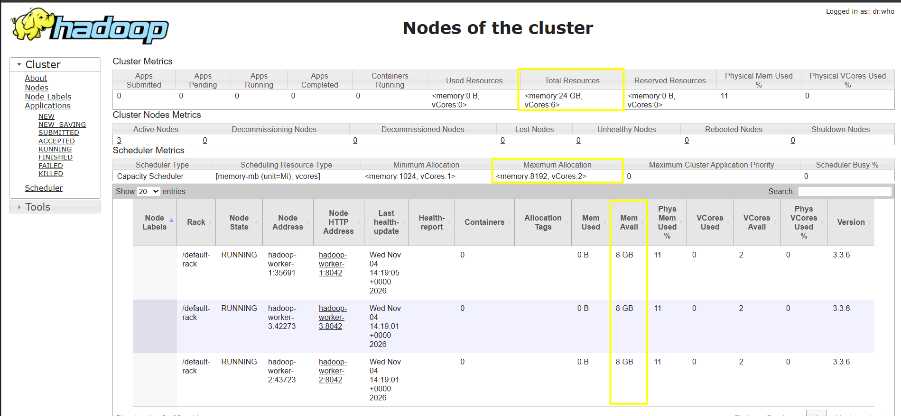

En el master:

```bash
./cluster/07-apply-config.sh
```

**Después**: recargar http://localhost:8088/cluster/nodes. Salen 3 nodos `RUNNING` con `6 GB` y `2` vCores cada uno. En http://localhost:8088/cluster, Total Resources `<memory:18 GB, vCores:6>`.

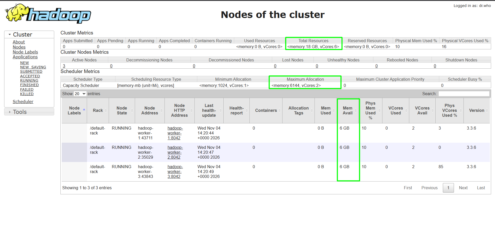

### 8. Spark en el client

En el master:

```bash
./cluster/08-setup-client.sh
```

Lo que más tarda es la descarga de Spark (383 MB), que no muestra progreso. Para seguirla, en otra terminal del master (se actualiza cada 5 s, salir con Ctrl+C):

```bash
ssh -t hadoop-client "watch -n 5 ls -lh /tmp/spark-3.5.3-bin-hadoop3.tgz"
```

Ha terminado cuando el archivo llega a `383M` y su fecha cambia a `Sep 9 2024`.

Comprobar en la terminal: `Pi is roughly 3.14`. En la web de YARN (http://localhost:8088/cluster/apps): la aplicación `PythonPi` en `FINISHED`.

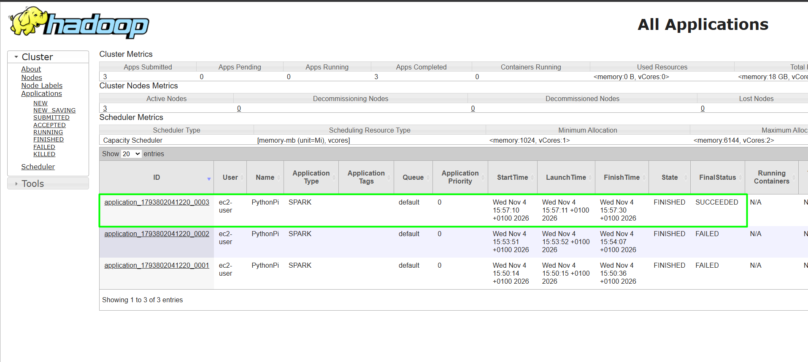

### 9. Subir el CSV a HDFS (~15 min)

En el master:

```bash
nohup ./cluster/09-upload-data.sh > upload.log 2>&1 &
tail -f --pid=$! upload.log   # se cierra solo al terminar el script; Ctrl+C deja de mirar, el script sigue
```

`--pid=$!` hace que `tail` termine cuando acaba el script (`$!` es el proceso que se acaba de lanzar con `&`). Si se corta el SSH, el script sigue: al volver a entrar, `tail upload.log` muestra cómo va, y la última línea `Esperado: ...` indica que ha terminado.

Comprobar en la web de HDFS, con el túnel de HDFS del paso 3 abierto (si se cerró, el comando lo da `./cluster/ssh-commands.sh`). Abrir http://localhost:50070, Utilities, Browse the file system, `/data/raw`: `openfoodfacts.csv` (~13 GB) y `muestra.csv`.

Al final del log, `hdfs dfs -du -h` muestra dos columnas: el tamaño del fichero (~13 G) y lo que ocupa en disco contando las réplicas (~39 G). El playbook de Ansible no cambia `dfs.replication`, así que se queda el valor por defecto de Hadoop, 3: cada bloque se guarda una vez en cada uno de los 3 workers. Para comprobarlo: `~/hadoop-3.3.6/bin/hdfs dfs -stat %r /data/raw/openfoodfacts.csv` (da `3`).

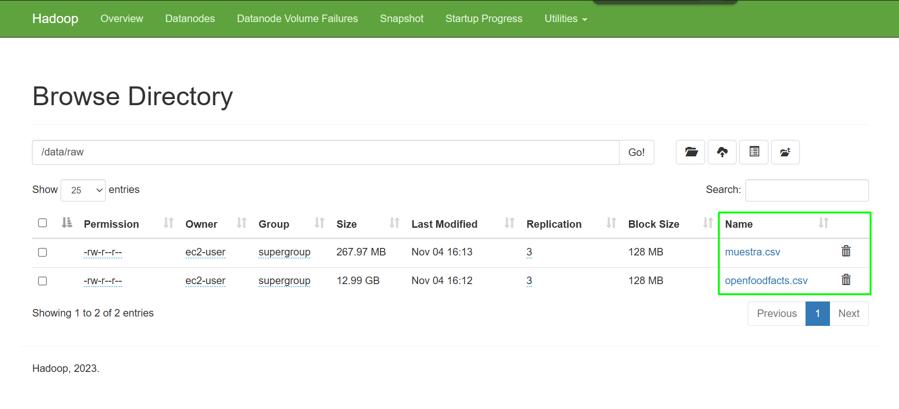

### 10. Limpiar los datos

Entrar al client desde el master:

```bash
ssh hadoop-client
cd open-food-facts-analytics
```

#### Con la muestra

Primero con la muestra, para comprobar en poco tiempo que el ETL funciona:

```bash
./run.sh jobs/00-etl.py hdfs:///data/raw/muestra.csv
```

Comprobar en la terminal: `Filas del CSV` (~99.000, el 2 % del total), la tabla de cuántos productos tienen cada dato y `OK 00-etl` al final.

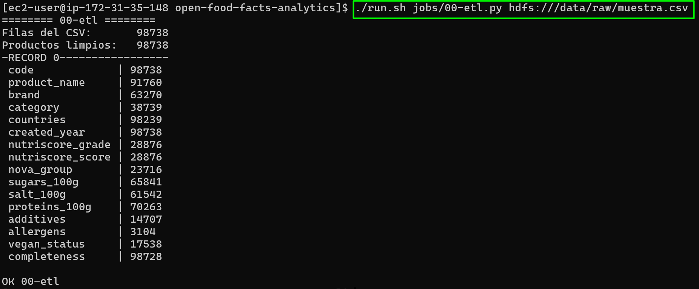

#### Con el CSV completo

Después con el CSV completo (sin argumento usa `/data/raw/openfoodfacts.csv`). Sobrescribe la salida de la muestra:

```bash
./run.sh jobs/00-etl.py
```

Comprobar en la terminal: `Filas del CSV` (~4,88 millones), la tabla de cuántos productos tienen cada dato y `OK 00-etl`. En la web de HDFS: carpeta `/data/clean/products`.

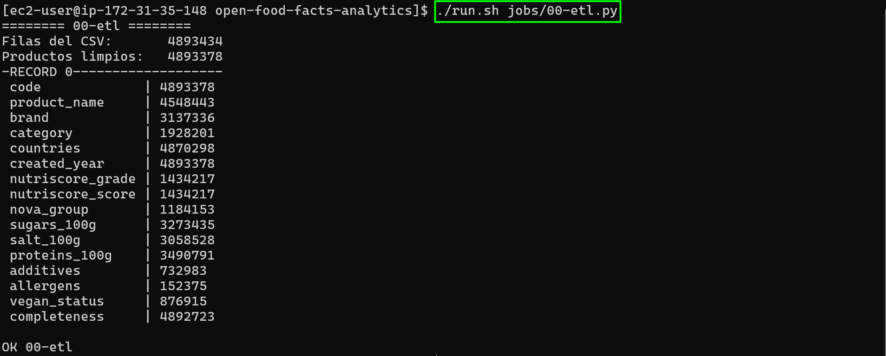

### 11. Las preguntas

En el client:

```bash
for f in jobs/q*.py; do ./run.sh "$f"; done
```

Comprobar en la terminal: un `OK qNN-...` por pregunta. En la web de HDFS: una carpeta por pregunta en `/results`.

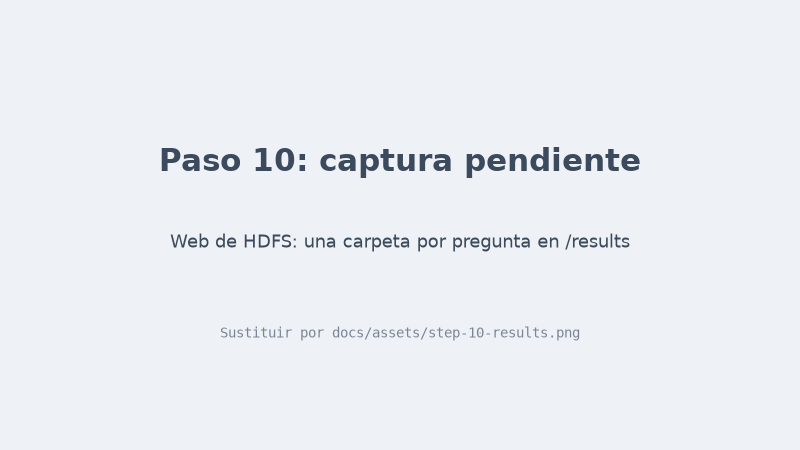

---

## Cada sesión

```bash
./cluster/start.sh          # tu equipo: encender (muestra los comandos ssh, el DNS cambia cada vez)
./cluster/check-cluster.sh  # master: comprobar que todo está arrancado
./cluster/stop.sh           # tu equipo: apagar al terminar
```

## Probar en local, sin AWS

```bash
./tests/setup-local-test.sh   # una vez: Java + PySpark
./tests/local-test.sh         # ETL + preguntas + gráficas con tests/sample-1k.csv
```
