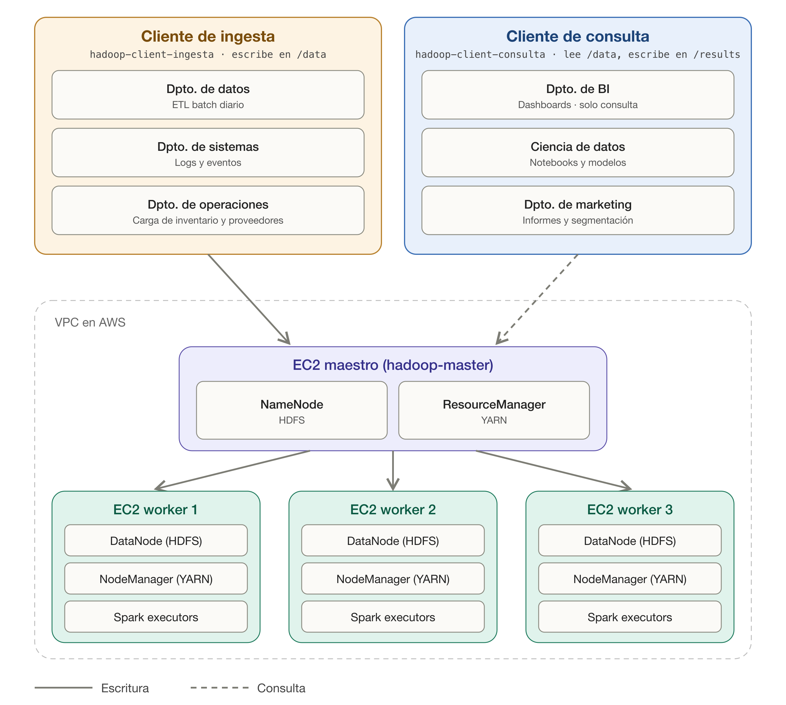

# BigData-OpenFoodFacts

Análisis de la información nutricional de Open Food Facts con **Spark sobre Hadoop
(HDFS + YARN) en AWS Academy**. El clúster tiene un master, tres workers y dos clientes:
uno de ingesta, que escribe los datos, y uno de consulta, que los lee. Los trabajos de Spark
se lanzan desde los clientes; el master no ejecuta trabajos.

Este README reúne las instrucciones de uso diario y desarrollo del proyecto.
La creación y preparación inicial se documentan en [la guía de despliegue](docs/DEPLOYMENT.md).
La exploración del dataset está en [EDA.md](docs/EDA.md) y la limpieza con Spark en
[LIMPIEZA.md](docs/LIMPIEZA.md). Las preguntas del análisis están en [PREGUNTAS.md](docs/PREGUNTAS.md).

> Contains data from Open Food Facts, available under the
> [Open Database License](https://opendatacommons.org/licenses/odbl/1.0/).
> Fuente: <https://world.openfoodfacts.org/data>.

## Índice

- [Arquitectura](#arquitectura)
- [Estructura del proyecto](#estructura-del-proyecto)
- [Requisitos](#requisitos)
- [Crear el clúster](#crear-el-clúster)
- [Explorar y limpiar los datos](#explorar-y-limpiar-los-datos)
- [Sincronizar y ejecutar el código de src/ en los clientes](#sincronizar-y-ejecutar-el-código-de-src-en-los-clientes)
- [Preguntas](#preguntas)

## Arquitectura



Línea continua: escritura. Línea discontinua: consulta.

| Nodo | Instancia | Función |
|---|---|---|
| Cliente de ingesta | `hadoop-client-ingesta` | Escribe: carga el CSV en HDFS, lo limpia y verifica el resultado. Atiende los departamentos de datos (ETL batch diario) y de sistemas (logs y eventos) |
| Cliente de consulta | `hadoop-client-consulta` | Lee: ejecuta las preguntas y guarda los resultados. Atiende los departamentos de BI (solo consulta) y de ciencia de datos (notebooks y modelos) |
| Master | `hadoop-master` | NameNode (HDFS) y ResourceManager (YARN). No ejecuta trabajos |
| Workers | `hadoop-worker-1/2/3` | DataNode, NodeManager y los executors de Spark |

Cada cliente tiene su identidad en HDFS (`ingesta` o `consulta`): `/data` es de `ingesta` y `/results`,
de `consulta`, de modo que consulta lee los datos pero no puede modificarlos. Los permisos están en
[DEPLOYMENT.md](docs/DEPLOYMENT.md#arquitectura-dos-clientes).

## Estructura del proyecto

```text
README.md                    # Uso del proyecto
scripts/
  cluster.sh                 # Despliegue: ver docs/DEPLOYMENT.md
  sync.sh                    # Copiar código a los clientes de ingesta y de consulta
ansible/
  deploy.yml                 # Configuración y datos del despliegue
config/
  cluster.env.example        # Ejemplo de configuración local
src/
  client_ingesta/            # Cliente de ingesta: perfil, limpieza y verificación de los datos
  client_consulta/           # Cliente de consulta: preguntas del análisis
docs/
  DEPLOYMENT.md              # Creación y preparación del clúster
  EDA.md                     # Exploración del dataset y reglas de limpieza
  LIMPIEZA.md                # Limpieza con Spark y cómo comprobarla
  PREGUNTAS.md               # Preguntas del análisis
  assets/                    # Imágenes
```

## Requisitos

Los dos scripts (`cluster.sh` y `sync.sh`) se ejecutan **en tu ordenador**, desde Linux, WSL o macOS, con Bash,
AWS CLI v2, OpenSSH y rsync. Los comandos `apt` del despliegue son para Linux/WSL.
Para instalar AWS CLI, seguir las [instrucciones oficiales para tu sistema](https://docs.aws.amazon.com/cli/latest/userguide/getting-started-install.html).

```bash
aws --version
ssh -V
rsync --version
```

Renovar las credenciales de AWS Academy en `~/.aws/credentials` (puedes usar nano ` nano ~/.aws/credentials`) al empezar la sesión.
La clave del laboratorio debe estar en `~/.ssh/vockey.pem` con permisos `600`.

## Crear el clúster

Para crear y preparar el clúster, seguir [DEPLOYMENT.md](docs/DEPLOYMENT.md).
La guía documenta la infraestructura, la configuración y la carga de datos paso a paso.

## Explorar y limpiar los datos

Antes de responder las preguntas se explora el dataset ([EDA.md](docs/EDA.md)) y se limpia con Spark
([LIMPIEZA.md](docs/LIMPIEZA.md)). El resultado es un Parquet en HDFS (`/data/clean/off_limpio`) que
usan todas las preguntas. Lo hace el cliente de ingesta con los scripts de `src/client_ingesta/`:
`perfil_completo.py`, `limpieza.py` y `verificar.py`.

## Sincronizar y ejecutar el código de `src/` en los clientes

Encender y apagar las instancias desde la consola de AWS. Para sincronizar `src/`
desde tu ordenador:

```bash
./scripts/sync.sh all          # o solo: ./scripts/sync.sh ingesta   |   ./scripts/sync.sh consulta
```

Cada cliente recibe solo su carpeta. El master no recibe código.

| Carpeta local | Cliente de destino | Carpeta remota |
|---|---|---|
| `src/client_ingesta/` | `hadoop-client-ingesta`: carga y limpieza | `~/BigData-OpenFoodFacts/src/client_ingesta/` |
| `src/client_consulta/` | `hadoop-client-consulta`: preguntas | `~/BigData-OpenFoodFacts/src/client_consulta/` |

El driver de Spark se ejecuta en el propio cliente con modo `client`; los executors procesan en los workers.

Los clientes no tienen IP pública: se entra saltando por el master (la IP privada del cliente está en la consola de EC2):

```bash
ssh -J ec2-user@<DNS-DEL-MASTER> -i ~/.ssh/vockey.pem ec2-user@<IP-PRIVADA-DEL-CLIENTE>
```

Ambas carpetas incluyen un `count_dataset.py` de prueba: lee el CSV de HDFS
con separador tabulador y cabecera, e imprime `TOTAL_PRODUCTOS` y `TOTAL_COLUMNAS`.
`src/client_ingesta/` además tiene los scripts de [LIMPIEZA.md](docs/LIMPIEZA.md).

En el cliente de ingesta:

```bash
source ~/.bashrc
cd ~/BigData-OpenFoodFacts
ls src/client_ingesta/

spark-submit src/client_ingesta/count_dataset.py
```

En el cliente de consulta (lee los datos que dejó ingesta):

```bash
source ~/.bashrc
cd ~/BigData-OpenFoodFacts
ls src/client_consulta/

spark-submit src/client_consulta/count_dataset.py
```

El master, el modo (`yarn`, `client`) y la IP del driver ya están en `spark-defaults.conf` de cada cliente,
así que basta con `spark-submit`. No lanzar a la vez dos trabajos grandes: los dos clientes comparten los 18 GB de YARN.

Por defecto leen `hdfs://hadoop-master:9000/data/raw/openfoodfacts.csv`.
Para probar con la muestra local, ejecutar en el cliente de ingesta (donde está `muestra.csv`):

```bash
spark-submit --master 'local[2]' --deploy-mode client src/client_ingesta/count_dataset.py file:///home/ec2-user/muestra.csv
```

La salida del driver aparece en la terminal del cliente. Los logs de executors se consultan
desde el cliente con `yarn logs -applicationId <APPLICATION_ID>`.

## Preguntas

Las 11 preguntas del análisis, con su objetivo, utilidad, columnas y operaciones de Spark, están en
[PREGUNTAS.md](docs/PREGUNTAS.md). Cada una se desarrolla en `src/client_consulta/` y lee el Parquet limpio de
`/data/clean/off_limpio`.
