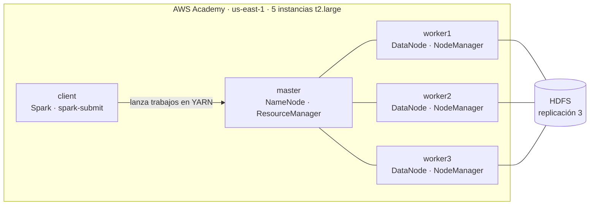
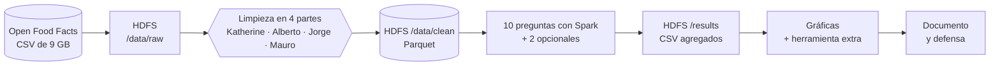
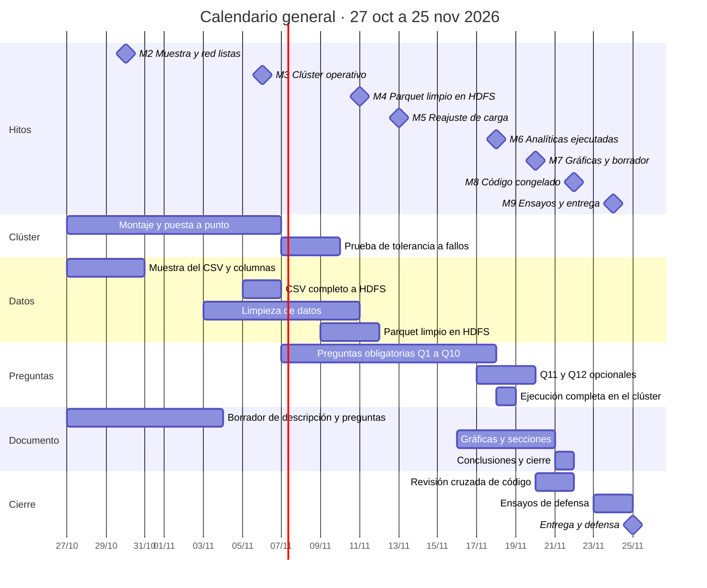
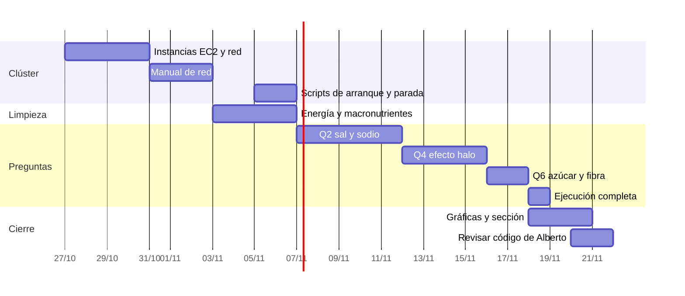
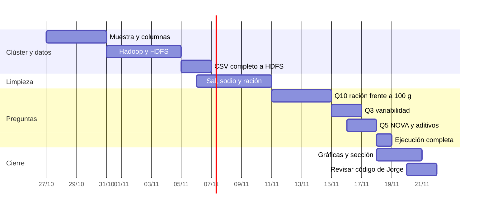
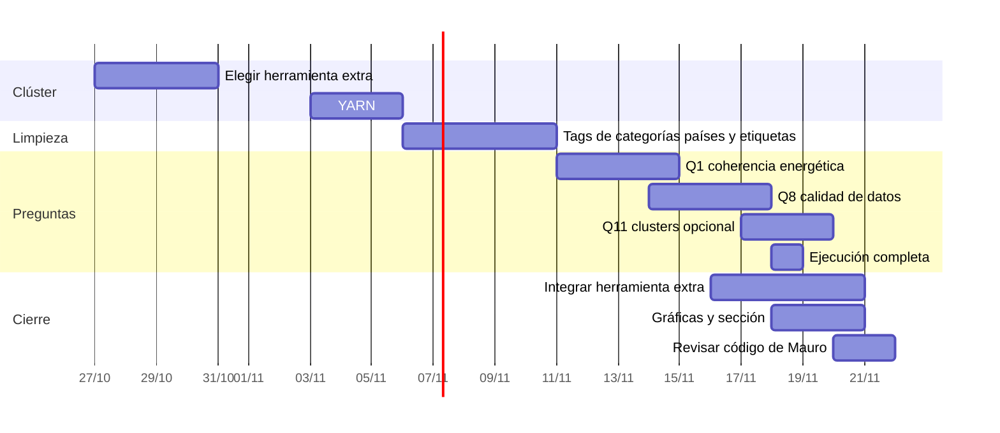
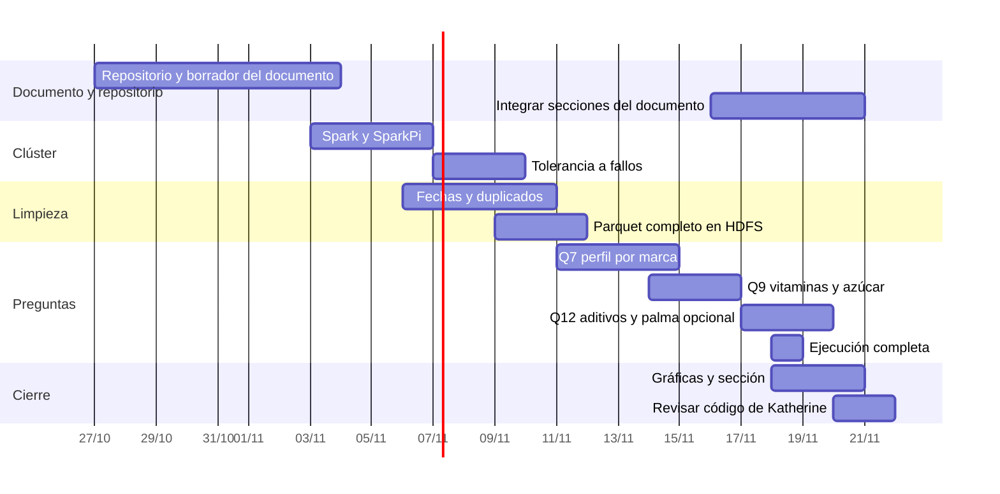
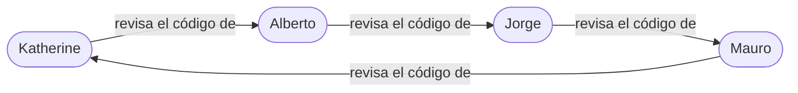

# BigData-OpenFoodFacts

Análisis de la información nutricional de **Open Food Facts** con **Spark sobre un clúster Hadoop (HDFS + YARN) en AWS Academy**. Trabajo en grupo de la asignatura ATBD.

> Contains data from Open Food Facts, available under the [Open Database License](https://opendatacommons.org/licenses/odbl/1.0/). Fuente: <https://world.openfoodfacts.org/data>

## TL;DR

| | |
| --- | --- |
| **Qué** | 10 preguntas analíticas (más 2 opcionales) sobre el CSV de productos de Open Food Facts, con la API DataFrame de Spark |
| **Dónde** | Clúster en AWS Academy: 1 master, 3 workers y 1 client (5 `t2.large` en us-east-1) |
| **Datos** | CSV de unos 0,9 GB comprimido y 9 GB descomprimido, separado por tabuladores. Los resultados se guardan en HDFS |
| **Entrega y defensa** | **25 de noviembre de 2026, 08:00** |
| **Código congelado** | 22 de noviembre |
| **Equipo** | Katherine (A), Alberto (B), Jorge (C) y Mauro (D). Cada uno toca todas las capas: clúster, limpieza, preguntas y documento |
| **Seguimiento** | [Issues](https://github.com/albertxestrada/BigData-OpenFoodFacts/issues) con etiqueta de persona y [hitos](https://github.com/albertxestrada/BigData-OpenFoodFacts/milestones) con fecha |

## Equipo

| | **A · Katherine** | **B · Alberto** | **C · Jorge** | **D · Mauro** |
| --- | --- | --- | --- | --- |
| **Clúster** | EC2, red y SSH | Hadoop y HDFS | YARN | Spark y tolerancia a fallos |
| **Limpieza de datos** | Energía y macronutrientes | Sal, sodio y ración | Tags de categorías, países y etiquetas | Fechas, duplicados y Parquet |
| **Preguntas** | Q2, Q4, Q6 | Q3, Q5, Q10 | Q1, Q8 (Q11 opcional) | Q7, Q9 (Q12 opcional) |
| **Transversal** | Scripts de arranque y parada | Descarga del CSV a HDFS | Herramienta extra y gráficas | Repositorio y documento |
| **Revisa el código de** | Alberto | Jorge | Mauro | Katherine |

## Arquitectura del clúster

| Pieza | Responsable |
| --- | --- |
| Instancias, red, SSH y `/etc/hosts` | Katherine |
| Hadoop y HDFS | Alberto |
| YARN | Jorge |
| Spark en el client y prueba de tolerancia a fallos | Mauro |

## Flujo de datos

## Calendario

## Cómo se va avanzando

Cada hito depende del anterior: sin clúster no hay datos limpios, y sin datos limpios no hay preguntas. Para marcar un hito como cumplido, cambiad su línea `class` de `pendiente` a `hecho` al final del diagrama.

```mermaid
flowchart LR
    M2["M2 · Muestra y red<br/>30 oct"] --> M3["M3 · Clúster operativo<br/>6 nov"]
    M3 --> M4["M4 · Parquet limpio<br/>11 nov"]
    M4 --> M5["M5 · Reajuste de carga<br/>13 nov"]
    M5 --> M6["M6 · Analíticas ejecutadas<br/>18 nov"]
    M6 --> M7["M7 · Gráficas y borrador<br/>20 nov"]
    M7 --> M8["M8 · Código congelado<br/>22 nov"]
    M8 --> M9["M9 · Ensayos y entrega<br/>24 nov"]
    M9 --> FIN(["Entrega y defensa<br/>25 nov · 08:00"])

    classDef pendiente fill:#f6f8fa,stroke:#8c959f,color:#1f2328
    classDef hecho fill:#dafbe1,stroke:#1a7f37,color:#1f2328
    class M2 pendiente
    class M3 pendiente
    class M4 pendiente
    class M5 pendiente
    class M6 pendiente
    class M7 pendiente
    class M8 pendiente
    class M9 pendiente
    class FIN pendiente
```

Casillas de los hitos (se marcan cuando todos sus issues están cerrados):

- [ ] **M2 · Muestra y red listas** · 30 oct · [2 issues](https://github.com/albertxestrada/BigData-OpenFoodFacts/milestone/2)
- [ ] **M3 · Clúster operativo** · 6 nov · [7 issues](https://github.com/albertxestrada/BigData-OpenFoodFacts/milestone/3)
- [ ] **M4 · Parquet limpio en HDFS** · 11 nov · [6 issues](https://github.com/albertxestrada/BigData-OpenFoodFacts/milestone/4)
- [ ] **M5 · Reajuste de carga** · 13 nov · [1 issue](https://github.com/albertxestrada/BigData-OpenFoodFacts/milestone/5)
- [ ] **M6 · Analíticas ejecutadas** · 18 nov · [12 issues](https://github.com/albertxestrada/BigData-OpenFoodFacts/milestone/6)
- [ ] **M7 · Gráficas y borrador** · 20 nov · [6 issues](https://github.com/albertxestrada/BigData-OpenFoodFacts/milestone/7)
- [ ] **M8 · Código congelado** · 22 nov · [6 issues](https://github.com/albertxestrada/BigData-OpenFoodFacts/milestone/8)
- [ ] **M9 · Ensayos y entrega** · 24 nov · [2 issues](https://github.com/albertxestrada/BigData-OpenFoodFacts/milestone/9)

## Detalle por hito

El responsable de cada tarea va entre paréntesis y el número lleva al issue.

### M2 · Muestra y red listas (30 oct)
- [ ] [#16](https://github.com/albertxestrada/BigData-OpenFoodFacts/issues/16) Lanzar las 5 instancias EC2: red, SSH y `/etc/hosts` (Katherine)
- [ ] [#17](https://github.com/albertxestrada/BigData-OpenFoodFacts/issues/17) Muestra del CSV y columnas que se usarán (Alberto)

### M3 · Clúster operativo (6 nov)
- [ ] [#18](https://github.com/albertxestrada/BigData-OpenFoodFacts/issues/18) Instalar Hadoop y configurar HDFS (Alberto)
- [ ] [#19](https://github.com/albertxestrada/BigData-OpenFoodFacts/issues/19) Configurar YARN (Jorge)
- [ ] [#20](https://github.com/albertxestrada/BigData-OpenFoodFacts/issues/20) Instalar Spark en el client y ejecutar SparkPi en YARN (Mauro)
- [ ] [#21](https://github.com/albertxestrada/BigData-OpenFoodFacts/issues/21) Scripts de arranque y parada del clúster (Katherine)
- [ ] [#22](https://github.com/albertxestrada/BigData-OpenFoodFacts/issues/22) CSV completo descomprimido y subido a HDFS (Alberto)
- [ ] [#23](https://github.com/albertxestrada/BigData-OpenFoodFacts/issues/23) Mini-manuales y sesión de enseñanza cruzada, 6 nov (todos)
- [ ] [#24](https://github.com/albertxestrada/BigData-OpenFoodFacts/issues/24) Borrador de la descripción del dataset y de las preguntas (Mauro)

### M4 · Parquet limpio en HDFS (11 nov)
- [ ] [#25](https://github.com/albertxestrada/BigData-OpenFoodFacts/issues/25) Limpieza: energía y macronutrientes (Katherine)
- [ ] [#26](https://github.com/albertxestrada/BigData-OpenFoodFacts/issues/26) Limpieza: sal, sodio y tamaño de ración (Alberto)
- [ ] [#27](https://github.com/albertxestrada/BigData-OpenFoodFacts/issues/27) Limpieza: tags de categorías, países y etiquetas (Jorge)
- [ ] [#28](https://github.com/albertxestrada/BigData-OpenFoodFacts/issues/28) Limpieza: fechas, duplicados y bandera de datos nutricionales (Mauro)
- [ ] [#29](https://github.com/albertxestrada/BigData-OpenFoodFacts/issues/29) Limpieza completa y Parquet publicado en HDFS (Mauro)
- [ ] [#30](https://github.com/albertxestrada/BigData-OpenFoodFacts/issues/30) Prueba de tolerancia a fallos: apagar un worker (Mauro)

### M5 · Reajuste de carga (13 nov)
- [ ] [#31](https://github.com/albertxestrada/BigData-OpenFoodFacts/issues/31) Decidir si se hacen Q11 y Q12 (todos)

### M6 · Analíticas ejecutadas (18 nov)
- [ ] [#32](https://github.com/albertxestrada/BigData-OpenFoodFacts/issues/32) Q01 · Coherencia energética (Jorge)
- [ ] [#33](https://github.com/albertxestrada/BigData-OpenFoodFacts/issues/33) Q02 · Consistencia entre sal y sodio (Katherine)
- [ ] [#34](https://github.com/albertxestrada/BigData-OpenFoodFacts/issues/34) Q03 · Variabilidad dentro de cada categoría (Alberto)
- [ ] [#35](https://github.com/albertxestrada/BigData-OpenFoodFacts/issues/35) Q04 · Efecto halo de las etiquetas (Katherine)
- [ ] [#36](https://github.com/albertxestrada/BigData-OpenFoodFacts/issues/36) Q05 · Grupo NOVA frente a aditivos, fibra y proteína (Alberto)
- [ ] [#37](https://github.com/albertxestrada/BigData-OpenFoodFacts/issues/37) Q06 · Ratio azúcar/fibra por categoría y país (Katherine)
- [ ] [#38](https://github.com/albertxestrada/BigData-OpenFoodFacts/issues/38) Q07 · Perfil nutricional por marca (Mauro)
- [ ] [#39](https://github.com/albertxestrada/BigData-OpenFoodFacts/issues/39) Q08 · Calidad de datos por país y año (Jorge)
- [ ] [#40](https://github.com/albertxestrada/BigData-OpenFoodFacts/issues/40) Q09 · Vitaminas y minerales frente a azúcar (Mauro)
- [ ] [#41](https://github.com/albertxestrada/BigData-OpenFoodFacts/issues/41) Q10 · Ración real frente a 100 g (Alberto)
- [ ] [#42](https://github.com/albertxestrada/BigData-OpenFoodFacts/issues/42) Q11 (opcional) · Clusters nutricionales con MLlib (Jorge)
- [ ] [#43](https://github.com/albertxestrada/BigData-OpenFoodFacts/issues/43) Q12 (opcional) · Aditivos y aceite de palma (Mauro)

### M7 · Gráficas y borrador (20 nov)
- [ ] [#44](https://github.com/albertxestrada/BigData-OpenFoodFacts/issues/44) Gráficas y sección del documento de Q2, Q4 y Q6 (Katherine)
- [ ] [#45](https://github.com/albertxestrada/BigData-OpenFoodFacts/issues/45) Gráficas y sección del documento de Q3, Q5 y Q10 (Alberto)
- [ ] [#46](https://github.com/albertxestrada/BigData-OpenFoodFacts/issues/46) Gráficas y sección del documento de Q1 y Q8 (Jorge)
- [ ] [#47](https://github.com/albertxestrada/BigData-OpenFoodFacts/issues/47) Gráficas y sección del documento de Q7 y Q9 (Mauro)
- [ ] [#48](https://github.com/albertxestrada/BigData-OpenFoodFacts/issues/48) Integrar la herramienta extra con los resultados (Jorge)
- [ ] [#49](https://github.com/albertxestrada/BigData-OpenFoodFacts/issues/49) Integrar las secciones del documento (Mauro)

### M8 · Código congelado (22 nov)
- [ ] [#50](https://github.com/albertxestrada/BigData-OpenFoodFacts/issues/50) Revisión cruzada: Katherine revisa el código de Alberto
- [ ] [#51](https://github.com/albertxestrada/BigData-OpenFoodFacts/issues/51) Revisión cruzada: Alberto revisa el código de Jorge
- [ ] [#52](https://github.com/albertxestrada/BigData-OpenFoodFacts/issues/52) Revisión cruzada: Jorge revisa el código de Mauro
- [ ] [#53](https://github.com/albertxestrada/BigData-OpenFoodFacts/issues/53) Revisión cruzada: Mauro revisa el código de Katherine
- [ ] [#54](https://github.com/albertxestrada/BigData-OpenFoodFacts/issues/54) Ejecutar trabajos ajenos y completar la matriz de conocimiento (todos)
- [ ] [#55](https://github.com/albertxestrada/BigData-OpenFoodFacts/issues/55) Congelar el repositorio con la etiqueta `entrega` (Mauro)

### M9 · Ensayos y entrega (24 nov)
- [ ] [#56](https://github.com/albertxestrada/BigData-OpenFoodFacts/issues/56) Ensayos de defensa, 23 y 24 nov (todos)
- [ ] [#57](https://github.com/albertxestrada/BigData-OpenFoodFacts/issues/57) Subir la entrega a ALUD antes de las 20:00 (Mauro)

## Las preguntas analíticas

| Pregunta | Tema | Responsable | Código listo | Issue |
| --- | --- | --- | --- | --- |
| Q1 | Coherencia energética: kcal declaradas frente a las calculadas | Jorge | 14 nov | [#32](https://github.com/albertxestrada/BigData-OpenFoodFacts/issues/32) |
| Q2 | Consistencia entre sal y sodio | Katherine | 11 nov | [#33](https://github.com/albertxestrada/BigData-OpenFoodFacts/issues/33) |
| Q3 | Variabilidad de azúcar y grasas saturadas dentro de cada categoría | Alberto | 16 nov | [#34](https://github.com/albertxestrada/BigData-OpenFoodFacts/issues/34) |
| Q4 | Efecto halo de las etiquetas (bio, vegano, sin gluten) | Katherine | 15 nov | [#35](https://github.com/albertxestrada/BigData-OpenFoodFacts/issues/35) |
| Q5 | Grupo NOVA frente a aditivos, fibra y proteína | Alberto | 17 nov | [#36](https://github.com/albertxestrada/BigData-OpenFoodFacts/issues/36) |
| Q6 | Ratio azúcar/fibra por categoría y país | Katherine | 17 nov | [#37](https://github.com/albertxestrada/BigData-OpenFoodFacts/issues/37) |
| Q7 | Perfil nutricional por marca | Mauro | 14 nov | [#38](https://github.com/albertxestrada/BigData-OpenFoodFacts/issues/38) |
| Q8 | Calidad de datos por país y año | Jorge | 17 nov | [#39](https://github.com/albertxestrada/BigData-OpenFoodFacts/issues/39) |
| Q9 | Vitaminas y minerales declarados frente a azúcar | Mauro | 16 nov | [#40](https://github.com/albertxestrada/BigData-OpenFoodFacts/issues/40) |
| Q10 | Aporte por ración real frente a 100 g | Alberto | 14 nov | [#41](https://github.com/albertxestrada/BigData-OpenFoodFacts/issues/41) |
| Q11 (opcional) | Clusters nutricionales con MLlib | Jorge | 19 nov | [#42](https://github.com/albertxestrada/BigData-OpenFoodFacts/issues/42) |
| Q12 (opcional) | Aditivos y aceite de palma por NOVA y país | Mauro | 19 nov | [#43](https://github.com/albertxestrada/BigData-OpenFoodFacts/issues/43) |

## Plan de cada persona

Cada barra del diagrama es una tarea de esa persona. Para la defensa, cada uno tiene que poder explicar sin mirar el código su parte del clúster, su limpieza, sus preguntas y el código que revisa.

### Katherine (A) · red y EC2, energía y macronutrientes, Q2, Q4 y Q6

Issues: [#16](https://github.com/albertxestrada/BigData-OpenFoodFacts/issues/16) · [#21](https://github.com/albertxestrada/BigData-OpenFoodFacts/issues/21) · [#25](https://github.com/albertxestrada/BigData-OpenFoodFacts/issues/25) · [#33](https://github.com/albertxestrada/BigData-OpenFoodFacts/issues/33) · [#35](https://github.com/albertxestrada/BigData-OpenFoodFacts/issues/35) · [#37](https://github.com/albertxestrada/BigData-OpenFoodFacts/issues/37) · [#44](https://github.com/albertxestrada/BigData-OpenFoodFacts/issues/44) · [#50](https://github.com/albertxestrada/BigData-OpenFoodFacts/issues/50)

### Alberto (B) · HDFS e ingesta, sal, sodio y ración, Q3, Q5 y Q10

Issues: [#17](https://github.com/albertxestrada/BigData-OpenFoodFacts/issues/17) · [#18](https://github.com/albertxestrada/BigData-OpenFoodFacts/issues/18) · [#22](https://github.com/albertxestrada/BigData-OpenFoodFacts/issues/22) · [#26](https://github.com/albertxestrada/BigData-OpenFoodFacts/issues/26) · [#34](https://github.com/albertxestrada/BigData-OpenFoodFacts/issues/34) · [#36](https://github.com/albertxestrada/BigData-OpenFoodFacts/issues/36) · [#41](https://github.com/albertxestrada/BigData-OpenFoodFacts/issues/41) · [#45](https://github.com/albertxestrada/BigData-OpenFoodFacts/issues/45) · [#51](https://github.com/albertxestrada/BigData-OpenFoodFacts/issues/51)

### Jorge (C) · YARN, tags, herramienta extra, Q1 y Q8 (Q11 opcional)

Issues: [#19](https://github.com/albertxestrada/BigData-OpenFoodFacts/issues/19) · [#27](https://github.com/albertxestrada/BigData-OpenFoodFacts/issues/27) · [#32](https://github.com/albertxestrada/BigData-OpenFoodFacts/issues/32) · [#39](https://github.com/albertxestrada/BigData-OpenFoodFacts/issues/39) · [#42](https://github.com/albertxestrada/BigData-OpenFoodFacts/issues/42) (opcional) · [#46](https://github.com/albertxestrada/BigData-OpenFoodFacts/issues/46) · [#48](https://github.com/albertxestrada/BigData-OpenFoodFacts/issues/48) · [#52](https://github.com/albertxestrada/BigData-OpenFoodFacts/issues/52)

### Mauro (D) · Spark, Parquet, documento y repositorio, Q7 y Q9 (Q12 opcional)

Issues: [#20](https://github.com/albertxestrada/BigData-OpenFoodFacts/issues/20) · [#24](https://github.com/albertxestrada/BigData-OpenFoodFacts/issues/24) · [#28](https://github.com/albertxestrada/BigData-OpenFoodFacts/issues/28) · [#29](https://github.com/albertxestrada/BigData-OpenFoodFacts/issues/29) · [#30](https://github.com/albertxestrada/BigData-OpenFoodFacts/issues/30) · [#38](https://github.com/albertxestrada/BigData-OpenFoodFacts/issues/38) · [#40](https://github.com/albertxestrada/BigData-OpenFoodFacts/issues/40) · [#43](https://github.com/albertxestrada/BigData-OpenFoodFacts/issues/43) (opcional) · [#47](https://github.com/albertxestrada/BigData-OpenFoodFacts/issues/47) · [#49](https://github.com/albertxestrada/BigData-OpenFoodFacts/issues/49) · [#53](https://github.com/albertxestrada/BigData-OpenFoodFacts/issues/53) · [#55](https://github.com/albertxestrada/BigData-OpenFoodFacts/issues/55) · [#57](https://github.com/albertxestrada/BigData-OpenFoodFacts/issues/57)

## Sesiones conjuntas

| Fecha | Duración | Objetivo |
| --- | --- | --- |
| Lun 2 nov | 2 h | Montaje conjunto del clúster, en cadena: Katherine (red), Alberto (HDFS), Jorge (YARN), Mauro (Spark) |
| Vie 6 nov | 1 h 20 min | Enseñanza cruzada: cada uno explica su parte del clúster en 20 minutos y todos ejecutan `SparkPi` |
| Vie 13 nov | 30 min | Reajuste de carga y decisión sobre Q11 y Q12 |
| Mié 18 nov | 1 h | Ejecución completa de las analíticas y comprobación de los resultados en HDFS |
| Sáb 21 nov | 1 h 30 min | Redactar juntos las conclusiones y cerrar el documento |
| Lun 23 nov | 2 h | Primer ensayo de defensa con preguntas cruzadas |
| Mar 24 nov | 1 h 30 min | Segundo ensayo y subida a ALUD |

## Cómo se trabaja

1. Cada tarea es un issue; se trabaja en una rama propia y se abre un pull request que lo cierra.
2. El código lo revisa la persona de la cadena (diagrama de abajo). Quien revisa tiene que poder explicarlo en la defensa.
3. Probar siempre primero con una muestra y después con el dataset completo en el clúster.
4. Nunca se suben claves `.pem`, credenciales de AWS ni datos: el CSV y el Parquet viven en HDFS.
5. Apagar el clúster al terminar cada sesión para no gastar crédito de AWS Academy.
6. Si se retrasa algo más de un día, se avisa al grupo ese mismo día.

