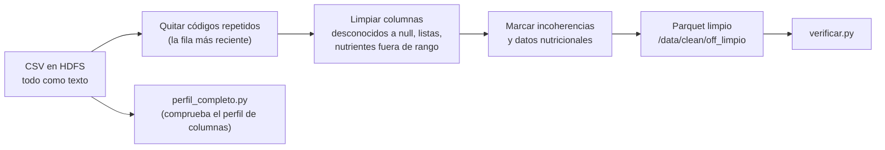

# Limpieza de datos

Cómo se limpia el CSV de Open Food Facts con Spark y cómo comprobar que quedó bien.
Las reglas salen de la [exploración](EDA.md); el resultado alimenta las [preguntas](PREGUNTAS.md).

- **Entrada:** `/data/raw/openfoodfacts.csv` (HDFS, 4.879.512 filas, 211 columnas, texto separado por tabulador).
- **Salida:** `/data/clean/off_limpio` (HDFS, Parquet, 34 columnas).
- **Scripts:** [`src/client_ingesta/perfil_completo.py`](../src/client_ingesta/perfil_completo.py), [`src/client_ingesta/limpieza.py`](../src/client_ingesta/limpieza.py) y [`src/client_ingesta/verificar.py`](../src/client_ingesta/verificar.py).
- **Dónde se ejecutan:** en el cliente de ingesta (`hadoop-client-ingesta`), que es quien escribe en `/data`. El master no ejecuta trabajos.
- **Responsables:** Alberto (reglas base, perfil y verificación) y Mauro (columnas ampliadas y ejecución).

## Índice

- [Flujo](#flujo)
- [Columnas del Parquet](#columnas-del-parquet)
- [Ampliación de Mauro](#ampliación-de-mauro)
- [Ejecutar](#ejecutar)
- [Comprobar que salió bien](#comprobar-que-salió-bien)
- [Decisiones provisionales](#decisiones-provisionales)
- [Estado](#estado)

## Flujo



| Script | Qué hace |
|---|---|
| `perfil_completo.py` | Cuenta las filas con valor de cada columna en el CSV completo y confirma el perfil de la exploración (211 columnas, 49 vacías). Guarda la tabla en `/data/clean/perfil_columnas`. |
| `limpieza.py` | Lee el CSV como texto, aplica las 13 reglas de [EDA.md](EDA.md#reglas-de-limpieza) y las columnas ampliadas, y escribe el Parquet. |
| `verificar.py` | Comprueba cada regla sobre el Parquet y repite los conteos de las preguntas de referencia sobre el archivo completo. |

Sin argumentos usan las rutas de HDFS de arriba; con dos argumentos (entrada y salida) se pueden probar con otro fichero.

## Columnas del Parquet

| Columna | Tipo | Origen y regla |
|---|---|---|
| `code` | texto | `code` leído como texto, sin repetidos (regla 1 y 2) |
| `code_raro` | booleano | longitud distinta de 8 y 13 dígitos; se marca, no se borra |
| `product_name` | texto | tal cual |
| `anio_alta` | entero | año de `created_t` (regla 13); 2026 es un año incompleto |
| `created_t`, `last_modified_t` | entero largo | marcas de tiempo originales |
| `grupo_pnns` | texto | `pnns_groups_1`, con `unknown` a `null` (reglas 3 y 4) |
| `categoria_pnns` | texto | `pnns_groups_2`, con `unknown` a `null` |
| `categories_tags` | texto | lista separada por comas; hay que hacer `split` antes de usarla |
| `nutriscore_grade` | texto | solo `a` a `e`, el resto `null` |
| `nova_group` | entero | solo 1 a 4 |
| `environmental_score_grade` | texto | `unknown` y similares a `null` |
| `additives_n` | entero | vacío = no se sabe, 0 = cero aditivos reales (regla 7) |
| `additives_tags` | lista de texto | aditivos del producto (E-números) |
| `es_vegano`, `es_vegetariano` | booleano | `true` o `false` solo con etiqueta clara, si no `null` (regla 5) |
| `paises` | lista de texto | `countries_tags` sin `en:world` (regla 6) |
| `marcas`, `marca_principal` | lista y texto | `brands_tags` en minúsculas y sin prefijo `xx:` (regla 11) |
| `packaging_tags` | lista de texto | materiales de envase |
| `serving_quantity` | decimal | ración numérica, mayor que 0 (regla 12) |
| `energy_kcal_100g` | decimal | entre 0 y 900, fuera de rango a `null` (regla 8) |
| `fat_100g`, `saturated_fat_100g`, `carbohydrates_100g`, `sugars_100g`, `fiber_100g`, `proteins_100g`, `salt_100g` | decimal | entre 0 y 100, fuera de rango a `null` (regla 8); `sodium_100g` se descarta (regla 10) |
| `iron_100g`, `calcium_100g`, `vitamin_c_100g` | decimal | entre 0 y 100 |
| `tiene_datos_nutricionales` | booleano | al menos uno de energía, grasa, carbohidratos, azúcares, proteínas o sal con valor |
| `nutrientes_incoherentes` | booleano | saturada > grasa, azúcar > carbohidratos, suma de macros > 105 g o error marcado por Open Food Facts (regla 9) |

> [!NOTE]
> Una fila con `nutrientes_incoherentes = true` **no se borra**: cada análisis de nutrientes la excluye con un filtro.

## Ampliación de Mauro

Sobre las reglas base, Mauro añadió columnas para cubrir las preguntas de aditivos, envases, categorías y micronutrientes:

| Se añadió | Para qué |
|---|---|
| `categories_tags` | categorías detalladas por producto (variabilidad y agrupaciones por categoría) |
| `additives_tags` como lista | qué aditivos concretos aparecen y en qué países |
| `packaging_tags` y `environmental_score_grade` | materiales de envase frente al impacto ambiental |
| `iron_100g`, `calcium_100g`, `vitamin_c_100g` | micronutrientes, acotados a 0 a 100 g |
| `created_t` y `last_modified_t` como enteros | días entre creación y modificación |
| `undefined` y texto vacío como desconocidos | además de `unknown` y `not-applicable` |

## Ejecutar

Todo desde el README: `./scripts/sync.sh ingesta` copia `src/client_ingesta/` al cliente de ingesta, y los scripts se lanzan desde ese **cliente**.

```bash
# En tu ordenador: copiar src/client_ingesta/ al cliente de ingesta
./scripts/sync.sh ingesta

# Entrar al cliente de ingesta saltando por el master (IP privada en la consola de EC2)
ssh -J ec2-user@<DNS-DEL-MASTER> -i ~/.ssh/vockey.pem ec2-user@<IP-PRIVADA-DEL-CLIENTE-INGESTA>

# En el cliente de ingesta
source ~/.bashrc
cd ~/BigData-OpenFoodFacts
```

Los clientes ya llevan `--master yarn --deploy-mode client` y los recursos base (3 executors de 2 GB) en `spark-defaults.conf`, así que basta con `spark-submit`.

**1. Prueba rápida con la muestra** (≈ 1 minuto). Si algo falla, se ve aquí y no tras esperar el archivo grande.

```bash
# Subir la muestra de la exploración a HDFS
hdfs dfs -put -f ~/muestra.csv /data/raw/muestra_aleatoria.csv

spark-submit src/client_ingesta/limpieza.py hdfs://hadoop-master:9000/data/raw/muestra_aleatoria.csv hdfs://hadoop-master:9000/data/clean/off_limpio_muestra
spark-submit src/client_ingesta/verificar.py hdfs://hadoop-master:9000/data/raw/muestra_aleatoria.csv hdfs://hadoop-master:9000/data/clean/off_limpio_muestra
```

Con la muestra, los conteos de las preguntas se parecerán a los de la muestra y no a la estimación del archivo completo, así que las líneas `AVISO` son normales.

**2. Archivo completo**, los tres scripts **uno detrás de otro** y en segundo plano (`nohup`) para que no se pare si se corta la conexión SSH:

```bash
nohup bash -c 'set -e
spark-submit src/client_ingesta/perfil_completo.py
spark-submit src/client_ingesta/limpieza.py
spark-submit src/client_ingesta/verificar.py' > ejecucion.log 2>&1 &

# Seguimiento: líneas clave del resultado
grep -E "FILAS_TOTALES|COLUMNAS|ESCRITO|^OK|^FALLO|^AVISO|RESUMEN" ejecucion.log
```

> [!WARNING]
> **No lanzar dos trabajos pesados a la vez.** Los dos clientes comparten los 18 GB de YARN (6 GB por worker). Con los recursos base caben dos aplicaciones pequeñas a la vez, pero no dos con executors grandes: la segunda se queda esperando o falla. Antes de lanzar la limpieza, comprobar con `yarn application -list` que el cliente de consulta no tiene nada en marcha. Mauro tuvo que ejecutar la limpieza definitiva con `--master "local[*]"` por lanzar varias aplicaciones en paralelo.

Si un executor muere por falta de memoria (`Container killed by YARN for exceeding memory limits`), subir `--executor-memory 3g` (con 3 g más el overhead de 512 m sigue cabiendo en los 6144 MB de cada worker) o bajar a un solo executor por worker.

## Comprobar que salió bien

| Qué se ejecutó | Qué debe salir |
|---|---|
| `perfil_completo.py` | `FILAS_TOTALES 4879512` y `COLUMNAS 211`. Los tramos deberían parecerse a los de la exploración (21 / 18 / 42 / 81 / 49). `COLUMNAS_VACIAS` debería rondar las 49; si alguna tiene unas pocas filas en el archivo completo, es normal |
| `limpieza.py` | La última línea es `ESCRITO hdfs://hadoop-master:9000/data/clean/off_limpio`. `hdfs dfs -ls /data/clean/off_limpio` muestra `_SUCCESS` y 12 ficheros `part-…parquet` |
| `verificar.py` | Termina con `RESUMEN: TODO OK` y `OK` en: filas = bruto − copias sobrantes (≈ 4.879.456, es decir 4.879.512 − 56 si cada código se repite una sola vez), `code` único, sin `unknown`, nutriscore solo a-e, nova solo 1-4, nutrientes en [0, 100], kcal en [0, 900], marcas en minúsculas y países sin `en:world` |
| Conteos de las preguntas | Líneas `OK` o `AVISO` con su estimación: ≈ 574.000 (vegano por categoría), 390.000 (vegetariano), 1,28 M (azúcar), 1,42 M (Nutri-Score por país), 1,13 M (aditivos y NOVA), 0,93 M (marcas por grupo). Un `AVISO` no es un error: la cifra real se aleja más del 15 % de la estimación de la muestra y conviene mirar por qué |

Comprobación a mano de que los códigos repetidos conocidos se trataron bien:

```bash
pyspark --master 'local[2]' --conf spark.ui.showConsoleProgress=false
```

```python
d = spark.read.parquet("hdfs://hadoop-master:9000/data/clean/off_limpio")

# Debe salir 1 fila por código (la modificada más recientemente)
d.filter("code in ('3033610080541', '0059527070430', '2000000151609')") \
 .select("code", "product_name", "marcas").show(truncate=False)
#   3033610080541 -> "Saumon fumé sauvage du pacifique", marcas [labeyrie]
#   0059527070430 -> "Goji"
#   2000000151609 -> "Mayonnaise REAL 72%" (la otra fila era un producto distinto)

d.filter("code like '0%'").count()       # los ceros de la izquierda se conservan: debe ser mayor que 0
len(d.columns)                            # 34
```

## Decisiones provisionales

- **Marcas blancas** (`hacendado`, `marque-repere`, `u`): cuentan como marca.
- **Año 2026:** se conserva en `anio_alta`, pero es un año incompleto y cualquier análisis por año debe indicarlo.
- **Códigos repetidos con productos distintos** (los `200…`): se queda uno solo; afecta a ≈ 0,001 % de las filas.

Cualquiera de las tres se cambia tocando solo `limpieza.py`.

## Permisos en HDFS

`/data` pertenece al usuario `ingesta`: el cliente de ingesta escribe el Parquet en `/data/clean`, y el de consulta solo lo lee.
Si `limpieza.py` falla con `Permission denied` en `/data/clean`, comprobar `echo $HADOOP_USER_NAME` (debe ser `ingesta`)
y `hdfs dfs -ls -d /data/clean` (propietario `ingesta`). Los comandos de permisos están en [DEPLOYMENT.md](DEPLOYMENT.md#arquitectura-dos-clientes).

## Estado

Mauro generó el Parquet en `/data/clean/off_limpio` y la verificación terminó en `TODO OK`, según su ejecución antes de separar los clientes. Falta repetirla desde el cliente de ingesta por YARN, con los comandos de arriba.
