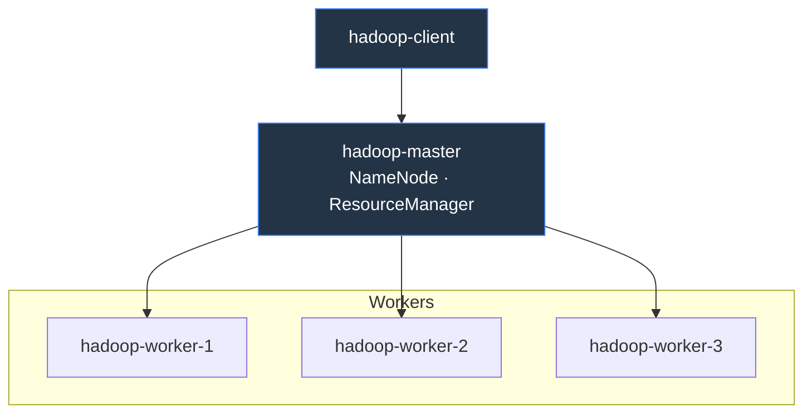
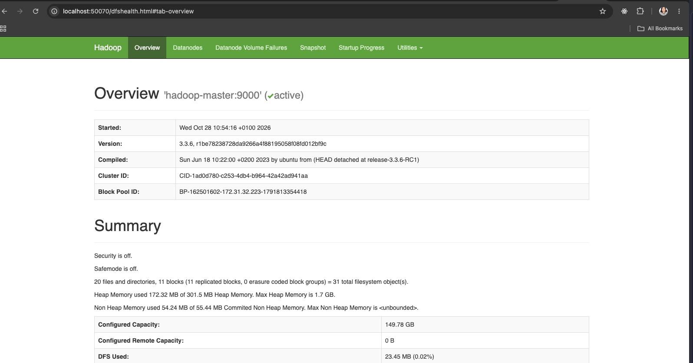
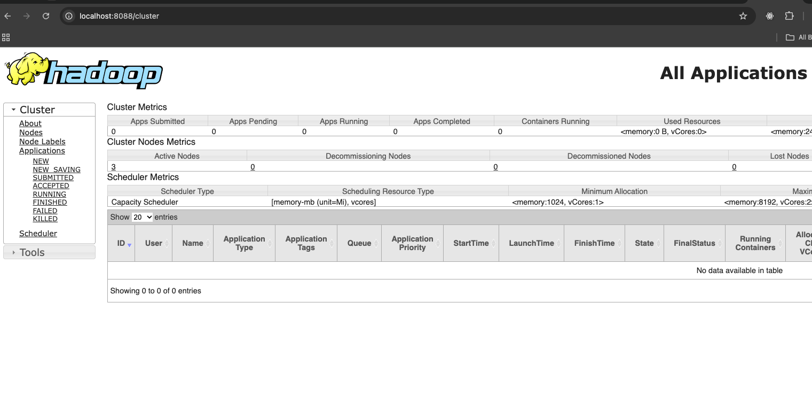
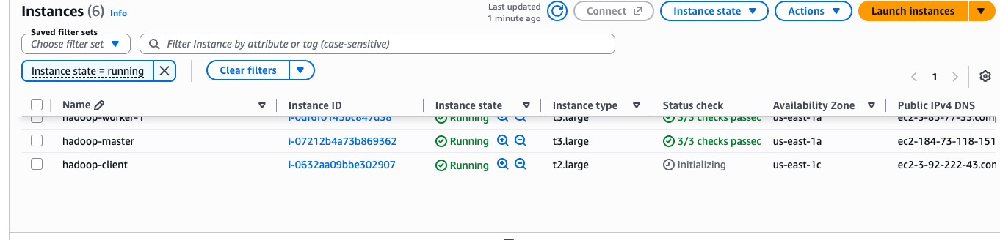
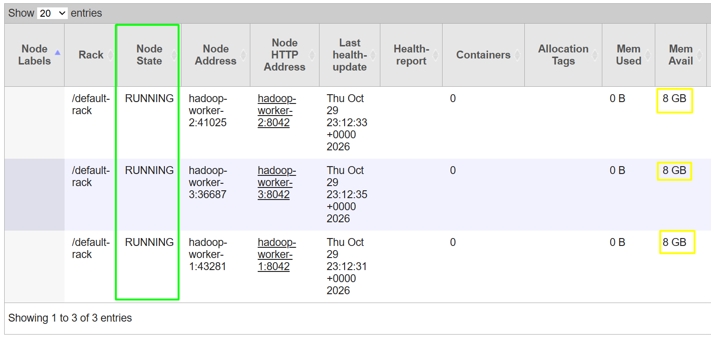
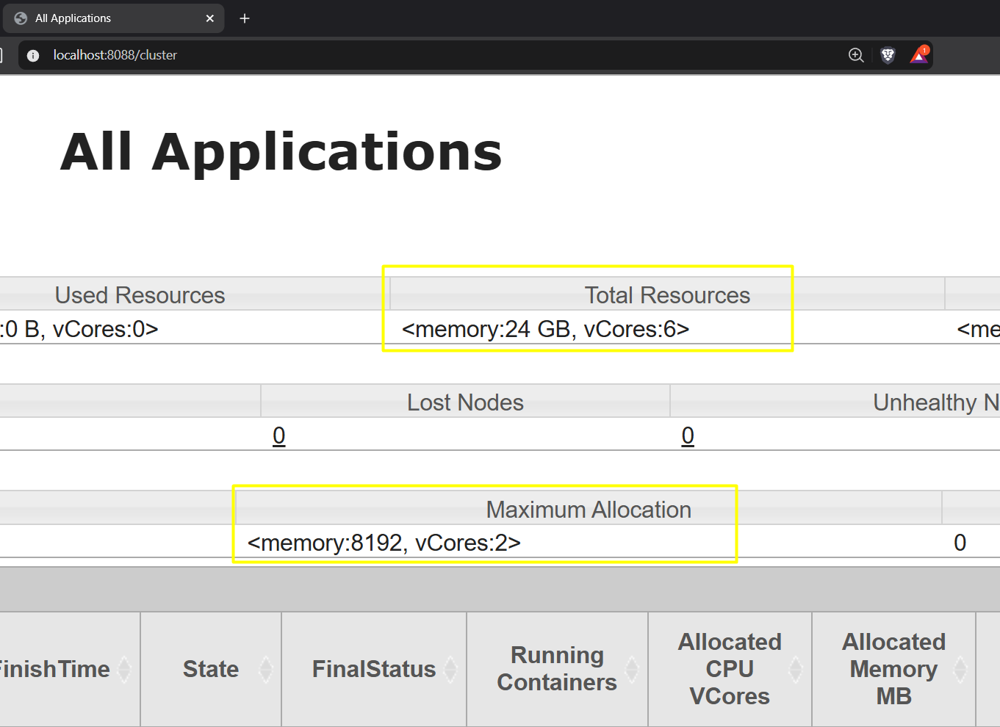
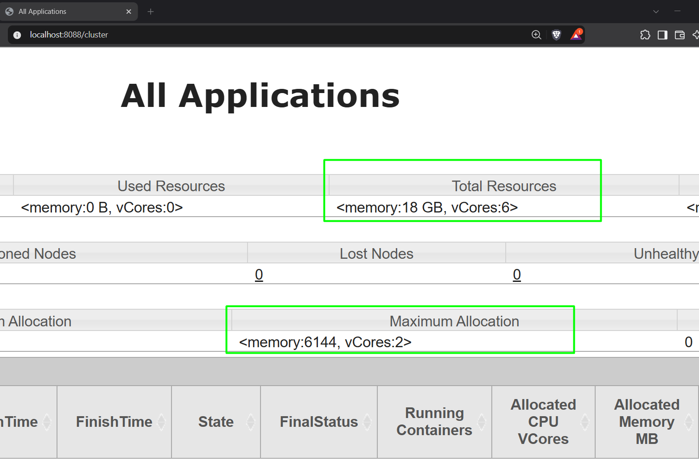

# Semana 0 · 27 oct – 2 nov · arrancar en paralelo

> Registro histórico de la Semana 0. Las instrucciones actuales están en el
> [README](../README.md) y la [guía de despliegue](../DEPLOYMENT.md).

- **Katherine:** instancias, red y SSH ([#16](https://github.com/albertxestrada/BigData-OpenFoodFacts/issues/16), 30 oct) · manual de red (2 nov) · también instala Hadoop en los nodos, porque el playbook de Ansible ya lo hace al crear las instancias
- **Alberto:** muestra y columnas ([#17](https://github.com/albertxestrada/BigData-OpenFoodFacts/issues/17), 30 oct)
- **Jorge:** candidatas de herramienta extra ([#15](https://github.com/albertxestrada/BigData-OpenFoodFacts/issues/15), 1 nov)
- **Mauro:** plantillas ([#14](https://github.com/albertxestrada/BigData-OpenFoodFacts/issues/14), 30 oct) · borrador del dataset ([#24](https://github.com/albertxestrada/BigData-OpenFoodFacts/issues/24), 2 nov)
- **Todos:** 4 preguntas candidatas ([#61](https://github.com/albertxestrada/BigData-OpenFoodFacts/issues/61), domingo 1 nov, 20:00) · explorar la muestra y empezar la parte genérica de la limpieza (tipos, duplicados, valores imposibles)

## Índice

- [Katherine (persona A) — instancias EC2, red y SSH](#katherine-persona-a--instancias-ec2-red-y-ssh)
  - [Checklist](#checklist)
  - [Diagrama de Client, Master, Workes creados en esta sección](#diagrama-de-client-master-workes-creados-en-esta-sección)
  - [Comandos](#comandos)
- [Alberto (persona B) — muestra del CSV y columnas](#alberto-persona-b--muestra-del-csv-y-columnas)
  - [Checklist](#checklist-1)
  - [Comandos](#comandos-1)
  - [Resultado: columnas (% de vacíos en la muestra de 100.000 filas)](#resultado-columnas--de-vacíos-en-la-muestra-de-100000-filas)
- [Jorge (persona C) — YARN y herramienta extra](#jorge-persona-c--yarn-y-herramienta-extra)
  - [Checklist](#checklist-2)
  - [1. Comprobar lo que ya tenemos de YARN](#1-comprobar-lo-que-ya-tenemos-de-yarn)
  - [2. Ajustar la memoria](#2-ajustar-la-memoria)
  - [Cheatsheet](#cheatsheet)
  - [Recursos para Spark (Mauro)](#recursos-para-spark-mauro)
  - [Defensa](#defensa)
- [Mauro (persona D) — plantillas y borrador del dataset](#mauro-persona-d--plantillas-y-borrador-del-dataset)
  - [Checklist](#checklist-3)
  - [Comandos](#comandos-2)
- [Todos — preguntas candidatas y exploración de la muestra](#todos--preguntas-candidatas-y-exploración-de-la-muestra)
  - [Checklist](#checklist-4)
  - [Comandos](#comandos-3)

## Katherine (persona A) — instancias EC2, red y SSH

### Checklist

- [x] [#16](https://github.com/albertxestrada/BigData-OpenFoodFacts/issues/16) Instancias EC2, red, SSH y `/etc/hosts` · 30 oct · cierra M2
- [x] Manual de red · 2 nov (documento a escribir una vez el clúster esté arriba, con topología e IPs)

### Diagrama de Client, Master, Workes creados en esta sección



### Comandos

Despliegue con el script de Ansible de clase (`hadoop-ansible-ec2`): crea 1 master + N workers en
EC2 y deja red, SSH y `/etc/hosts` configurados entre todos los nodos. El mismo playbook instala
Hadoop y Spark en todos los nodos; esa instalación la asumo yo porque el comando ya la incluye al
crear las instancias, aunque en el reparto original fuera tarea de Alberto/Jorge/Mauro.

#### 1. Credenciales de AWS Academy

Learner Lab → **AWS Details → AWS CLI → Show** → copiar el contenido en `~/.aws/credentials`
(`nano ~/.aws/credentials`)

#### 2. Dependencias y clave SSH (Linux/WSL)

```bash
sudo apt update
sudo apt install git python3-venv libffi-dev
# Learner Lab entrega la clave como labsuser.pem; el playbook espera vockey.pem
cp labsuser.pem ~/.ssh/vockey.pem
chmod og-rwx ~/.ssh/vockey.pem
```

#### 3. Entorno de Ansible

```bash
python3 -m venv ~/ansible
source ~/ansible/bin/activate
git clone https://github.com/memaldi/hadoop-ansible-ec2 && cd hadoop-ansible-ec2
pip install -r requirements.txt
```

#### 4. Crear las instancias EC2 (red, SSH y `/etc/hosts`)

Ejecutar el playbook original, conservando las reglas SSH con **My IP**.
Si se aplicó antes la sustitución con `sed`, restaurar
`cidr_ip: "{{ ipify_public_ip }}/32"` en ambos security groups antes de continuar.

```bash
ansible-playbook -i inventory.aws_ec2.yml --key-file=~/.ssh/vockey.pem --user ec2-user create-instances.yml
```

#### 4.1. Añadir SSH desde Anywhere al grupo del master

Después de que termine Ansible, ejecutar desde el equipo local:

```bash
aws ec2 authorize-security-group-ingress \
  --group-name hadoop-master-sg \
  --protocol tcp \
  --port 22 \
  --cidr 0.0.0.0/0 \
  --region us-east-1
```

#### 5. Verificar red y SSH entre nodos

```bash
# desde el equipo local al master
ssh -i ~/.ssh/vockey.pem ec2-user@<master-public-dns>

# dentro del master: solo confirma que /etc/hosts tiene las entradas correctas
cat /etc/hosts
```

#### 6. Acceso a las UIs (opcional, solo para comprobar que el clúster responde)

```bash
# correr en tu local: para ver los namenodes (HDFS)
ssh -i ~/.ssh/vockey.pem -N -L 50070:<master-public-dns>:50070 ec2-user@<master-public-dns>  
```


```bash
# correr en tu local: Resource Manager (YARN)
ssh -i ~/.ssh/vockey.pem -N -L 8088:<master-public-dns>:8088 ec2-user@<master-public-dns> 
```


#### 7. Creación de una nueva EC2 -> Nodo client

Misma AMI, clave y red que el resto; sin nada adicional, solo para lanzar `spark-submit`.

```bash
# Lanzar la instancia client
aws ec2 run-instances \
  --image-id ami-066784287e358dad1 \
  --instance-type t2.large \
  --key-name vockey \
  --security-groups hadoop-sg hadoop-master-sg \
  --count 1 \
  --region us-east-1 \
  --tag-specifications 'ResourceType=instance,Tags=[{Key=Name,Value=hadoop-client},{Key=Group,Value=hadoop-client}]' \
  --block-device-mappings '[{"DeviceName":"/dev/xvda","Ebs":{"VolumeSize":50,"DeleteOnTermination":true}}]'

# Obtener su IP privada/pública para corroborar su creación y detalles
aws ec2 describe-instances --filters "Name=tag:Group,Values=hadoop-client" \
  --query "Reservations[].Instances[].[InstanceId,PrivateIpAddress,PublicDnsName]" --output table
```

IMPORTANT: Wait for initialization to finish before continuing.


```bash
# Desde tu equipo local (usa /tmp/hosts como archivo intermedio entre master y client)
# Copiar el /etc/hosts completo del master al client: es para que las herramientas de Hadoop/Spark que corran en el client puedan resolver "hadoop-master" y los workers por nombre.
scp -i ~/.ssh/vockey.pem ec2-user@<master-public-dns>:/etc/hosts /tmp/hosts
scp -i ~/.ssh/vockey.pem /tmp/hosts ec2-user@<client-public-dns>:/tmp/hosts
ssh -i ~/.ssh/vockey.pem ec2-user@<client-public-dns> "sudo mv /tmp/hosts /etc/hosts"
```

#### 8. Apagar al terminar la sesión

En la UI de EC2 en AWS Console, podemos darle **stop** a todas las instances.

## Alberto (persona B) — muestra del CSV y columnas

### Checklist

- [x] [#17](https://github.com/albertxestrada/BigData-OpenFoodFacts/issues/17) Muestra del CSV y columnas que se usarán · 30 oct · cierra M2 
- [x] CSV completo en HDFS (`/data/raw`) · parte de [#22](https://github.com/albertxestrada/BigData-OpenFoodFacts/issues/22)
- [x] HDFS verificado (3 DataNodes) y carpetas creadas · parte de [#18](https://github.com/albertxestrada/BigData-OpenFoodFacts/issues/18), porque el playbook de Ansible ya instala Hadoop

### Comandos

Cada integrante tiene su propio clúster, así que estos pasos se repiten en cada uno. Todo se
ejecuta **en el master**, salvo el paso 1. Los DNS públicos cambian al parar y arrancar las instancias.

#### 1. Entrar al master (desde el equipo local)

```bash
ssh-add ~/.ssh/vockey.pem
ssh -A -i ~/.ssh/vockey.pem ec2-user@<DNS-DEL-MASTER>
```

El DNS está en la consola de EC2 (instancia `hadoop-master`, "DNS IPv4 público"). En Windows, usar WSL
con la clave en `~/.ssh` (no en `/mnt/c`) y `chmod 600`. Errores: `Permission denied (publickey)` →
clave equivocada o comando lanzado dentro del master; `UNPROTECTED PRIVATE KEY FILE` → falta el `chmod 600`.

#### 2. Verificar HDFS y crear carpetas

```bash
source ~/.bashrc
hdfs dfsadmin -report | grep -E "Live datanodes|Configured Capacity"   # Live datanodes (3)
hdfs dfs -mkdir -p /data/raw /data/clean /results
```

`hdfs: command not found` → falta el `source ~/.bashrc` (hace falta en cada sesión nueva).

#### 3. Subir el CSV completo a HDFS

Unos 1,4 GB comprimido y 13 GB descomprimido; se baja, descomprime y sube en una tubería, sin pasar
por el disco del master.

```bash
nohup bash -c 'curl -L https://static.openfoodfacts.org/data/en.openfoodfacts.org.products.csv.gz | gunzip | hdfs dfs -put - /data/raw/openfoodfacts.csv' > put.log 2>&1 &
hdfs dfs -ls -h /data/raw      # durante la subida: openfoodfacts.csv._COPYING_ creciendo
hdfs dfs -du -h /data/raw      # al terminar: 13.0 G  38.9 G (tamaño y réplicas)
```

Tarda unos 10 minutos. Si `put.log` muestra `unexpected end of file` o `curl: (18)`, se cortó:
`hdfs dfs -rm -f /data/raw/openfoodfacts.csv*` y relanzar.

#### 4. Muestra aleatoria de 100.000 filas

El CSV está **ordenado por código de barras**: las primeras 100.000 filas (`head`) eran un 89 % de
EE. UU. y sesgaban todos los porcentajes. Se usa una muestra aleatoria (reservorio) de todo el archivo:

```bash
hdfs dfs -cat /data/raw/openfoodfacts.csv | awk -v K=100000 'NR==1{h=$0;next} NR-1<=K{a[NR-1]=$0;next} {j=int(rand()*(NR-1))+1; if(j<=K)a[j]=$0} END{print h; for(i=1;i<=K;i++)print a[i]; print "TOTAL_FILAS=" NR-1 > "/dev/stderr"}' > muestra.csv
wc -l muestra.csv                                       # 100001
awk -F'\t' '{print NF}' muestra.csv | sort | uniq -c    # 100001 211 (sin filas partidas)
```

Salida de `TOTAL_FILAS`: 4.879.512 productos. Para compartirla: `gzip -k muestra.csv` y `scp` al equipo local.

#### 5. Porcentaje de datos por columna

```bash
awk -F'\t' 'NR==1{h=NF; for(i=1;i<=NF;i++) n[i]=$i; next} {for(i=1;i<=NF;i++) if($i!="") c[i]++} END{for(i=1;i<=h;i++) printf "%d\t%s\t%.1f\n", i, n[i], 100*c[i]/(NR-1)}' muestra.csv > columnas_relleno.tsv
grep -w "iron_100g" columnas_relleno.tsv     # comprobar el nombre real de cada columna
```

El % de vacíos es 100 menos el último campo. Los nombres se copian de la cabecera real, no de la documentación.

#### 6. Leer la muestra con Spark (separador, cabecera, tipos)

```bash
cat > leer_muestra.py <<'EOF'
from pyspark.sql import SparkSession
spark = SparkSession.builder.getOrCreate()
df = spark.read.csv("file:///home/ec2-user/muestra.csv", sep="\t", header=True, inferSchema=True)
print("FILAS:", df.count(), "COLUMNAS:", len(df.columns))
print(df.select("code", "created_t", "nova_group", "energy-kcal_100g", "nutriscore_grade").dtypes)
EOF
spark-submit --master local[2] --driver-memory 3g leer_muestra.py 2>/dev/null   # FILAS: 100000 COLUMNAS: 211
```

Con tabulador y cabecera basta: las comillas no rompen filas. Si no sale nada, repetir sin `2>/dev/null` para ver el error.

### Resultado: columnas (% de vacíos en la muestra de 100.000 filas)

La tabla completa está en el comentario de [#17](https://github.com/albertxestrada/BigData-OpenFoodFacts/issues/17).

| Columna | Tipo | % vacíos |
|---|---|---|
| `code` | string (forzar) | 0 |
| `created_t`, `last_modified_t` | long | 0 |
| `product_name`, `countries_tags` | string | 7 · 0,4 |
| `brands`, `categories_tags`, `labels_tags` | string | 36 · 60 · 74 |
| `nova_group`, `additives_n` | int | 76 · 72 |
| `energy-kcal`, `fat`, `carbohydrates`, `proteins` (`_100g`) | double | 28-29 |
| `sugars`, `saturated-fat`, `salt`/`sodium` (`_100g`) | double | 33 · 35 · 37,5 |
| `energy-kj_100g`, `fiber_100g` | double | 47 · 61 |
| `iron`, `calcium`, `vitamin-c`, `vitamin-a` (`_100g`) | double | 84-89 |
| `nutriscore_grade` | string | 71 (`unknown` 67 %, `not-applicable` 2,4 %) |
| `ingredients_from_palm_oil_n` | — | no existe en este CSV |

- `code` hay que leerlo como texto: Spark lo infiere como número y pierde ceros y dígitos.
- Una columna rellena no implica dato real: `unknown` y `not-applicable` son nulos para la limpieza.
- Sodio y sal aportan casi lo mismo; el resto de vitaminas y minerales está casi vacío.

_ La muestra (`muestra.csv.gz`) en drive compartido del grupo._

## Jorge (persona C) — YARN y herramienta extra

### Checklist

- [x] [#19](https://github.com/albertxestrada/BigData-OpenFoodFacts/issues/19) Configurar YARN · 5 nov

### 1. Comprobar lo que ya tenemos de YARN

- Ansible ya instala Hadoop con YARN configurado y arrancado: ResourceManager en el master, NodeManager en cada worker.
- Son servicios que arrancan solos con la instancia; no hay que instalar nada.
- Antes de tocar nada, comprobamos qué hay. Todo desde el master, entrando con `ssh -A` para poder saltar a los workers:

**a) En WSL: cargar la clave en el agente SSH**

```bash
# Arranca el agente SSH en esta terminal
eval $(ssh-agent)
# Carga la clave para poder reenviarla al master con -A
ssh-add ~/.ssh/vockey.pem
```

**b) Entrar al master**

```bash
# -A permite saltar desde el master a los workers con tu clave
ssh -A -i ~/.ssh/vockey.pem ec2-user@<DNS-DEL-MASTER>
```

**c) Ya en el master: preparar la sesión**

```bash
# Carga las variables que dejó Ansible (HADOOP_HOME, JAVA_HOME y el PATH con yarn y hdfs)
source ~/.bashrc
# Comprueba que la clave llegó al master: si sale "Could not open a connection", salir y repetir desde a)
ssh-add -l
```

**d) Ver los nodos de YARN**

```bash
# Nodos que ve YARN y cuántos recursos ofrece cada uno (si responde, el ResourceManager y los NodeManagers funcionan)
yarn node -list -showDetails | grep -E "Total Nodes|RUNNING|Configured Resources"
```

**e) Ver la configuración que dejó Ansible**

```bash
# Configuración del master
cat $HADOOP_HOME/etc/hadoop/yarn-site.xml
# Configuración de un worker (los tres son iguales)
ssh hadoop-worker-1 "cat ~/hadoop-3.3.6/etc/hadoop/yarn-site.xml"
```

**f) Abrir la web de YARN (opcional)**

```bash
# En otra terminal de WSL (se queda abierta mientras uses la web): reenvía el puerto 8088 del master a tu localhost
ssh -i ~/.ssh/vockey.pem -N -L 8088:<DNS-DEL-MASTER>:8088 ec2-user@<DNS-DEL-MASTER>
```

Lo que se ve:

- 3 nodos RUNNING con `<memory:8192, vCores:2>`: **24 GB y 6 vcores** en total ([web](http://localhost:8088/cluster/nodes)).
- El `yarn-site.xml` no fija la memoria, así que YARN usa los 8 GB enteros de cada worker.



### 2. Ajustar la memoria

Las 4 máquinas que crea Ansible son iguales:

| Nodo | Instancia | vCPU | RAM | Disco | Qué corre |
|---|---|---|---|---|---|
| `hadoop-master` | t3.large | 2 | 8 GiB | 50 GB | NameNode, ResourceManager, Spark (lanza los trabajos) |
| `hadoop-worker-1/2/3` | t3.large | 2 | 8 GiB | 50 GB | DataNode, NodeManager y los contenedores de los trabajos |

Por qué ajustar:

- **RAM por worker**: YARN usaría los 8 GB, pero el sistema y el DataNode también necesitan RAM. Le dejamos 6 GB
  (3 × 6 = **18 GB** en total) y quedan 2 GB libres para que el worker no se quede sin memoria.
- **Máx. por contenedor**: también 6 GB. Con 8 GB, un contenedor podría pedir más de lo que cabe en un worker.

| Qué | Propiedad (`yarn-site.xml`) | Dónde | Antes | Ahora |
|---|---|---|---|---|
| RAM por worker | `yarn.nodemanager.resource.memory-mb` | workers | 8192 | **6144** |
| Máx. por contenedor | `yarn.scheduler.maximum-allocation-mb` | master | 8192 | **6144** |

> [!WARNING]
> - Ejecutar **una sola vez por clúster**: si se repite, la propiedad queda duplicada en el `yarn-site.xml`.
> - Todo en la misma sesión del master.

```bash
# Master: máximo por contenedor y reiniciar el ResourceManager
sed -i 's#</configuration>#  <property><name>yarn.scheduler.maximum-allocation-mb</name><value>6144</value></property>\n</configuration>#' $HADOOP_HOME/etc/hadoop/yarn-site.xml
sudo systemctl restart resourcemanager

# Workers: memoria de cada uno y reiniciar su NodeManager
for w in hadoop-worker-1 hadoop-worker-2 hadoop-worker-3; do
  ssh $w "sed -i 's#</configuration>#  <property><name>yarn.nodemanager.resource.memory-mb</name><value>6144</value></property>\n</configuration>#' ~/hadoop-3.3.6/etc/hadoop/yarn-site.xml && sudo systemctl restart nodemanager"
done

# Comprobar: 3 nodos con <memory:6144, vCores:2>
sleep 30
yarn node -list -showDetails | grep "Configured Resources"

# Probar con un trabajo de ejemplo: debe terminar en SUCCEEDED
yarn jar $HADOOP_HOME/share/hadoop/mapreduce/hadoop-mapreduce-examples-3.3.6.jar pi 3 1000
```

> [!NOTE]
> **Qué es el `pi`**
> - Ejemplo de Hadoop que estima π con 3 tareas *map* de 1000 puntos cada una.
> - Solo sirve de prueba: si termina en `Job Finished` (≈ 3,14), YARN sigue ejecutando trabajos con la memoria nueva.

Comprobación en la web de YARN ([http://localhost:8088/cluster](http://localhost:8088/cluster)):

| Dato en la web | Antes | Después |
|---|---|---|
| **Total Resources** | `<memory:24 GB, vCores:6>` | `<memory:18 GB, vCores:6>` |
| **Maximum Allocation** | `<memory:8192, vCores:2>` | `<memory:6144, vCores:2>` |

| Antes | Después |
|---|---|
|  |  |

### Cheatsheet

| Para… | Comando |
|---|---|
| Ver nodos y su memoria | `yarn node -list -showDetails` |
| Ver aplicaciones | `yarn application -list -appStates ALL` |
| Matar una aplicación | `yarn application -kill <id>` |
| Reiniciar | master: `sudo systemctl restart resourcemanager` · worker: `sudo systemctl restart nodemanager` |

### Recursos para Spark (Mauro)

Para [#20](https://github.com/albertxestrada/BigData-OpenFoodFacts/issues/20):

- `--num-executors 3 --executor-memory 4g --executor-cores 2`: 1 executor por worker.
- Más de 6 GB por executor: YARN lo rechaza.

### Defensa

- **RM / NM / contenedor:** el ResourceManager (master) reparte; el NodeManager (cada worker) ejecuta; un contenedor es
  un trozo de memoria y núcleos donde corre una tarea.
- **Memoria:** 8 GB − 2 GB = 6 GB por nodo. Pedir más de 6 GB: rechazado; si no hay hueco, espera en ACCEPTED.
- **Si cae un worker:** queda LOST y YARN relanza sus tareas en otro nodo; los datos siguen en HDFS (3 réplicas).

## Mauro (persona D) — plantillas y borrador del dataset

### Checklist

- [x] [#14](https://github.com/albertxestrada/BigData-OpenFoodFacts/issues/14) Plantillas .docx del profesor · 30 oct
- [x] [#24](https://github.com/albertxestrada/BigData-OpenFoodFacts/issues/24) Borrador del dataset · 2 nov

### Comandos

La descripción del dataset se ha elaborado utilizando el archivo completo de Open Food Facts y los resultados de exploración documentados en el issue [#17](https://github.com/albertxestrada/BigData-OpenFoodFacts/issues/17).

### Características verificadas

- Registros del dataset completo: 4.879.512 productos.
- Número de columnas: 211.
- Muestra aleatoria: 100.000 productos.
- Formato: CSV delimitado por tabuladores (TSV).
- Tamaño aproximado del archivo descomprimido: 13 GB.
- Ubicación en HDFS: /data/raw/openfoodfacts.csv.
- Muestra compartida: muestra.csv.gz.

## Manual de Despliegue, Configuración y Validación de Spark en el Nodo Cliente


### 1.Conexión SSH al Nodo Cliente:Ubicación: 
Tu ordenador local (WSL / Terminal).
Conéctate por SSH a la IPv4 DNS de la instancia EC2 destinada como nodo cliente:

```bash
ssh -i ~/.ssh/labsuser.pem ec2-user@{EC2}
```
### 2. Instalación de Java 8 y Apache Spark 3.5.3
Instala la versión de Java requerida por Hadoop/Spark y descarga el motor de Spark en /opt/spark:
```bash
# 1. Instalar dependencias del sistema
sudo dnf install -y java-1.8.0-amazon-corretto-devel python3 wget tar

# 2. Descargar y descomprimir Spark 3.5.3
cd /tmp
wget https://archive.apache.org/dist/spark/spark-3.5.3/spark-3.5.3-bin-hadoop3.tgz
tar -xzf spark-3.5.3-bin-hadoop3.tgz
sudo mv spark-3.5.3-bin-hadoop3 /opt/spark
sudo chown -R ec2-user:ec2-user /opt/spark
```
Verificación: Ejecuta /opt/spark/bin/spark-submit --version

Si aparece esto: version 3.5.3

👉 Pasa al Paso 3.


### 3. Configuración de Red y Variables de Entorno
Asocia el nombre del máster a su IP privada y añade las variables de entorno globales en el archivo .bashrc:

```bash
# 1. Asociar IP del Máster en /etc/hosts (Sustituye 172.31.35.171 si tu IP privada es diferente)
echo "172.31.35.171 hadoop-master" | sudo tee -a /etc/hosts

# 2. Agregar variables de entorno al perfil
cat >> ~/.bashrc << 'EOF'
export JAVA_HOME=/usr/lib/jvm/java-1.8.0-amazon-corretto
export SPARK_HOME=/opt/spark
export HADOOP_CONF_DIR=$HOME/hadoop_conf
export YARN_CONF_DIR=$HOME/hadoop_conf
export PATH=$PATH:$SPARK_HOME/bin:$SPARK_HOME/sbin
EOF

# 3. Cargar las variables en la sesión activa
source ~/.bashrc
```
Verificación: Ejecuta echo $JAVA_HOME

Si aparece esto: /usr/lib/jvm/java-1.8.0-amazon-corretto

👉 Pasa al Paso 4.

### 4. Creación del Directorio de Configuración Hadoop (hadoop_conf)
Crea la carpeta ~/hadoop_conf con los descriptores XML que redirigen las peticiones de HDFS y YARN hacia el máster:
```bash
mkdir -p ~/hadoop_conf

# 1. Configurar YARN (yarn-site.xml)
cat > ~/hadoop_conf/yarn-site.xml << 'EOF'
<?xml version="1.0"?>
<configuration>
<property>
    <name>yarn.resourcemanager.hostname</name>
    <value>hadoop-master</value>
</property>
<property>
    <name>yarn.resourcemanager.address</name>
    <value>hadoop-master:8032</value>
</property>
<property>
    <name>yarn.resourcemanager.scheduler.address</name>
    <value>hadoop-master:8030</value>
</property>
<property>
    <name>yarn.resourcemanager.resource-tracker.address</name>
    <value>hadoop-master:8031</value>
</property>
</configuration>
EOF

# 2. Configurar HDFS (core-site.xml)
cat > ~/hadoop_conf/core-site.xml << 'EOF'
<?xml version="1.0"?>
<configuration>
<property>
    <name>fs.defaultFS</name>
    <value>hdfs://hadoop-master:9000</value>
</property>
</configuration>
EOF
```
Verificación: Ejecuta grep -q "hadoop-master" ~/hadoop_conf/yarn-site.xml && echo "OK"

Si aparece esto: OK

👉 Pasa al Paso 5.


### 5. Asignación de Recursos Spark (spark-defaults.conf)
Configura los parámetros por defecto para repartir los recursos del clúster (3 ejecutores en los 3 workers):
```bash
cat > $SPARK_HOME/conf/spark-defaults.conf << 'EOF'
spark.master                     yarn
spark.submit.deployMode          client
spark.driver.memory              2g
spark.executor.instances         3
spark.executor.cores             2
spark.executor.memory            3g
spark.executor.memoryOverhead    512m
EOF
```
Verificación: Ejecuta cat $SPARK_HOME/conf/spark-defaults.conf

Si aparece esto: Las líneas recién agregadas.

👉 Pasa al Paso 6.
### 6. Prueba 1: Ejecución del Trabajo SparkPi en YARN

Lanza el trabajo de prueba para validar que YARN recibe y procesa la aplicación:
```bash
spark-submit --master yarn --deploy-mode cluster \
  --class org.apache.spark.examples.SparkPi \
  $SPARK_HOME/examples/jars/spark-examples_2.12-3.5.3.jar 100
```
Verificación en los Logs:
```bash
# 1. Obtener el ID del trabajo finalizado
yarn application -list -appStates FINISHED

# 2. Filtrar el valor de Pi en los logs usando el ID obtenido (ej: application_1730412345678_0001)
yarn logs -applicationId <APPLICATION_ID> | grep "Pi is roughly"
```

Si aparece esto: Pi is roughly 3.14159...

👉 Pasa al Paso 7.

❌ Si falla: Verifica que en el Paso 3 agregaste la IP correcta de hadoop-master.
### 7. Prueba 2: Lectura de HDFS desde PySpark
Valida la comunicación con las "estanterías" de HDFS desde el entorno interactivo:
```bash
pyspark
```
Dentro de la consola interactiva de Python (>>>), copia y pega:
```bash
df = spark.read.text("/data/raw/openfoodfacts.csv")
print("TOTAL LINEAS LEIDAS DE HDFS:", df.count())
exit()
```
Si aparece esto: TOTAL LINEAS LEIDAS DE HDFS: 4885837

👉 ¡INSTALACIÓN Y CONFIGURACIÓN COMPLETADAS CON ÉXITO! 🎉

## Todos — preguntas candidatas y exploración de la muestra

### Checklist

- [ ] [#61](https://github.com/albertxestrada/BigData-OpenFoodFacts/issues/61) Proponer 4 preguntas candidatas por persona · domingo 1 nov, 20:00
- [ ] Explorar la muestra y empezar la parte genérica de la limpieza (tipos, duplicados, valores imposibles)

### Comandos

_Pendiente de añadir entre todos._

#### Candidatas de Katherine (4 de 4)

1. **Vegano/vegetariano por categoría.**
   - Objetivo: qué porcentaje de productos son veganos, vegetarianos, no-veganos o de estado
     desconocido, y cómo varía según la categoría de alimento.
   - Utilidad: foto rápida de cuánta oferta "vegana" hay realmente en Open Food Facts y en qué
     categorías se concentra.
   - Columnas: `ingredients_analysis_tags` (`en:vegan-status-unknown`, `en:non-vegan`,
     `en:maybe-vegan`...), `food_groups_en`/`categories_en` para agrupar.

2. **Productos "altos en azúcar" según el semáforo nutricional.**
   - Objetivo: qué porcentaje de productos superan el umbral de "alto en azúcar" (>22.5 g/100g,
     o >27 g/100ml en líquidos, el mismo criterio del Reglamento UE 1169/2011 / semáforo
     nutricional), y qué categorías concentran más casos.
   - Utilidad: pregunta con respaldo regulatorio real, no un umbral inventado.
   - Columnas: `sugars_100g` o `nutrient_levels_tags` (ya trae `en:sugars-in-high-quantity`
     precalculado), más `categories_en`/`food_groups_en` para agrupar.

3. **Distribución del Nutri-Score por país.**
   - Objetivo: cómo se reparte la calificación Nutri-Score (A–E) entre los distintos países
     donde se vende el producto.
   - Utilidad: compara la "calidad nutricional" percibida del mercado de alimentos envasados
     entre países.
   - Columnas: `nutriscore_grade`, `countries_en`/`countries_tags` (hay que explotar la lista,
     un producto puede venderse en varios países).

4. **Aditivos vs. nivel de procesamiento (NOVA).**
   - Objetivo: a mayor número de aditivos (`additives_n`), ¿mayor es la probabilidad de que el
     producto esté en el grupo NOVA 4 (ultraprocesado)?
   - Utilidad: valida con datos una intuición común (más aditivos = más ultraprocesado).
   - Columnas: `additives_n`, `nova_group`.

### Candidatas de Alberto

**1. Marcas con mejor y peor perfil nutricional dentro de cada grupo de alimentos**
- **Enunciado:** dentro de cada grupo PNNS (`pnns_groups_1`), ¿qué 5 marcas con al menos N productos tienen la media más baja y la más alta de azúcar, grasa saturada y sal?
- **Objetivo:** clasificar las marcas por su perfil nutricional dentro de su propio grupo, para no comparar bebidas con aceites.
- **Utilidad:** ayuda a consumidores y a distribuidores a identificar qué marcas de cada categoría tienen mejores productos nutricionalmente y cuáles destacan por lo contrario.
- **Columnas:** `brands`, `pnns_groups_1`, `sugars_100g`, `saturated-fat_100g`, `salt_100g`.
- **Operaciones de Spark:** `split` + `explode` (un producto puede tener varias marcas), `groupBy`/`agg` (`avg`, `count`), `filter` por mínimo de productos, ventana `row_number()` con `Window.partitionBy(...).orderBy(...)`.
- **Dificultad:** 3.
- **Riesgo de datos:** `brands` 35,9 % nulos; `sugars` 33 %, `saturated-fat` 34,6 %, `salt` 37,5 %. `pnns_groups_1` contiene `unknown` (por limpiar).

**2. Evolución anual de la cantidad y calidad de los datos nutricionales**
- **Enunciado:** por año de alta del producto (`created_t`), ¿cuántos productos se añadieron, qué porcentaje tiene energía y macronutrientes informados, y cómo crece cada año respecto al anterior?
- **Objetivo:** medir cómo ha mejorado la completitud de Open Food Facts con el tiempo.
- **Utilidad:** decide de qué años se pueden fiar las demás preguntas, y justifica filtros de limpieza.
- **Columnas:** `created_t`, `energy-kcal_100g`, `fat_100g`, `carbohydrates_100g`, `proteins_100g`.
- **Operaciones de Spark:** `from_unixtime`/`year`, `groupBy`/`agg` con `avg(when(col.isNotNull(),1).otherwise(0))`, ventana con `lag` para la variación interanual.
- **Dificultad:** 2.
- **Riesgo de datos:** `created_t` 0 % nulos; la energía y los macros tienen 28-29 % de nulos, que es justamente la métrica medida.

**3. Coherencia entre la energía declarada y la calculada, por país**
- **Enunciado:** ¿qué porcentaje de productos tiene una energía declarada que difiere más de un 20 % de la calculada con `4·carbohidratos + 4·proteínas + 9·grasa`, y cómo varía según el país?
- **Objetivo:** detectar etiquetados incoherentes o errores de entrada, y ver en qué países son más frecuentes.
- **Utilidad:** distingue qué mercados tienen datos fiables y alimenta las reglas de limpieza de valores imposibles.
- **Columnas:** `energy-kcal_100g`, `carbohydrates_100g`, `proteins_100g`, `fat_100g`, `countries_tags`.
- **Operaciones de Spark:** `withColumn` con expresión aritmética, `when`/`otherwise`, `explode(split(...))` sobre países, `groupBy`/`agg`, filtro por mínimo de productos por país.
- **Dificultad:** 2.
- **Riesgo de datos:** `energy` 28 %, `carbohydrates` 28,7 %, `proteins` 28,6 %, `fat` 28,7 % nulos; hay que medir cuántas filas tienen las cuatro a la vez. `countries_tags` 0,4 % nulos.

### Candidatas de Jorge

**1. Productos que cumplen las alegaciones "fuente de / alto en proteínas y fibra" (Reglamento UE 1924/2006)**
- **Enunciado:** ¿qué porcentaje de productos cumple los umbrales legales para declararse "fuente de proteínas" o "alto contenido de proteínas", y "fuente de fibra" o "alto contenido de fibra", y en qué grupos de alimentos se concentran?
- **Objetivo:** cuantificar cuántos productos podrían anunciarse con una alegación nutricional según el criterio legal y en qué grupos aparecen.
- **Utilidad:** los umbrales vienen de un reglamento europeo, así que la pregunta no se apoya en un criterio inventado.
- **Umbrales (Anexo del Reglamento 1924/2006):**
  - Fuente de proteínas: al menos el 12 % de la energía viene de proteínas (`proteins_100g · 4 / energy-kcal_100g ≥ 0,12`).
  - Alto contenido de proteínas: al menos el 20 % de la energía.
  - Fuente de fibra: ≥ 3 g/100g (o ≥ 1,5 g/100 kcal).
  - Alto contenido de fibra: ≥ 6 g/100g (o ≥ 3 g/100 kcal).
- **Columnas:** `proteins_100g`, `energy-kcal_100g`, `fiber_100g`, `pnns_groups_1`.
- **Operaciones de Spark:** `withColumn` para calcular el % de energía que aportan las proteínas, `when`/`otherwise` para asignar cada alegación, `filter` de valores imposibles (nutrientes > 100 g, energía ≤ 0 o > 900 kcal), `groupBy`/`agg` por grupo PNNS.
- **Dificultad:** 2.
- **Riesgo de datos:**
  - `fiber_100g` tiene un 61 % de nulos, así que la parte de fibra se calcula solo sobre los productos que la informan.
  - `proteins_100g` y `energy-kcal_100g` rondan el 28-29 % de nulos.
  - `pnns_groups_1` contiene `unknown`, que hay que tratar como nulo.

### Propuestas ideadas en clase en grupo


**3. Aditivos más frecuentes y su presencia por país**
- **Enunciado:** ¿cuáles son los 10 aditivos (E-números) más usados en los productos, y en qué países aparecen proporcionalmente más?
- **Objetivo:** pasar del número de aditivos de cada producto a saber cuáles son y cómo cambia su uso entre mercados.
- **Utilidad:** permite ver diferencias de regulación o de hábitos de fabricación entre países (un aditivo frecuente en un país y casi ausente en otro).
- **Columnas:** `additives_tags` (lista tipo `en:e330,en:e322i`), `countries_tags`.
- **Operaciones de Spark:** doble `explode(split(...))` (aditivos × países), `groupBy`/`count`, normalizar por el total de productos con aditivos informados de cada país, `filter` por mínimo de productos por país, ventana `row_number()` con `Window.partitionBy("pais")` para el top N.
- **Dificultad:** 3. El doble `explode` multiplica las filas, así que conviene `repartition` y vigilar la memoria de los executors en YARN.
- **Riesgo de datos:** `additives_tags` no está en la tabla de columnas de la muestra; hay que confirmar su nombre con `grep -w "additives_tags" columnas_relleno.tsv`. Se espera un % de nulos parecido al de `additives_n` (72 %), y hay que distinguir "sin aditivos" de "no informado".

**6. Mejores categorías como fuente de hierro, calcio y vitamina C**
- **Enunciado:** ¿qué categorías aportan más hierro, calcio y vitamina C por 100 g y por 100 kcal, y qué proporción de sus productos informa esos nutrientes?
- **Objetivo:** identificar dónde están las fuentes alimentarias de esos micronutrientes y hasta qué punto se dispone de datos.
- **Utilidad:** ayuda a quien necesita más hierro, calcio o vitamina C (por ejemplo, dietas veganas) a ver qué categorías de producto envasado le aportan más.
- **Columnas:** `iron_100g`, `calcium_100g`, `vitamin-c_100g`, `energy-kcal_100g`, `categories_tags`.
- **Operaciones de Spark:** `explode` de categorías, `withColumn` para el valor por 100 kcal, `groupBy`/`agg` (`avg`, `percentile_approx`, `count`, porcentaje de no nulos), filtro por mínimo de productos con dato y `rank` con ventana por nutriente.
- **Dificultad:** 2.
- **Riesgo de datos:** alto; hierro 84 %, calcio 84,2 % y vitamina C 88,8 % de nulos. Solo se interpreta sobre los productos que informan el nutriente, y el porcentaje de cobertura forma parte de la respuesta.

**7. Reparto de la energía entre grasas, carbohidratos y proteínas frente a los rangos recomendados**
- **Enunciado:** ¿qué porcentaje de los productos de cada categoría reparte su energía dentro de los rangos de referencia (grasa 20-35 % y carbohidratos 45-60 % de la energía, según EFSA/OMS), y cuáles se desvían más?
- **Objetivo:** medir el equilibrio de macronutrientes de cada categoría respecto a recomendaciones oficiales, sin inventar umbrales.
- **Utilidad:** muestra qué categorías, por su composición, empujan la dieta hacia el exceso de grasa o de carbohidratos.
- **Columnas:** `fat_100g`, `carbohydrates_100g`, `proteins_100g`, `energy-kcal_100g`, `categories_tags`.
- **Operaciones de Spark:** `withColumn` para el % de energía de cada macronutriente (`9·grasa`, `4·carbohidratos`, `4·proteínas`, sobre la suma), filtro de filas incoherentes, `when`/`otherwise` para "dentro/fuera de rango", `explode` de categorías, `groupBy`/`agg`.
- **Dificultad:** 2.
- **Riesgo de datos:** `energy` 28 %, `fat` 28,7 %, `carbohydrates` 28,7 %, `proteins` 28,6 % nulos; hay que medir las filas con los cuatro a la vez. Hay que confirmar la fuente exacta de los rangos antes de publicar.
