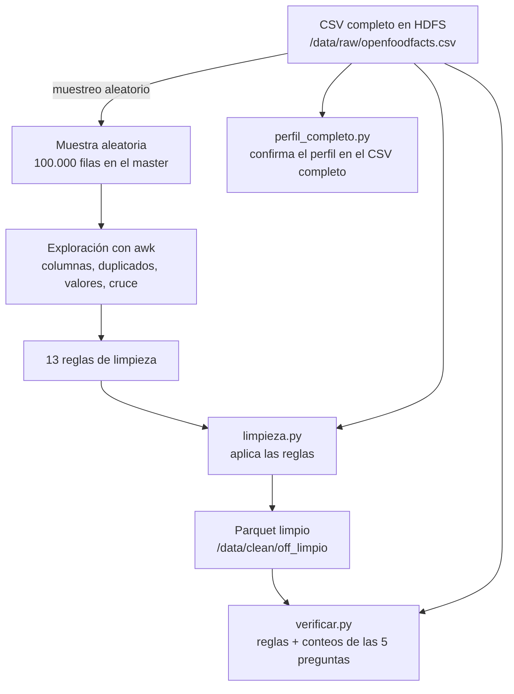

# Semana 1 · 3 – 9 nov · explorar y limpiar el dataset

- **Alberto:** exploración del dataset (muestra aleatoria), 13 reglas de limpieza, scripts de Spark y su verificación
- **Mauro:** pendiente, definir cómo va a hacer la limpieza ([ver pendiente](#pendiente))

## Índice

- [Alberto (persona B) — exploración y limpieza del dataset](#alberto-persona-b--exploración-y-limpieza-del-dataset)
  - [Checklist](#checklist)
  - [Diagrama del flujo](#diagrama-del-flujo)
  - [Exploración (en el master)](#exploración-en-el-master)
    - [1. Columnas: cuántas hay y cuánto relleno tienen](#1-columnas-cuántas-hay-y-cuánto-relleno-tienen)
    - [2. Identificador, duplicados y fechas](#2-identificador-duplicados-y-fechas)
    - [3. Columnas de pocos valores (Nutri-Score, NOVA, PNNS)](#3-columnas-de-pocos-valores-nutri-score-nova-pnns)
    - [4. Categorías](#4-categorías)
    - [5. Listas separadas por comas (vegano, países, aditivos)](#5-listas-separadas-por-comas-vegano-países-aditivos)
    - [6. Nutrientes numéricos: valores imposibles](#6-nutrientes-numéricos-valores-imposibles)
    - [7. Texto: marcas, ración y cantidad](#7-texto-marcas-ración-y-cantidad)
    - [8. Calidad de datos](#8-calidad-de-datos)
    - [9. Cruce con las 5 preguntas de referencia](#9-cruce-con-las-5-preguntas-de-referencia)
  - [Reglas de limpieza](#reglas-de-limpieza)
  - [Scripts de Spark (en el nodo client)](#scripts-de-spark-en-el-nodo-client)
    - [1. Preparar: carpeta de trabajo y muestra en HDFS](#1-preparar-carpeta-de-trabajo-y-muestra-en-hdfs)
    - [2. `perfil_completo.py`: comprobar el perfil en el archivo completo](#2-perfil_completopy-comprobar-el-perfil-en-el-archivo-completo)
    - [3. `limpieza.py`: aplicar las reglas](#3-limpiezapy-aplicar-las-reglas)
    - [4. `verificar.py`: comprobar el resultado](#4-verificarpy-comprobar-el-resultado)
    - [5. Ejecutar: primero con la muestra, después con el archivo completo](#5-ejecutar-primero-con-la-muestra-después-con-el-archivo-completo)
  - [Cómo comprobar que salió bien](#cómo-comprobar-que-salió-bien)
  - [Decisiones tomadas de forma provisional](#decisiones-tomadas-de-forma-provisional)
  - [Pendiente](#pendiente)

## Alberto (persona B) — exploración y limpieza del dataset

### Checklist

- [x] Exploración del dataset en 8 partes + cruce con las 5 preguntas de referencia
- [x] 13 reglas de limpieza derivadas de lo que se vio
- [x] Scripts de Spark escritos: `perfil_completo.py`, `limpieza.py`, `verificar.py`
- [ ] Ejecutar los scripts en el nodo client y comprobar los resultados ([cómo comprobarlo](#cómo-comprobar-que-salió-bien))
- [ ] Pendiente de Mauro: definir cómo va a hacer la limpieza ([ver pendiente](#pendiente))

> [!NOTE]
> La exploración se hizo sobre una **muestra aleatoria de 100.000 filas** (de 4.879.512). El archivo está ordenado por código de barras, así que las primeras filas son casi todas de EE. UU. y **no sirven como muestra**. Los scripts de Spark repiten las comprobaciones importantes sobre el archivo completo.

### Diagrama del flujo



La exploración se hace en el **master** (awk sobre la muestra) y los scripts de Spark se lanzan desde el **client** con `spark-submit`; YARN reparte el trabajo en los 3 workers.

### Exploración (en el master)

Todos los comandos se ejecutan en el master, en la carpeta donde está `muestra.csv`. No modifican nada, solo leen. Las posiciones de columna se buscan por nombre en la cabecera (no se cuentan a mano).

#### 1. Columnas: cuántas hay y cuánto relleno tienen

```bash
# Número de columnas del CSV
head -1 muestra.csv | tr '\t' '\n' | wc -l

# Columnas por tramo de relleno (columnas_relleno.tsv: número, nombre, % con valor)
awk -F'\t' '{p=$3; if(p>=90)a++; else if(p>=50)b++; else if(p>=10)c++; else if(p>0)d++; else e++}
  END{print "90-100:",a; print "50-90:",b; print "10-50:",c; print "0-10:",d; print "0:",e}' columnas_relleno.tsv
```

| Tramo de relleno | Columnas |
|---|---|
| 90 – 100 % | 21 |
| 50 – 90 % | 18 |
| 10 – 50 % | 42 |
| 0 – 10 % | 81 |
| 0 % (vacías) | 49 |

Total: **211 columnas**. Con más del 50 % de relleno están `code`, `created_t`, `countries_tags`, `pnns_groups_1/2`, `nutriscore_grade`, `product_name` (93,0 %), `energy-kcal_100g` (72,0 %), `proteins` (71,4 %), `fat` (71,3 %), `sugars` (67,0 %), `brands_tags` (64,1 %) y `salt` (62,5 %).

**Conclusión:** 49 columnas vacías que se pueden ignorar (se confirma en el archivo completo con `perfil_completo.py`). Que una columna esté llena no significa que tenga datos útiles: [más abajo](#3-columnas-de-pocos-valores-nutri-score-nova-pnns) se ve que `nutriscore_grade` está al 98,7 % pero solo el 29,3 % son letras válidas.

#### 2. Identificador, duplicados y fechas

```bash
# Longitud del código (¿todos son códigos de barras?)
awk -F'\t' 'NR>1{n[length($1)]++} END{for(l in n) print n[l]"\t"l}' muestra.csv | sort -rn | head -8

# Altas por año (requiere gawk, que es el awk de Amazon Linux)
awk -F'\t' -v col=created_t 'NR==1{for(i=1;i<=NF;i++) if($i==col) k=i; next} $k!=""{print strftime("%Y",$k)}' muestra.csv | sort | uniq -c

# Códigos repetidos en el CSV completo (lee los 13 GB, unos 2 minutos)
hdfs dfs -cat /data/raw/openfoodfacts.csv | cut -f1 | LC_ALL=C sort | uniq -d | wc -l

# Las copias de tres códigos repetidos: fecha de alta, de modificación, nombre y marca
hdfs dfs -cat /data/raw/openfoodfacts.csv | awk -F'\t' '$1=="0059527070430" || $1=="3033610080541" || $1=="2000000151609" {print $1 " | creado " $4 " | modificado " $6 " | " $11 " | " $20}'
```

| Longitud de `code` | Filas |
|---|---|
| 13 dígitos | 92.857 (92,9 %) |
| 8 dígitos | 5.429 |
| 18, 20, 14, 15, 24, 21 dígitos | de 133 a 386 cada una |

Altas por año: 2012 → 79; 2017 → 5.657; 2020 → 9.476; 2023 → 7.329; 2024 → 11.155; 2025 → 13.964; **2026 → 13.711 (año incompleto)**. En cambio, `last_modified_t` tiene el **62 % de las filas en 2026**: son actualizaciones masivas, no sirve para medir si un dato es reciente.

Hay **56 códigos repetidos** en el archivo completo (no son líneas rotas, son códigos numéricos reales). Las tres parejas revisadas son de tres tipos distintos:

| Código | Qué pasa | Interpretación |
|---|---|---|
| `3033610080541` | Misma fecha de alta; la segunda versión corrige "Saupon" → "Saumon" y añade marca | Dos versiones del mismo producto |
| `2000000151609` | "Him's Biotin gummies" y "Mayonnaise REAL 72%" | Productos distintos: los códigos `200…` son internos (sin código de barras) y se repiten |
| `0059527070430` | "Goji Snack Bars" (2017) y "Goji" (2024), misma marca | Ambiguo |

**Conclusión:** `code` **no es una clave única fiable**, aunque son solo 56 códigos de 4,88 millones (≈ 0,001 %). Regla simple: si un código se repite, se conserva la fila con `last_modified_t` más alta. Los duplicados no están seguidos en el archivo, así que se deduplica con una ventana de Spark y no comparando filas vecinas. Además hay que leer `code` **como texto** (si no, Spark lo convierte en número y pierde los ceros de la izquierda) y marcar, sin borrar, los códigos que no miden 8 ni 13 dígitos.

#### 3. Columnas de pocos valores (Nutri-Score, NOVA, PNNS)

```bash
# Cuántas veces aparece cada valor (los 14 más frecuentes) y cuántos valores distintos hay
for c in nutriscore_grade nova_group pnns_groups_1 no_nutrition_data environmental_score_grade; do
  echo "=== $c ==="
  awk -F'\t' -v col=$c 'NR==1{for(i=1;i<=NF;i++) if($i==col) k=i; next} {v=($k==""?"(vacio)":$k); n[v]++} END{for(x in n) print n[x]"\t"x; print "DISTINTOS\t"length(n)}' muestra.csv | sort -rn | head -14
done
```

| Columna | Valores útiles | Qué hay en el resto |
|---|---|---|
| `nutriscore_grade` | **29,3 %** (letras a – e) | `unknown` 67,0 %, `not-applicable` 2,4 %, vacío 1,3 % |
| `pnns_groups_1` | **30,9 %** (11 grupos) | `unknown` 67,8 %, vacío 1,3 % |
| `nova_group` | **24,2 %** (valores 1 – 4) | vacío 75,8 %; el grupo 4 pesa el 64 % de los que tienen valor |
| `no_nutrition_data` | 0,3 % | mezcla de `on`, `true`, `off`, `null` |
| `environmental_score_grade` | 21,2 % | `unknown` 76,4 % (no se usa en las 5 preguntas) |

**Conclusión:** `unknown` y `not-applicable` son "no hay dato" y deben pasar a `null`. `no_nutrition_data` no sirve como indicador; para saber si hay datos nutricionales se miran los propios nutrientes.

#### 4. Categorías

```bash
for c in pnns_groups_2 main_category_en; do
  echo "=== $c ==="
  awk -F'\t' -v col=$c 'NR==1{for(i=1;i<=NF;i++) if($i==col) k=i; next} {v=($k==""?"(vacio)":$k); n[v]++} END{for(x in n) print n[x]"\t"x; print "DISTINTOS "length(n) > "/dev/stderr"}' muestra.csv | sort -rn | head -15
done
```

| Columna | Valores distintos | Qué pasa |
|---|---|---|
| `pnns_groups_2` | **43** (41 categorías reales) | Coherente con `pnns_groups_1`: mismo 67,8 % de `unknown` |
| `main_category_en` | **7.737** (en solo 100.000 filas) | 59,9 % vacía, formatos mezclados (`en:groceries`, `en:undefined` junto a `Beverages`) |

**Conclusión:** como categoría se usa `pnns_groups_2` (41 valores) o `pnns_groups_1` (11); `main_category_en` es demasiado dispersa. El coste es que solo cubre ≈ 31 % de los productos.

#### 5. Listas separadas por comas (vegano, países, aditivos)

```bash
# Igual que antes pero troceando cada celda por las comas y contando cada etiqueta
for c in ingredients_analysis_tags countries_tags additives_tags; do
  echo "=== $c ==="
  awk -F'\t' -v col=$c 'NR==1{for(i=1;i<=NF;i++) if($i==col) k=i; next} {if($k==""){n["(vacio)"]++} else {m=split($k,a,","); for(j=1;j<=m;j++) n[a[j]]++}} END{for(x in n) print n[x]"\t"x; print "DISTINTOS "length(n) > "/dev/stderr"}' muestra.csv | sort -rn | head -14
done

# ¿additives_n vacío significa "sin aditivos" o "sin dato"? Se cruza con additives_tags
awk -F'\t' 'NR==1{for(i=1;i<=NF;i++){if($i=="additives_n")a=i; if($i=="additives_tags")t=i}; next} {n=($a==""?"(vacio)":$a); e=($t==""?"tags_vacio":"tags_con"); c[n" | "e]++} END{for(x in c) print c[x]"\t"x}' muestra.csv | sort -rn | head -15
```

`ingredients_analysis_tags` está **vacía en el 70,7 %** de las filas. En el resto cada producto tiene una etiqueta por familia:

| | Sí | No | Duda o desconocido |
|---|---|---|---|
| Vegano | `en:vegan` 6.505 | `en:non-vegan` 11.506 | `vegan-status-unknown` 9.417 + `maybe-vegan` 1.759 |
| Vegetariano | `en:vegetarian` 8.468 | `en:non-vegetarian` 4.024 | `vegetarian-status-unknown` 14.072 + `maybe-vegetarian` 2.735 |

Con estado **conocido** quedan el 18,0 % (vegano) y el 12,5 % (vegetariano) de los productos.

`countries_tags` tiene 220 valores: France 26,3 %, EE. UU. 20,5 %, Alemania 8,9 %, España 7,4 %, Italia 5,7 %, Reino Unido 4,0 %. Un producto puede tener varios países y aparece `en:world` (1.516 filas), que no es un país.

`additives_n` frente a `additives_tags`:

| `additives_n` | Filas | Significado |
|---|---|---|
| vacío | 72.410 (72,4 %) | No se sabe |
| **0** | **12.678 (12,7 %)** | Cero aditivos reales (las etiquetas están vacías) |
| 1 o más | 14.912 (14,9 %) | Coincide exactamente con las filas con `additives_tags` rellena |

**Conclusión:** vegano o vegetariano solo cuando la etiqueta es clara (`vegan`/`non-vegan`, `vegetarian`/`non-vegetarian`); `unknown`, `maybe-*` y vacío son `null`. Los países se parten en lista y se descarta `en:world`. Para aditivos se usa `additives_n` (vacío = desconocido, 0 = cero reales), **nunca** `additives_tags` vacía.

#### 6. Nutrientes numéricos: valores imposibles

```bash
# Por columna: filas con valor, mínimo, máximo, negativos, mayores que 100 y no numéricos
awk -F'\t' -v cols="energy-kcal_100g,fat_100g,saturated-fat_100g,carbohydrates_100g,sugars_100g,fiber_100g,proteins_100g,salt_100g,sodium_100g" 'BEGIN{nc=split(cols,C,",")} NR==1{for(i=1;i<=NF;i++)for(j=1;j<=nc;j++)if($i==C[j])P[j]=i; next} {for(j=1;j<=nc;j++){v=$P[j]; if(v=="")continue; n[j]++; if(v!~/^-?[0-9]+(\.[0-9]+)?$/){bad[j]++;continue}; x=v+0; if(!(j in mn)||x<mn[j])mn[j]=x; if(!(j in mx)||x>mx[j])mx[j]=x; if(x<0)neg[j]++; if(x>100)g100[j]++}} END{printf "%-22s %7s %9s %9s %6s %6s %6s\n","columna","n","min","max","<0",">100","noNum"; for(j=1;j<=nc;j++)printf "%-22s %7d %9s %9s %6d %6d %6d\n",C[j],n[j],mn[j],mx[j],neg[j],g100[j],bad[j]}' muestra.csv

# Incoherencias entre columnas (en las posiciones se buscan por nombre)
awk -F'\t' 'NR==1{for(i=1;i<=NF;i++){if($i=="energy-kcal_100g")ek=i;if($i=="fat_100g")f=i;if($i=="saturated-fat_100g")s=i;if($i=="carbohydrates_100g")c=i;if($i=="sugars_100g")z=i;if($i=="proteins_100g")p=i;if($i=="salt_100g")sa=i;if($i=="sodium_100g")so=i};next} {if($ek!=""&&$ek+0>900)e900++; if($s!=""&&$f!=""&&$s+0>$f+0)sf++; if($z!=""&&$c!=""&&$z+0>$c+0)sc++; if($f!=""&&$c!=""&&$p!=""&&$f+$c+$p>105&&$f+0<=100&&$c+0<=100&&$p+0<=100)mac++; if($sa!=""&&$so!=""){both++; d=$sa-2.5*$so; if(d<0)d=-d; if(d>0.05*$sa+0.01)nosal++}} END{print "energia_kcal>900:",e900+0; print "sat>grasa:",sf+0; print "azucar>carbohidratos:",sc+0; print "grasa+carb+prot>105 (cada una<=100):",mac+0; print "salt y sodium presentes:",both+0," incoherentes (salt!=2.5*sodium):",nosal+0}' muestra.csv
```

| Columna | Con valor | Máximo | Mayores que 100 |
|---|---|---|---|
| `fat_100g` | 71.271 | 111.111 | 148 (0,21 %) |
| `saturated-fat_100g` | 65.438 | 11.111 | 23 (0,04 %) |
| `carbohydrates_100g` | 71.349 | 6.660 | 287 (0,40 %) |
| `sugars_100g` | 67.003 | 2.400 | 135 (0,20 %) |
| `fiber_100g` | 38.562 | 700 | 11 (0,03 %) |
| `proteins_100g` | 71.398 | 8.079 | 49 (0,07 %) |
| `salt_100g` | 62.463 | 35.000 | 52 (0,08 %) |
| `sodium_100g` | 62.464 | 14.000 | 41 (0,07 %) |

No hay negativos ni texto. `energy-kcal_100g` llega a 201.411; sus 54.946 valores mayores que 100 son normales (un alimento puede tener hasta ≈ 900 kcal), el error empieza por encima de 900.

| Incoherencia | Filas |
|---|---|
| `energy-kcal_100g` > 900 | 427 (0,6 %) |
| Grasa saturada > grasa total | 61 |
| Azúcar > carbohidratos | 98 |
| Grasa + carbohidratos + proteínas > 105 g | 156 |
| `salt` y `sodium` a la vez / sin cumplir `salt = 2,5 × sodium` | 62.463 / 559 |

**Conclusión:** son pocos (menos del 1 %), pero tan exagerados que rompen medias y máximos. `sodium_100g` se calcula a partir de `salt_100g`: con una basta.

#### 7. Texto: marcas, ración y cantidad

```bash
# brands_tags se trocea por comas (un producto puede tener varias marcas); las otras dos se cuentan enteras
for c in brands_tags serving_size quantity; do
  echo "=== $c ==="
  awk -F'\t' -v col=$c 'NR==1{for(i=1;i<=NF;i++) if($i==col) k=i; next} {if($k==""){n["(vacio)"]++} else if(col=="brands_tags"){m=split($k,a,",");for(j=1;j<=m;j++)n[a[j]]++} else n[$k]++} END{for(x in n) print n[x]"\t"x; print "DISTINTOS "length(n) > "/dev/stderr"}' muestra.csv | sort -rn | head -15
done
```

| Columna | Vacía | Distintos | Qué pasa |
|---|---|---|---|
| `brands_tags` | 35,9 % | 36.310 | Prefijo `xx:` y **mayúsculas mezcladas**: `xx:Carrefour` 336 y `xx:carrefour` 204; `xx:Lidl` 220 y `xx:lidl` 200 |
| `serving_size` | 67,4 % | 9.495 | Texto libre: `100 g`, `100g`, `100.0g`, `1 portion (100 g)`… |
| `quantity` | 68,1 % | 5.156 | Unidades mezcladas: `1pcs`, `500 g`, `1 kg`, `1 serving(s)` |

**Conclusión:** las marcas hay que pasarlas a minúsculas y quitar el prefijo, o Carrefour contaría como dos marcas. Entre las más frecuentes hay marcas de distribución (`hacendado`, `marque-repere`, `u`). Para la ración se usa `serving_quantity` (ya numérica, 32,2 % de relleno) y no `serving_size`; `quantity` no la necesita ninguna pregunta.

#### 8. Calidad de datos

```bash
awk -F'\t' 'NR==1{for(i=1;i<=NF;i++) if($i=="completeness") k=i; next} $k!=""{x=$k+0; n++; s+=x; if(n==1||x<mn)mn=x; if(x>mx)mx=x} END{print "completeness n="n" min="mn" max="mx" media="s/n}' muestra.csv
for c in states_tags data_quality_errors_tags; do
  echo "=== $c ==="
  awk -F'\t' -v col=$c 'NR==1{for(i=1;i<=NF;i++) if($i==col) k=i; next} {if($k==""){n["(vacio)"]++} else {m=split($k,a,",");for(j=1;j<=m;j++)n[a[j]]++}} END{for(x in n) print n[x]"\t"x; print "DISTINTOS "length(n) > "/dev/stderr"}' muestra.csv | sort -rn | head -16
done
```

- `completeness`: rellena en el 99,99 %, escala de 0 a 1 (media 0,41).
- `states_tags` (38 estados) solo repite los huecos ya medidos. Sirve `en:nutrition-facts-completed` (75,1 %) como indicador de datos nutricionales.
- `data_quality_errors_tags`: **3,8 % de las filas** traen algún error marcado por Open Food Facts (129 tipos). Los más frecuentes: energía que no coincide con la calculada (≈ 2.200), suma de nutrientes sobre 105 (546), energía sobre 3.800 (305), carbohidratos / azúcares / grasa sobre 105.

**Conclusión:** Open Food Facts marca los mismos errores que encontramos nosotros, lo que confirma las reglas de nutrientes.

#### 9. Cruce con las 5 preguntas de referencia

```bash
awk -F'\t' 'NR==1{for(i=1;i<=NF;i++)h[$i]=i; P=h["pnns_groups_2"]; P1=h["pnns_groups_1"]; I=h["ingredients_analysis_tags"]; S=h["sugars_100g"]; N=h["nutriscore_grade"]; C=h["countries_tags"]; A=h["additives_n"]; V=h["nova_group"]; B=h["brands_tags"]; next}
{pv=($P!=""&&$P!="unknown"); nv=($N ~ /^[a-e]$/);
 if(pv && $I ~ /(^|,)en:(vegan|non-vegan)(,|$)/) q1v++;
 if(pv && $I ~ /(^|,)en:(vegetarian|non-vegetarian)(,|$)/) q1t++;
 if(pv && $S!="" && $S+0<=100) q2++;
 if(nv && $C!="" && $C!="en:world") q3++;
 if($A!="" && $V!="") q4++;
 if($B!="" && $P1!="" && $P1!="unknown" && nv) q5++}
END{print "Filas totales:",NR-1; print "Q1 vegano por categoria:",q1v+0; print "Q1 vegetariano por categoria:",q1t+0; print "Q2 azucar por categoria:",q2+0; print "Q3 Nutri-Score por pais:",q3+0; print "Q4 aditivos vs NOVA:",q4+0; print "Q5 marcas por grupo PNNS con Nutri-Score:",q5+0}' muestra.csv
```

Que cada columna esté al 30 % no garantiza que coincidan en las mismas filas, por eso se cuentan las filas con **todos** los datos válidos:

| Pregunta | Filas útiles en la muestra | Estimado en el archivo completo (× 48,8) |
|---|---|---|
| Q1 vegano por categoría | 11.768 (11,8 %) | ≈ 574.000 |
| Q1 vegetariano por categoría | 7.996 (8,0 %) | ≈ 390.000 |
| Q2 azúcar por categoría | 26.141 (26,1 %) | ≈ 1,28 M |
| Q3 Nutri-Score por país | 29.144 (29,1 %) | ≈ 1,42 M |
| Q4 aditivos frente a NOVA | 23.089 (23,1 %) | ≈ 1,13 M |
| Q5 marcas por grupo PNNS | 19.127 (19,1 %) | ≈ 0,93 M |

**Conclusión:** las 5 preguntas tienen datos de sobra. La más ajustada es vegetariano por categoría (≈ 390.000 productos en 41 categorías). En Q4, casi todos los productos con NOVA tienen también `additives_n` (23.089 de 24.180): hay que recordar que NOVA 4 se define en parte por los aditivos, así que la relación será algo circular.

### Reglas de limpieza

| # | Regla | Motivo |
|---|---|---|
| 1 | `code` se lee como texto; los códigos que no miden 8 ni 13 dígitos se marcan (`code_raro`), no se borran | Spark pierde los ceros de la izquierda si lo convierte en número |
| 2 | Códigos repetidos: se conserva la fila con `last_modified_t` más alta | 56 códigos repetidos, versiones del mismo producto |
| 3 | `unknown` y `not-applicable` pasan a `null` en `nutriscore_grade`, `pnns_groups_1` y `pnns_groups_2` | Más del 67 % de lo que parece relleno es `unknown` |
| 4 | Categoría = `pnns_groups_2` (41 valores); grupo = `pnns_groups_1` (11 valores) | `main_category_en` tiene 7.737 valores y formatos mezclados |
| 5 | Vegano / vegetariano solo con etiqueta clara; `unknown`, `maybe-*` y vacío → `null` | Solo 18 % y 12,5 % de estado conocido |
| 6 | Países: se parte la lista, el producto cuenta en cada país, se descarta `en:world` | Un producto puede venderse en varios países |
| 7 | `additives_n`: vacío = desconocido, 0 = cero aditivos reales; no se mira `additives_tags` | 12,7 % tiene 0 reales, 72,4 % no tiene dato |
| 8 | Nutrientes en gramos fuera de [0, 100] → `null`; `energy-kcal_100g` > 900 → `null` | Máximos absurdos (111.111, 201.411) |
| 9 | `nutrientes_incoherentes` = saturada > grasa, azúcar > carbohidratos, suma > 105 g o error marcado por Open Food Facts; la fila no se borra | Un análisis de nutrientes puede excluirla |
| 10 | Solo `salt_100g`; `sodium_100g` se descarta | Se calcula a partir de la sal |
| 11 | Marcas desde `brands_tags`, en minúsculas y sin prefijo `xx:` | `Carrefour` y `carrefour` son la misma marca |
| 12 | Ración desde `serving_quantity`; `serving_size` y `quantity` se descartan | Texto libre con miles de formatos |
| 13 | Año de alta desde `created_t`; `last_modified_t` no mide frescura | 62 % de modificaciones en 2026 por actualizaciones masivas |

### Scripts de Spark (en el nodo client)

Se ejecutan desde el **nodo client** con `spark-submit` (la configuración de YARN ya está en `spark-defaults.conf`, no hace falta indicar recursos). Los resultados se guardan en HDFS.

#### 1. Preparar: carpeta de trabajo y muestra en HDFS

```bash
# En el master: subir la muestra a HDFS para probar los scripts rápido antes de usar los 13 GB
hdfs dfs -put -f ~/muestra.csv /data/raw/muestra_aleatoria.csv
hdfs dfs -ls -h /data/raw/

# En el client: carpeta donde dejar los tres scripts (los contenidos están a continuación)
mkdir -p ~/semana1 && cd ~/semana1
```

#### 2. `perfil_completo.py`: comprobar el perfil en el archivo completo

Cuenta, para cada columna, las filas con valor en el CSV completo. Sirve para confirmar que las 49 columnas vacías en la muestra también lo están en el archivo entero.

```bash
cat > perfil_completo.py <<'EOF'
# perfil_completo.py · % de filas con valor en cada columna del CSV completo
import sys
from collections import Counter
from pyspark.sql import SparkSession, functions as F

entrada = sys.argv[1] if len(sys.argv) > 1 else "/data/raw/openfoodfacts.csv"
salida = sys.argv[2] if len(sys.argv) > 2 else "/results/perfil_columnas"

spark = SparkSession.builder.appName("perfil_columnas").getOrCreate()
# Todo como texto (sin inferSchema). quote="" evita que una comilla suelta una dos líneas.
# En Spark una celda vacía se lee como null, así que count(columna) cuenta las filas con valor.
df = spark.read.csv(entrada, sep="\t", header=True, quote="")

agg = df.agg(F.count(F.lit(1)).alias("__filas"),
             *[F.count(F.col(f"`{c}`")).alias(c) for c in df.columns]).first().asDict()
filas = agg.pop("__filas")

perfil = [(i + 1, c, agg[c], round(100.0 * agg[c] / filas, 2)) for i, c in enumerate(df.columns)]
(spark.createDataFrame(perfil, ["n", "columna", "filas_con_valor", "pct_con_valor"])
      .coalesce(1).write.mode("overwrite").option("header", True).option("sep", "\t").csv(salida))


def banda(p):
    if p >= 90: return "1) 90-100 %"
    if p >= 50: return "2) 50-90 %"
    if p >= 10: return "3) 10-50 %"
    if p > 0: return "4) 0-10 %"
    return "5) 0 % (vacías)"


print("FILAS_TOTALES", filas)
print("COLUMNAS", len(perfil))
for b, k in sorted(Counter(banda(p[3]) for p in perfil).items()):
    print(b, k)
print("COLUMNAS_VACIAS:", [p[1] for p in perfil if p[2] == 0])
EOF
```

#### 3. `limpieza.py`: aplicar las reglas

Lee el CSV, aplica las 13 reglas y guarda el resultado en Parquet. Sin argumentos usa el archivo completo; con dos argumentos (entrada y salida) se puede probar con la muestra.

```bash
cat > limpieza.py <<'EOF'
# limpieza.py · aplica las 13 reglas de la exploración y guarda el resultado en Parquet
import sys
from pyspark.sql import SparkSession, Window, functions as F

entrada = sys.argv[1] if len(sys.argv) > 1 else "/data/raw/openfoodfacts.csv"
salida = sys.argv[2] if len(sys.argv) > 2 else "/data/clean/off_limpio"

spark = SparkSession.builder.appName("limpieza_off").getOrCreate()
spark.conf.set("spark.sql.session.timeZone", "UTC")

# Regla 1: todo como texto, así `code` conserva los ceros de la izquierda
df = spark.read.csv(entrada, sep="\t", header=True, quote="")


def c(nombre):
    return F.col(f"`{nombre}`")        # las comillas invertidas permiten nombres con guion


def num(nombre, lo, hi):               # Regla 8: fuera de [lo, hi] -> null
    x = c(nombre).cast("double")
    return F.when((x >= lo) & (x <= hi), x)


def sin_desconocidos(nombre):          # Regla 3: unknown / not-applicable -> null
    return F.when(~c(nombre).isin("unknown", "not-applicable"), c(nombre))


# Regla 2: códigos repetidos -> nos quedamos con la fila modificada más recientemente
orden = Window.partitionBy("code").orderBy(c("last_modified_t").cast("long").desc_nulls_last())
df = df.withColumn("_rn", F.row_number().over(orden)).filter("_rn = 1").drop("_rn")

etiq_analisis = F.split(c("ingredients_analysis_tags"), ",")           # Regla 5
paises = F.filter(F.split(c("countries_tags"), ","), lambda p: p != "en:world")   # Regla 6
marcas = F.transform(F.split(c("brands_tags"), ","),                   # Regla 11
                     lambda b: F.regexp_replace(F.lower(F.trim(b)), r"^[a-z]{2}:", ""))
marcas = F.array_distinct(F.filter(marcas, lambda b: b != ""))

limpio = df.select(
    F.col("code"),
    (~F.length("code").isin(8, 13)).alias("code_raro"),                # Regla 1: se marca, no se borra
    c("product_name").alias("product_name"),
    F.year(F.from_unixtime(c("created_t").cast("long"))).alias("anio_alta"),   # Regla 13
    sin_desconocidos("pnns_groups_1").alias("grupo_pnns"),             # Reglas 3 y 4
    sin_desconocidos("pnns_groups_2").alias("categoria_pnns"),
    F.when(c("nutriscore_grade").isin("a", "b", "c", "d", "e"), c("nutriscore_grade")).alias("nutriscore_grade"),
    F.when(c("nova_group").isin("1", "2", "3", "4"), c("nova_group").cast("int")).alias("nova_group"),
    c("additives_n").cast("int").alias("additives_n"),                 # Regla 7: vacío=null, 0=cero real
    F.when(F.array_contains(etiq_analisis, "en:vegan"), True)
     .when(F.array_contains(etiq_analisis, "en:non-vegan"), False).alias("es_vegano"),
    F.when(F.array_contains(etiq_analisis, "en:vegetarian"), True)
     .when(F.array_contains(etiq_analisis, "en:non-vegetarian"), False).alias("es_vegetariano"),
    F.when(F.size(paises) > 0, paises).alias("paises"),
    F.when(F.size(marcas) > 0, marcas).alias("marcas"),
    F.when(F.size(marcas) > 0, F.element_at(marcas, 1)).alias("marca_principal"),
    F.when(c("serving_quantity").cast("double") > 0, c("serving_quantity").cast("double")).alias("serving_quantity"),  # Regla 12
    num("energy-kcal_100g", 0, 900).alias("energy_kcal_100g"),
    num("fat_100g", 0, 100).alias("fat_100g"),
    num("saturated-fat_100g", 0, 100).alias("saturated_fat_100g"),
    num("carbohydrates_100g", 0, 100).alias("carbohydrates_100g"),
    num("sugars_100g", 0, 100).alias("sugars_100g"),
    num("fiber_100g", 0, 100).alias("fiber_100g"),
    num("proteins_100g", 0, 100).alias("proteins_100g"),
    num("salt_100g", 0, 100).alias("salt_100g"),                       # Regla 10: sodium_100g se descarta
    c("data_quality_errors_tags").isNotNull().alias("_error_off"),
)

# Reglas 8 y 9: datos nutricionales y marca de incoherencia
nutrientes = ["energy_kcal_100g", "fat_100g", "carbohydrates_100g", "sugars_100g", "proteins_100g", "salt_100g"]
tiene_datos = F.coalesce(F.greatest(*[F.col(n).isNotNull().cast("int") for n in nutrientes]), F.lit(0)) == 1
incoherente = (
    F.coalesce(F.col("saturated_fat_100g") > F.col("fat_100g"), F.lit(False))
    | F.coalesce(F.col("sugars_100g") > F.col("carbohydrates_100g"), F.lit(False))
    | F.coalesce(F.col("fat_100g") + F.col("carbohydrates_100g") + F.col("proteins_100g") > 105, F.lit(False))
    | F.col("_error_off")
)
limpio = (limpio.withColumn("tiene_datos_nutricionales", tiene_datos)
                .withColumn("nutrientes_incoherentes", incoherente)
                .drop("_error_off"))

limpio.repartition(12).write.mode("overwrite").parquet(salida)
print("ESCRITO", salida)
EOF
```

#### 4. `verificar.py`: comprobar el resultado

Comprueba cada regla sobre el Parquet y repite los conteos de las 5 preguntas con el archivo completo.

```bash
cat > verificar.py <<'EOF'
# verificar.py · comprueba que el Parquet cumple las reglas y repite los conteos de las 5 preguntas
import sys
from functools import reduce
from pyspark.sql import SparkSession, functions as F

entrada = sys.argv[1] if len(sys.argv) > 1 else "/data/raw/openfoodfacts.csv"
salida = sys.argv[2] if len(sys.argv) > 2 else "/data/clean/off_limpio"

spark = SparkSession.builder.appName("verificar_limpieza").getOrCreate()
bruto = spark.read.csv(entrada, sep="\t", header=True, quote="")
limpio = spark.read.parquet(salida)
fallos = []


def comprobar(nombre, ok, detalle):
    print(("OK    " if ok else "FALLO ") + nombre + " -> " + str(detalle))
    if not ok:
        fallos.append(nombre)


# 1. Filas: las que faltan deben ser exactamente las copias sobrantes de códigos repetidos
n_bruto, n_limpio = bruto.count(), limpio.count()
sobrantes = bruto.groupBy("code").count().filter("count > 1").agg(F.sum(F.col("count") - 1)).first()[0] or 0
comprobar("filas = bruto - copias sobrantes", n_bruto - n_limpio == sobrantes,
          f"bruto={n_bruto} limpio={n_limpio} sobrantes={sobrantes}")
comprobar("code único", limpio.select("code").distinct().count() == n_limpio, "distinct == filas")

# 2. Valores desconocidos y rangos
comprobar("sin 'unknown' en grupo/categoría",
          limpio.filter(F.col("grupo_pnns").isin("unknown", "not-applicable")
                        | F.col("categoria_pnns").isin("unknown", "not-applicable")).count() == 0, "0 filas")
comprobar("nutriscore solo a-e",
          limpio.filter(F.col("nutriscore_grade").isNotNull() & ~F.col("nutriscore_grade").isin("a", "b", "c", "d", "e")).count() == 0, "0 filas")
comprobar("nova_group solo 1-4",
          limpio.filter(F.col("nova_group").isNotNull() & ~F.col("nova_group").between(1, 4)).count() == 0, "0 filas")
g100 = ["fat_100g", "saturated_fat_100g", "carbohydrates_100g", "sugars_100g", "fiber_100g", "proteins_100g", "salt_100g"]
r = limpio.agg(*[F.min(x).alias("min_" + x) for x in g100], *[F.max(x).alias("max_" + x) for x in g100],
               F.min("energy_kcal_100g").alias("min_kcal"), F.max("energy_kcal_100g").alias("max_kcal")).first()
comprobar("nutrientes en [0, 100]", all(r["min_" + x] >= 0 and r["max_" + x] <= 100 for x in g100 if r["max_" + x] is not None),
          {x: (r["min_" + x], r["max_" + x]) for x in g100})
comprobar("energy_kcal en [0, 900]", r["min_kcal"] >= 0 and r["max_kcal"] <= 900, (r["min_kcal"], r["max_kcal"]))

# 3. Coherencia de las marcas y de las columnas derivadas
comprobar("marcas en minúsculas y sin prefijo",
          limpio.filter(F.exists("marcas", lambda b: (b != F.lower(b)) | b.rlike("^[a-z]{2}:"))).count() == 0, "0 filas")
comprobar("paises sin en:world",
          limpio.filter(F.array_contains("paises", "en:world")).count() == 0, "0 filas")
comprobar("incoherentes con saturada > grasa siempre marcadas",
          limpio.filter((F.col("saturated_fat_100g") > F.col("fat_100g")) & ~F.col("nutrientes_incoherentes")).count() == 0, "0 filas")

# 4. Conteos de las 5 preguntas (la estimación sale de la muestra de 100.000 filas)
esperado = {"q1_vegano": 11768, "q1_vegetariano": 7996, "q2_azucar": 26141,
            "q3_nutriscore_pais": 29144, "q4_aditivos_nova": 23089, "q5_marcas_pnns": 19127}


def nn(*cols):   # cuenta las filas donde todas las columnas indicadas tienen valor
    return F.sum(reduce(lambda a, b: a & b, [F.col(x).isNotNull() for x in cols]).cast("int"))


q = limpio.agg(nn("categoria_pnns", "es_vegano").alias("q1_vegano"),
               nn("categoria_pnns", "es_vegetariano").alias("q1_vegetariano"),
               nn("categoria_pnns", "sugars_100g").alias("q2_azucar"),
               nn("nutriscore_grade", "paises").alias("q3_nutriscore_pais"),
               nn("additives_n", "nova_group").alias("q4_aditivos_nova"),
               nn("marcas", "grupo_pnns", "nutriscore_grade").alias("q5_marcas_pnns")).first().asDict()
for k, v in q.items():          # solo aviso: la estimación sale de una muestra, no es una regla
    est = esperado[k] * n_limpio / 100000
    print(("OK    " if abs(v - est) <= 0.15 * est else "AVISO ") + f"{k} real={v} estimado={int(est)} (±15 %)")

print("\nRESUMEN:", "TODO OK" if not fallos else f"{len(fallos)} FALLO(S): {fallos}")
sys.exit(1 if fallos else 0)
EOF
```

#### 5. Ejecutar: primero con la muestra, después con el archivo completo

```bash
# Prueba rápida con la muestra (≈ 1 minuto): si algo falla, se ve aquí y no tras esperar el archivo grande
spark-submit limpieza.py /data/raw/muestra_aleatoria.csv /data/clean/off_limpio_muestra
spark-submit verificar.py /data/raw/muestra_aleatoria.csv /data/clean/off_limpio_muestra

# Archivo completo: en segundo plano (nohup) para que no se pare si se corta la conexión SSH
nohup spark-submit perfil_completo.py > perfil.log 2>&1 &
nohup spark-submit limpieza.py > limpieza.log 2>&1 &

# Comprobar si ha terminado: si no sale ninguna línea, ya acabó
ps aux | grep "[s]park-submit" | cut -c1-120
tail -n 5 perfil.log limpieza.log

# Cuando limpieza.log diga ESCRITO, verificar
spark-submit verificar.py
```

> [!NOTE]
> Con la muestra, los conteos de las 5 preguntas se parecerán a los de la muestra y no a la estimación del archivo completo, así que ahí las líneas `AVISO` son normales: es una comparación de plausibilidad, no una regla.

> [!WARNING]
> Si `spark-submit` falla con `Connection refused` hacia el master, comprobar que el nodo client tiene las variables cargadas (`echo $HADOOP_CONF_DIR $SPARK_HOME`) y que el clúster está encendido. Un `File does not exist` casi siempre es una ruta mal escrita en HDFS (`hdfs dfs -ls /data/raw/`).

### Cómo comprobar que salió bien

| Qué se ejecutó | Qué debe salir |
|---|---|
| `perfil_completo.py` | `FILAS_TOTALES 4879512` y `COLUMNAS 211`. Los tramos deberían parecerse a los de la muestra (21 / 18 / 42 / 81 / 49). `COLUMNAS_VACIAS` debería rondar las 49; si alguna columna que en la muestra salía vacía tiene unas pocas filas en el archivo completo, es normal |
| `limpieza.py` | La última línea es `ESCRITO /data/clean/off_limpio`. En HDFS, `hdfs dfs -ls /data/clean/off_limpio` muestra `_SUCCESS` y 12 ficheros `part-…parquet` |
| `verificar.py` | Termina con `RESUMEN: TODO OK`, con `OK` en: filas = bruto − copias sobrantes (esperado ≈ 4.879.456, es decir 4.879.512 − 56 si cada código se repite una sola vez), `code` único, sin `unknown`, nutriscore solo a–e, nova solo 1–4, nutrientes en [0, 100], kcal en [0, 900], marcas en minúsculas y países sin `en:world` |
| Conteos de las 5 preguntas | Cada línea con `OK` o `AVISO` y su estimación. Esperado ≈ 574.000 (vegano), 390.000 (vegetariano), 1,28 M (azúcar), 1,42 M (Nutri-Score por país), 1,13 M (aditivos y NOVA) y 0,93 M (marcas por grupo). Un `AVISO` no es un error: la cifra real se aleja más del 15 % de la estimación de la muestra y conviene mirar por qué |

Y una comprobación a mano de que los códigos conocidos se trataron bien. Desde el client:

```bash
pyspark --conf spark.ui.showConsoleProgress=false
```

```python
d = spark.read.parquet("/data/clean/off_limpio")

# Códigos repetidos: debe salir 1 fila por código (la modificada más recientemente)
d.filter("code in ('3033610080541', '0059527070430', '2000000151609')") \
 .select("code", "product_name", "marcas").show(truncate=False)
#   3033610080541 -> "Saumon fumé sauvage du pacifique", marcas [labeyrie]
#   0059527070430 -> "Goji"
#   2000000151609 -> "Mayonnaise REAL 72%" (la otra fila era un producto distinto, ver Exploración, parte 2)

# Los ceros de la izquierda se conservan: debe haber códigos que empiezan por 0
d.filter("code like '0%'").count()

# Reparto de vegano: True, False y muchos null
d.groupBy("es_vegano").count().show()
```

### Decisiones tomadas de forma provisional

- **Marcas blancas** (`hacendado`, `marque-repere`, `u`): cuentan como marca. Tienen mucho volumen y comparar marca blanca frente a fabricante es un resultado interesante.
- **Año 2026:** se conserva en `anio_alta`, pero es un año incompleto y cualquier análisis por año debe indicarlo.
- **Códigos repetidos con productos distintos** (los `200…`): la regla 2 se queda con uno solo; afecta a ≈ 0,001 % de las filas.

El equipo puede cambiar cualquiera de las tres; solo habría que tocar `limpieza.py`.

### Pendiente

> [!WARNING]
> **Mauro** tiene que definir cómo va a hacer la limpieza. Los scripts de este documento cubren lo que salió de la exploración de Alberto con las 5 preguntas de referencia, y se ajustarán cuando Mauro cierre su parte, antes de dar el Parquet por definitivo.