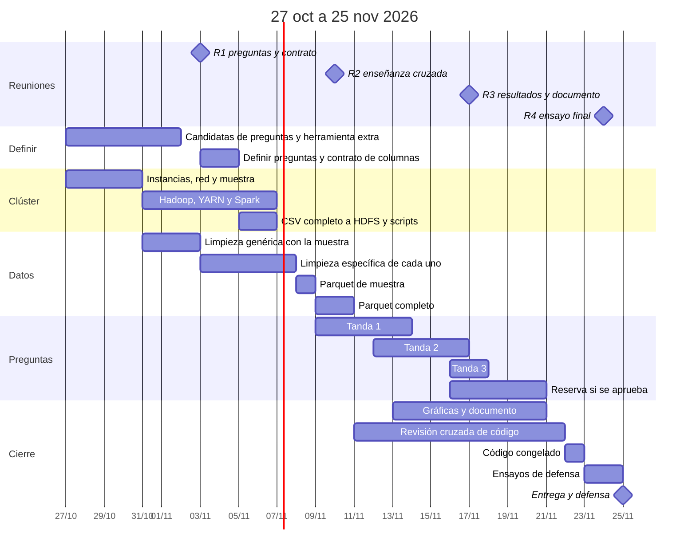
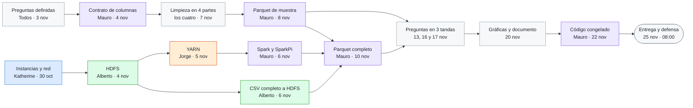
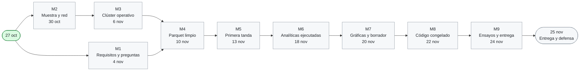

# BigData-OpenFoodFacts

Análisis de la información nutricional de **Open Food Facts** con **Spark sobre un clúster Hadoop (HDFS + YARN) en AWS Academy**. Trabajo en grupo de la asignatura ATBD.

> Contains data from Open Food Facts, available under the [Open Database License](https://opendatacommons.org/licenses/odbl/1.0/). Fuente: <https://world.openfoodfacts.org/data>

## Resumen

| | |
| --- | --- |
| **Qué** | 10 preguntas analíticas con la API DataFrame de Spark sobre el CSV de Open Food Facts (unos 9 GB), más 2 de reserva. **Las preguntas aún no están definidas** (ver [Preguntas](#preguntas-por-definir)) |
| **Dónde** | Clúster en AWS Academy: 1 master, 3 workers y 1 client (5 `t2.large`) |
| **Confirmado** | Entrega y defensa el **25 de noviembre de 2026, 08:00**, con grupo de 4 |
| **Reuniones** | Martes de **11:30 a 12:30**: 3, 10, 17 y 24 de noviembre |
| **Código congelado** | 22 de noviembre. Subir a ALUD antes del 24 de noviembre a las 20:00 |

## Equipo

| | **Katherine (A)** | **Alberto (B)** | **Jorge (C)** | **Mauro (D)** |
| --- | --- | --- | --- | --- |
| **Clúster** | Instancias, red y SSH | Hadoop y HDFS | YARN | Spark y tolerancia a fallos |
| **Limpieza de datos** | Energía y macronutrientes | Sal, sodio y ración | Tags: categorías, países, etiquetas y marca | Fechas, duplicados y NOVA |
| **Transversal** | Scripts de arranque y parada | Muestra y CSV a HDFS | Herramienta extra | Documento, contrato de columnas y Parquet |
| **Preguntas** | 3 | 3 | 2 + reserva | 2 + reserva |
| **Revisa el código de** | Alberto | Jorge | Mauro | Katherine |
| **Sus issues** | [ver issues](https://github.com/albertxestrada/BigData-OpenFoodFacts/issues?q=is%3Aissue%20label%3A%22persona%3AA%22) | [ver issues](https://github.com/albertxestrada/BigData-OpenFoodFacts/issues?q=is%3Aissue%20label%3A%22persona%3AB%22) | [ver issues](https://github.com/albertxestrada/BigData-OpenFoodFacts/issues?q=is%3Aissue%20label%3A%22persona%3AC%22) | [ver issues](https://github.com/albertxestrada/BigData-OpenFoodFacts/issues?q=is%3Aissue%20label%3A%22persona%3AD%22) |

- **Limpieza de datos:** el CSV lo rellenan usuarios y trae valores imposibles, textos libres, listas separadas por comas y duplicados. Cada uno limpia un trozo y Mauro los une en un Parquet fiable que leen las preguntas.
- **Transversal:** tareas que no son de una capa pero de las que depende el resto: scripts, subir el CSV, herramienta extra, documento y el contrato que mantiene encajados los cuatro trozos de la limpieza.

## Calendario

### Semana 0 · 27 oct – 2 nov · arrancar en paralelo
Sin reunión. Se cierra **M2 (30 oct)**.
- **Katherine:** instancias, red y SSH ([#16](https://github.com/albertxestrada/BigData-OpenFoodFacts/issues/16), 30 oct) · manual de red (2 nov)
- **Alberto:** muestra y columnas ([#17](https://github.com/albertxestrada/BigData-OpenFoodFacts/issues/17), 30 oct) · instalar Hadoop en los nodos (hasta el 2 nov)
- **Jorge:** candidatas de herramienta extra ([#15](https://github.com/albertxestrada/BigData-OpenFoodFacts/issues/15), 1 nov)
- **Mauro:** plantillas ([#14](https://github.com/albertxestrada/BigData-OpenFoodFacts/issues/14), 30 oct) · borrador del dataset ([#24](https://github.com/albertxestrada/BigData-OpenFoodFacts/issues/24), 2 nov)
- **Todos:** 4 preguntas candidatas ([#61](https://github.com/albertxestrada/BigData-OpenFoodFacts/issues/61), domingo 1 nov, 20:00) · explorar la muestra y empezar la parte genérica de la limpieza (tipos, duplicados, valores imposibles)

### Semana 1 · 3 – 9 nov · clúster y limpieza
**Reunión martes 3 nov** ([#63](https://github.com/albertxestrada/BigData-OpenFoodFacts/issues/63)): definir las preguntas ([#62](https://github.com/albertxestrada/BigData-OpenFoodFacts/issues/62)), elegir la herramienta extra y revisar el contrato. Se cierran **M1 (4 nov)** y **M3 (6 nov)**.
- **Katherine:** scripts de arranque ([#21](https://github.com/albertxestrada/BigData-OpenFoodFacts/issues/21), 6 nov) · limpieza de energía y macros ([#25](https://github.com/albertxestrada/BigData-OpenFoodFacts/issues/25), 7 nov)
- **Alberto:** HDFS ([#18](https://github.com/albertxestrada/BigData-OpenFoodFacts/issues/18), 4 nov) · CSV a HDFS ([#22](https://github.com/albertxestrada/BigData-OpenFoodFacts/issues/22), 6 nov) · limpieza de sal y ración ([#26](https://github.com/albertxestrada/BigData-OpenFoodFacts/issues/26), 7 nov)
- **Jorge:** YARN ([#19](https://github.com/albertxestrada/BigData-OpenFoodFacts/issues/19), 5 nov) · limpieza de tags ([#27](https://github.com/albertxestrada/BigData-OpenFoodFacts/issues/27), 7 nov)
- **Mauro:** contrato de columnas ([#67](https://github.com/albertxestrada/BigData-OpenFoodFacts/issues/67), 4 nov) · Spark y SparkPi ([#20](https://github.com/albertxestrada/BigData-OpenFoodFacts/issues/20), 6 nov) · limpieza de fechas y NOVA ([#28](https://github.com/albertxestrada/BigData-OpenFoodFacts/issues/28), 7 nov) · Parquet de muestra ([#68](https://github.com/albertxestrada/BigData-OpenFoodFacts/issues/68), 8 nov)
- **Todos:** desde el 9 nov, empezar la pregunta de la tanda 1

### Semana 2 · 10 – 16 nov · Parquet completo y preguntas
**Reunión martes 10 nov** ([#64](https://github.com/albertxestrada/BigData-OpenFoodFacts/issues/64)): enseñanza cruzada (10 minutos cada uno) y reajuste de carga. Se cierran **M4 (10 nov)** y **M5 (13 nov)**.
- **Mauro:** Parquet completo ([#29](https://github.com/albertxestrada/BigData-OpenFoodFacts/issues/29), 10 nov) · tolerancia a fallos ([#30](https://github.com/albertxestrada/BigData-OpenFoodFacts/issues/30), 13 nov)
- **Todos:** tanda 1 (código 11 nov, ejecución 12–13 nov) · tanda 2 (código 15 nov, ejecución 16 nov) · empezar gráficas el 13 nov · revisar los pull requests del compañero en menos de 48 horas

### Semana 3 · 17 – 23 nov · cierre
**Reunión martes 17 nov** ([#65](https://github.com/albertxestrada/BigData-OpenFoodFacts/issues/65)): resultados, gráficas y documento. Se cierran **M6 (18 nov)**, **M7 (20 nov)** y **M8 (22 nov)**.
- **Todos:** tanda 3 (ejecución 17 nov, solo Katherine y Alberto) · gráficas y secciones (20 nov) · revisión cruzada (21 nov)
- **Jorge:** herramienta extra integrada ([#48](https://github.com/albertxestrada/BigData-OpenFoodFacts/issues/48), 20 nov)
- **Mauro:** documento integrado ([#49](https://github.com/albertxestrada/BigData-OpenFoodFacts/issues/49), 20 nov) · repositorio congelado ([#55](https://github.com/albertxestrada/BigData-OpenFoodFacts/issues/55), 22 nov)
- **Sábado 21 nov:** sesión extra para las conclusiones · **lunes 23 nov:** primer ensayo de defensa

### Semana 4 · 24 – 25 nov · ensayo y entrega
**Reunión martes 24 nov** ([#66](https://github.com/albertxestrada/BigData-OpenFoodFacts/issues/66)): segundo ensayo y logística. Se cierra **M9 (24 nov)**. Mauro sube la entrega a ALUD antes de las 20:00 ([#57](https://github.com/albertxestrada/BigData-OpenFoodFacts/issues/57)). **Miércoles 25 nov, 08:00: entrega y defensa.**

## Quién desbloquea a quién

Cada color es una persona. Una flecha significa «esto tiene que estar listo para que empiece lo siguiente».

Azul: Katherine · verde: Alberto · naranja: Jorge · morado: Mauro · gris: todo el grupo.

Si algo se retrasa, avisar ese mismo día, porque bloquea a otros:

| Si se retrasa… | Se bloquea… |
| --- | --- |
| Instancias y red (Katherine, 30 oct) | HDFS, YARN y Spark |
| HDFS (Alberto, 4 nov) | YARN, SparkPi y el CSV completo |
| YARN (Jorge, 5 nov) | SparkPi y los scripts de arranque |
| La limpieza de cualquiera (7 nov) | El Parquet de muestra y, con él, todas las preguntas |
| Parquet de muestra (Mauro, 8 nov) | Empezar a programar las preguntas |
| Parquet completo (Mauro, 10 nov) | Ejecutar las preguntas en el clúster |
| Ejecución de una tanda | Las gráficas de esa tanda y el documento |

## Avance del equipo

Para marcar un hito como cumplido, cambiad su línea `class` de `pendiente` a `hecho` cuando todos sus issues estén cerrados.

### M1 · Requisitos, preguntas y contrato definidos · 4 nov
- [ ] [#14](https://github.com/albertxestrada/BigData-OpenFoodFacts/issues/14) Plantillas .docx del profesor · Mauro · 30 oct
- [ ] [#15](https://github.com/albertxestrada/BigData-OpenFoodFacts/issues/15) Elegir la herramienta extra del Tema 6 · Jorge · 3 nov
- [ ] [#61](https://github.com/albertxestrada/BigData-OpenFoodFacts/issues/61) Proponer 4 preguntas candidatas por persona · Todos · 1 nov
- [ ] [#62](https://github.com/albertxestrada/BigData-OpenFoodFacts/issues/62) Definir las 10 preguntas finales y su reparto · Todos · 3 nov
- [ ] [#63](https://github.com/albertxestrada/BigData-OpenFoodFacts/issues/63) Reunión 1 · martes 3 nov · Todos · 3 nov
- [ ] [#67](https://github.com/albertxestrada/BigData-OpenFoodFacts/issues/67) Contrato de columnas del Parquet · Mauro · 4 nov

### M2 · Muestra y red listas · 30 oct
- [x] [#16](https://github.com/albertxestrada/BigData-OpenFoodFacts/issues/16) Instancias EC2, red, SSH y `/etc/hosts` · Katherine · 30 oct (manual de red 2 nov)
- [x] [#17](https://github.com/albertxestrada/BigData-OpenFoodFacts/issues/17) Muestra del CSV y columnas que se usarán · Alberto · 30 oct

### M3 · Clúster operativo · 6 nov
- [ ] [#18](https://github.com/albertxestrada/BigData-OpenFoodFacts/issues/18) Hadoop y HDFS · Alberto · 4 nov
- [x] [#19](https://github.com/albertxestrada/BigData-OpenFoodFacts/issues/19) YARN · Jorge · 5 nov
- [ ] [#20](https://github.com/albertxestrada/BigData-OpenFoodFacts/issues/20) Spark en el client y SparkPi en YARN · Mauro · 6 nov
- [ ] [#21](https://github.com/albertxestrada/BigData-OpenFoodFacts/issues/21) Scripts de arranque y parada · Katherine · 6 nov
- [ ] [#22](https://github.com/albertxestrada/BigData-OpenFoodFacts/issues/22) CSV completo descomprimido y subido a HDFS · Alberto · 6 nov
- [ ] [#24](https://github.com/albertxestrada/BigData-OpenFoodFacts/issues/24) Borrador de la descripción del dataset y de las preguntas · Mauro · 6 nov

### M4 · Parquet limpio en HDFS · 10 nov
- [ ] [#25](https://github.com/albertxestrada/BigData-OpenFoodFacts/issues/25) Limpieza: energía y macronutrientes · Katherine · 7 nov
- [ ] [#26](https://github.com/albertxestrada/BigData-OpenFoodFacts/issues/26) Limpieza: sal, sodio y ración · Alberto · 7 nov
- [ ] [#27](https://github.com/albertxestrada/BigData-OpenFoodFacts/issues/27) Limpieza: tags de categorías, países, etiquetas y marca · Jorge · 7 nov
- [ ] [#28](https://github.com/albertxestrada/BigData-OpenFoodFacts/issues/28) Limpieza: fechas, duplicados, NOVA y datos nutricionales · Mauro · 7 nov
- [ ] [#68](https://github.com/albertxestrada/BigData-OpenFoodFacts/issues/68) Parquet de muestra para programar las preguntas · Mauro · 8 nov
- [ ] [#29](https://github.com/albertxestrada/BigData-OpenFoodFacts/issues/29) Limpieza completa y Parquet en HDFS · Mauro · 10 nov
- [ ] [#23](https://github.com/albertxestrada/BigData-OpenFoodFacts/issues/23) Mini-manuales y enseñanza cruzada · Todos · 10 nov
- [ ] [#64](https://github.com/albertxestrada/BigData-OpenFoodFacts/issues/64) Reunión 2 · martes 10 nov · Todos · 10 nov

### M5 · Primera tanda de preguntas ejecutada · 13 nov
- [ ] [#33](https://github.com/albertxestrada/BigData-OpenFoodFacts/issues/33) Pregunta de Katherine · tanda 1 · Katherine · código 11 nov · ejecución 13 nov
- [ ] [#34](https://github.com/albertxestrada/BigData-OpenFoodFacts/issues/34) Pregunta de Alberto · tanda 1 · Alberto · código 11 nov · ejecución 13 nov
- [ ] [#32](https://github.com/albertxestrada/BigData-OpenFoodFacts/issues/32) Pregunta de Jorge · tanda 1 · Jorge · código 11 nov · ejecución 13 nov
- [ ] [#38](https://github.com/albertxestrada/BigData-OpenFoodFacts/issues/38) Pregunta de Mauro · tanda 1 · Mauro · código 11 nov · ejecución 13 nov
- [ ] [#30](https://github.com/albertxestrada/BigData-OpenFoodFacts/issues/30) Prueba de tolerancia a fallos: apagar un worker · Mauro · 13 nov

### M6 · Analíticas ejecutadas · 18 nov
- [ ] [#35](https://github.com/albertxestrada/BigData-OpenFoodFacts/issues/35) Pregunta de Katherine · tanda 2 · Katherine · código 15 nov · ejecución 16 nov
- [ ] [#41](https://github.com/albertxestrada/BigData-OpenFoodFacts/issues/41) Pregunta de Alberto · tanda 2 · Alberto · código 15 nov · ejecución 16 nov
- [ ] [#39](https://github.com/albertxestrada/BigData-OpenFoodFacts/issues/39) Pregunta de Jorge · tanda 2 · Jorge · código 15 nov · ejecución 16 nov
- [ ] [#40](https://github.com/albertxestrada/BigData-OpenFoodFacts/issues/40) Pregunta de Mauro · tanda 2 · Mauro · código 15 nov · ejecución 16 nov
- [ ] [#37](https://github.com/albertxestrada/BigData-OpenFoodFacts/issues/37) Pregunta de Katherine · tanda 3 · Katherine · código 16 nov · ejecución 17 nov
- [ ] [#36](https://github.com/albertxestrada/BigData-OpenFoodFacts/issues/36) Pregunta de Alberto · tanda 3 · Alberto · código 16 nov · ejecución 17 nov
- [ ] [#65](https://github.com/albertxestrada/BigData-OpenFoodFacts/issues/65) Reunión 3 · martes 17 nov · Todos · 17 nov

### M7 · Gráficas y borrador · 20 nov
- [ ] [#44](https://github.com/albertxestrada/BigData-OpenFoodFacts/issues/44) Gráficas y sección del documento (Katherine) · Katherine · 20 nov (empezar el 13)
- [ ] [#45](https://github.com/albertxestrada/BigData-OpenFoodFacts/issues/45) Gráficas y sección del documento (Alberto) · Alberto · 20 nov (empezar el 13)
- [ ] [#46](https://github.com/albertxestrada/BigData-OpenFoodFacts/issues/46) Gráficas y sección del documento (Jorge) · Jorge · 20 nov (empezar el 13)
- [ ] [#47](https://github.com/albertxestrada/BigData-OpenFoodFacts/issues/47) Gráficas y sección del documento (Mauro) · Mauro · 20 nov (empezar el 13)
- [ ] [#48](https://github.com/albertxestrada/BigData-OpenFoodFacts/issues/48) Integrar la herramienta extra con los resultados · Jorge · 20 nov
- [ ] [#49](https://github.com/albertxestrada/BigData-OpenFoodFacts/issues/49) Integrar las secciones del documento · Mauro · 20 nov
- [ ] [#42](https://github.com/albertxestrada/BigData-OpenFoodFacts/issues/42) Pregunta de reserva de Jorge · Jorge · ejecución 20 nov, si se aprueba
- [ ] [#43](https://github.com/albertxestrada/BigData-OpenFoodFacts/issues/43) Pregunta de reserva de Mauro · Mauro · ejecución 20 nov, si se aprueba

### M8 · Código congelado · 22 nov
- [ ] [#50](https://github.com/albertxestrada/BigData-OpenFoodFacts/issues/50) Katherine revisa el código de Alberto · Katherine · 21 nov
- [ ] [#51](https://github.com/albertxestrada/BigData-OpenFoodFacts/issues/51) Alberto revisa el código de Jorge · Alberto · 21 nov
- [ ] [#52](https://github.com/albertxestrada/BigData-OpenFoodFacts/issues/52) Jorge revisa el código de Mauro · Jorge · 21 nov
- [ ] [#53](https://github.com/albertxestrada/BigData-OpenFoodFacts/issues/53) Mauro revisa el código de Katherine · Mauro · 21 nov
- [ ] [#54](https://github.com/albertxestrada/BigData-OpenFoodFacts/issues/54) Ejecutar trabajos ajenos y matriz de conocimiento · Todos · 22 nov
- [ ] [#55](https://github.com/albertxestrada/BigData-OpenFoodFacts/issues/55) Congelar el repositorio con la etiqueta `entrega` · Mauro · 22 nov

### M9 · Ensayos y entrega · 24 nov
- [ ] [#56](https://github.com/albertxestrada/BigData-OpenFoodFacts/issues/56) Ensayos de defensa · Todos · lun 23 y mar 24 nov
- [ ] [#57](https://github.com/albertxestrada/BigData-OpenFoodFacts/issues/57) Subir la entrega a ALUD antes de las 20:00 · Mauro · 24 nov
- [ ] [#66](https://github.com/albertxestrada/BigData-OpenFoodFacts/issues/66) Reunión 4 · martes 24 nov · Todos · 24 nov

## Preguntas por definir

Todavía no hay ninguna pregunta decidida. El proceso es:

1. **1 nov:** cada persona propone 4 candidatas con su objetivo, utilidad y columnas necesarias ([#61](https://github.com/albertxestrada/BigData-OpenFoodFacts/issues/61)).
2. **3 nov:** en la reunión 1 se eligen las 10 preguntas y 2 de reserva ([#62](https://github.com/albertxestrada/BigData-OpenFoodFacts/issues/62)).
3. **4 nov:** se cierra el contrato de columnas del Parquet según las preguntas elegidas ([#67](https://github.com/albertxestrada/BigData-OpenFoodFacts/issues/67)).

Mientras tanto hay un hueco por pregunta, con su responsable provisional y su tanda. Al decidirlas, cada hueco se rellena con su pregunta.

| Tanda | Código listo | Ejecución | Katherine | Alberto | Jorge | Mauro |
| --- | --- | --- | --- | --- | --- | --- |
| **1** | 11 nov | 13 nov | [#33](https://github.com/albertxestrada/BigData-OpenFoodFacts/issues/33) | [#34](https://github.com/albertxestrada/BigData-OpenFoodFacts/issues/34) | [#32](https://github.com/albertxestrada/BigData-OpenFoodFacts/issues/32) | [#38](https://github.com/albertxestrada/BigData-OpenFoodFacts/issues/38) |
| **2** | 15 nov | 16 nov | [#35](https://github.com/albertxestrada/BigData-OpenFoodFacts/issues/35) | [#41](https://github.com/albertxestrada/BigData-OpenFoodFacts/issues/41) | [#39](https://github.com/albertxestrada/BigData-OpenFoodFacts/issues/39) | [#40](https://github.com/albertxestrada/BigData-OpenFoodFacts/issues/40) |
| **3** | 16 nov | 17 nov | [#37](https://github.com/albertxestrada/BigData-OpenFoodFacts/issues/37) | [#36](https://github.com/albertxestrada/BigData-OpenFoodFacts/issues/36) | | |
| **Reserva** | 17 nov | 20 nov | | | [#42](https://github.com/albertxestrada/BigData-OpenFoodFacts/issues/42) | [#43](https://github.com/albertxestrada/BigData-OpenFoodFacts/issues/43) |

## Cómo se trabaja

1. Cada tarea es un issue; se trabaja en una rama propia y un pull request lo cierra.
2. Cada pull request lo revisa, en menos de 48 horas, la persona de la cadena: Katherine revisa a Alberto, Alberto a Jorge, Jorge a Mauro y Mauro a Katherine. Quien revisa tiene que poder explicar ese código en la defensa.
3. Probar siempre primero con la muestra y después con el dataset completo en el clúster.
4. Nunca se suben claves `.pem`, credenciales de AWS ni datos: el CSV y el Parquet viven en HDFS.
5. Apagar el clúster al terminar cada sesión para no gastar crédito de AWS Academy.
6. Si algo se retrasa más de un día, se avisa al grupo ese mismo día.
