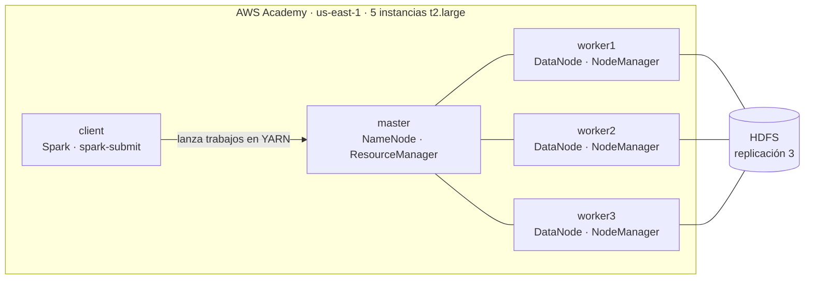
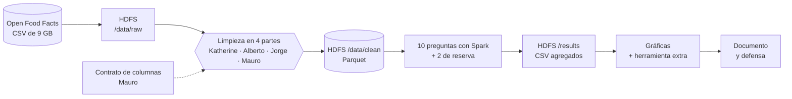
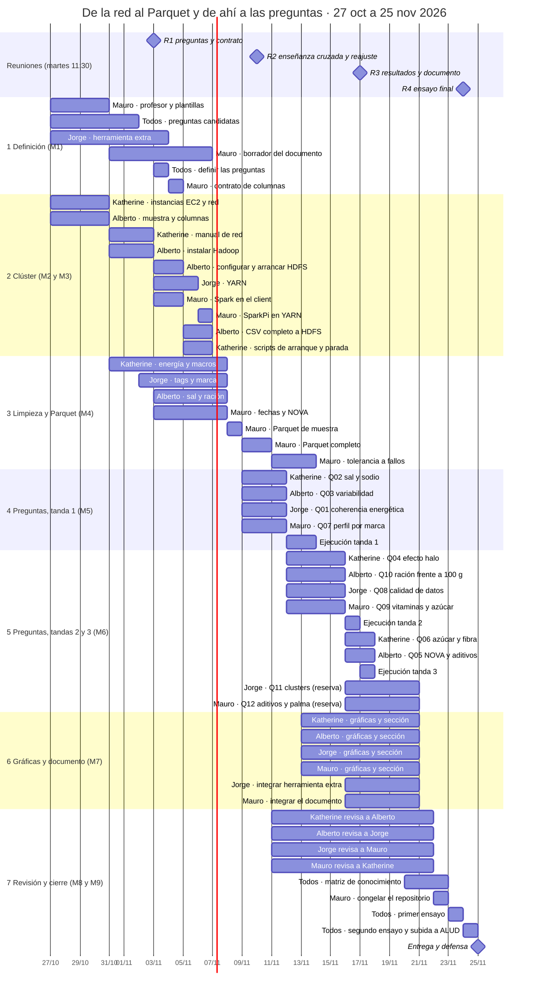
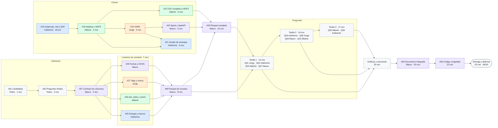
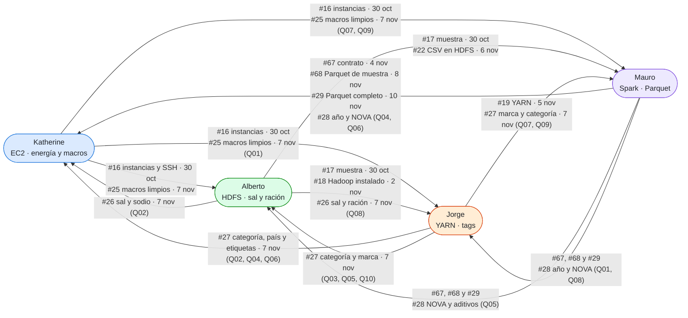
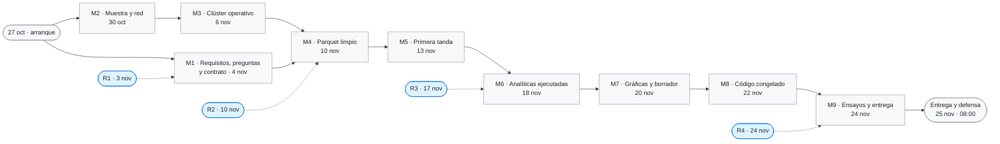
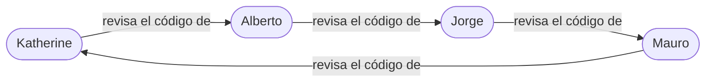

# BigData-OpenFoodFacts

Análisis de la información nutricional de **Open Food Facts** con **Spark sobre un clúster Hadoop (HDFS + YARN) en AWS Academy**. Trabajo en grupo de la asignatura ATBD.

> Contains data from Open Food Facts, available under the [Open Database License](https://opendatacommons.org/licenses/odbl/1.0/). Fuente: <https://world.openfoodfacts.org/data>

## TL;DR

| | |
| --- | --- |
| **Qué** | 10 preguntas analíticas (más 2 de reserva) sobre el CSV de productos de Open Food Facts, con la API DataFrame de Spark. **Las preguntas están por definir** (ver [#61](https://github.com/albertxestrada/BigData-OpenFoodFacts/issues/61) y [#62](https://github.com/albertxestrada/BigData-OpenFoodFacts/issues/62)) |
| **Dónde** | Clúster en AWS Academy: 1 master, 3 workers y 1 client (5 `t2.large` en us-east-1) |
| **Datos** | CSV de unos 0,9 GB comprimido y 9 GB descomprimido, separado por tabuladores. Los resultados se guardan en HDFS |
| **Reuniones** | Todos los **martes de 11:30 a 12:30**, desde el 3 de noviembre: 3, 10, 17 y 24 de noviembre |
| **Entrega y defensa** | **25 de noviembre de 2026, 08:00** (subir a ALUD antes del 24 a las 20:00) |
| **Código congelado** | 22 de noviembre |
| **Equipo** | Katherine (A), Alberto (B), Jorge (C) y Mauro (D). Cada uno toca todas las capas: clúster, limpieza, preguntas y documento |
| **Seguimiento** | [Issues](https://github.com/albertxestrada/BigData-OpenFoodFacts/issues) con etiqueta de persona y [hitos](https://github.com/albertxestrada/BigData-OpenFoodFacts/milestones) con fecha |

## Qué es cada fila del reparto

| Fila | Qué significa |
| --- | --- |
| **Clúster** | Montar la infraestructura: instancias en AWS, HDFS (donde viven los datos), YARN (reparte CPU y memoria) y Spark (hace los cálculos). Sin esto no hay dónde ejecutar nada |
| **Limpieza de datos** | El CSV lo rellenan usuarios, así que trae valores imposibles (100 g de grasa en 30 g de producto), textos libres (`1 cup (240 ml)`), campos con listas separadas por comas y productos repetidos. La limpieza es un trabajo de Spark que lo arregla y guarda un **Parquet fiable** que leen las 10 preguntas. Se parte en cuatro trozos, uno por persona, y Mauro los une |
| **Preguntas** | Las analíticas del enunciado: cada una es un programa de Spark que lee el Parquet limpio, agrupa o calcula algo y guarda una tabla pequeña en HDFS |
| **Transversal** | Tareas que no pertenecen a una capa, pero de las que depende el resto: scripts para arrancar el clúster, subir el CSV a HDFS, herramienta extra y gráficas, repositorio y documento, y el contrato de columnas que mantiene encajadas las cuatro partes de la limpieza |
| **Revisa el código de** | Cadena de revisión cruzada: todos tienen que poder explicar el código de otra persona en la defensa |

## Equipo

| | **A · Katherine** | **B · Alberto** | **C · Jorge** | **D · Mauro** |
| --- | --- | --- | --- | --- |
| **Clúster** | EC2, red y SSH | Hadoop y HDFS | YARN | Spark y tolerancia a fallos |
| **Limpieza de datos** | Energía y macronutrientes | Sal, sodio y ración | Tags de categorías, países, etiquetas y marca | Fechas, duplicados, NOVA y bandera de datos nutricionales |
| **Preguntas** | Q2, Q4, Q6 | Q3, Q5, Q10 | Q1, Q8 (Q11 opcional) | Q7, Q9 (Q12 opcional) |
| **Transversal** | Scripts de arranque y parada | Muestra y CSV completo a HDFS | Herramienta extra y gráficas | Repositorio, documento, contrato de columnas y Parquet |
| **Revisa el código de** | Alberto | Jorge | Mauro | Katherine |

> El reparto de preguntas es provisional hasta la reunión del 3 de noviembre ([#62](https://github.com/albertxestrada/BigData-OpenFoodFacts/issues/62)).

## Arquitectura del clúster

| Pieza | Responsable |
| --- | --- |
| Instancias, red, SSH y `/etc/hosts` | Katherine |
| Hadoop y HDFS | Alberto |
| YARN | Jorge |
| Spark en el client y prueba de tolerancia a fallos | Mauro |

## Flujo de datos

## Calendario por semanas

Se reparte el trabajo para ir avanzando poco a poco: la semana del 27 de octubre sirve para arrancar en paralelo (red, muestra, preguntas candidatas y diseño de la limpieza con la muestra), y las preguntas se ejecutan en tres tandas en vez de todas al final.

| Semana | Foco | Reunión del martes | Se cierra |
| --- | --- | --- | --- |
| **0 · 27 oct – 2 nov** | Arrancar en paralelo: red, muestra, preguntas candidatas, diseño de la limpieza | (no hay) | M2 (30 oct) |
| **1 · 3 – 9 nov** | Clúster operativo y limpieza con la muestra | **3 nov** · [#63](https://github.com/albertxestrada/BigData-OpenFoodFacts/issues/63): definir preguntas, herramienta extra y contrato | M1 (4 nov), M3 (6 nov) |
| **2 · 10 – 16 nov** | Parquet completo y preguntas en tandas | **10 nov** · [#64](https://github.com/albertxestrada/BigData-OpenFoodFacts/issues/64): enseñanza cruzada y reajuste de carga | M4 (10 nov), M5 (13 nov) |
| **3 · 17 – 23 nov** | Resultados, gráficas, documento y revisión | **17 nov** · [#65](https://github.com/albertxestrada/BigData-OpenFoodFacts/issues/65): resultados y documento | M6 (18 nov), M7 (20 nov), M8 (22 nov) |
| **4 · 24 – 25 nov** | Ensayo final y entrega | **24 nov** · [#66](https://github.com/albertxestrada/BigData-OpenFoodFacts/issues/66): ensayo y logística | M9 (24 nov) |

Las preguntas se ejecutan en tres tandas, con sus gráficas empezando en cuanto hay resultados:

| Tanda | Preguntas | Código listo | Ejecución en el clúster |
| --- | --- | --- | --- |
| **1** | Q01 (Jorge) · Q02 (Katherine) · Q03 (Alberto) · Q07 (Mauro) | 11 nov | 12–13 nov |
| **2** | Q04 (Katherine) · Q08 (Jorge) · Q09 (Mauro) · Q10 (Alberto) | 15 nov | 16 nov |
| **3** | Q05 (Alberto) · Q06 (Katherine) | 16 nov | 17 nov |
| **Reserva** | Q11 (Jorge) · Q12 (Mauro), si se aprueban en la reunión del 10 nov | 17 nov | 20 nov |

## Calendario con dependencias

Cada barra es una tarea de una persona. Las que usan `after` empiezan cuando termina la tarea de la que dependen, aunque sea de otra persona (por ejemplo, las preguntas empiezan cuando Mauro publica el Parquet de muestra).

## Ruta crítica: quién desbloquea a quién

Cada color es una persona. Una flecha significa «esto tiene que estar hecho para que empiece lo siguiente». La ruta más larga va de las instancias de Katherine al Parquet de Mauro y de ahí a todas las preguntas.

Leyenda: azul = Katherine, verde = Alberto, naranja = Jorge, morado = Mauro, gris = todo el grupo.

## Quién necesita a quién

La flecha sale de quien entrega y llega a quien espera. Cada etiqueta dice qué entrega, en qué issue y cuándo.

Si algo se retrasa, esta tabla dice a quién avisar:

| Persona | Necesita de otros | Otros necesitan de ella o él |
| --- | --- | --- |
| **Katherine** | De Mauro: contrato ([#67](https://github.com/albertxestrada/BigData-OpenFoodFacts/issues/67), 4 nov), Parquet de muestra ([#68](https://github.com/albertxestrada/BigData-OpenFoodFacts/issues/68), 8 nov) y completo ([#29](https://github.com/albertxestrada/BigData-OpenFoodFacts/issues/29), 10 nov). De Alberto y Jorge: limpieza de sal y sodio ([#26](https://github.com/albertxestrada/BigData-OpenFoodFacts/issues/26)) y de tags ([#27](https://github.com/albertxestrada/BigData-OpenFoodFacts/issues/27)) el 7 nov, para Q02, Q04 y Q06. De Alberto y Jorge: HDFS y YARN para los scripts ([#21](https://github.com/albertxestrada/BigData-OpenFoodFacts/issues/21)) | Instancias y red ([#16](https://github.com/albertxestrada/BigData-OpenFoodFacts/issues/16), 30 oct) para todos. Energía y macronutrientes limpios ([#25](https://github.com/albertxestrada/BigData-OpenFoodFacts/issues/25), 7 nov) para Q01, Q03, Q05, Q07, Q09 y Q10 |
| **Alberto** | De Katherine: instancias ([#16](https://github.com/albertxestrada/BigData-OpenFoodFacts/issues/16), 30 oct). De Mauro: contrato, Parquet de muestra y completo, y NOVA ([#28](https://github.com/albertxestrada/BigData-OpenFoodFacts/issues/28)). De Katherine y Jorge: macros ([#25](https://github.com/albertxestrada/BigData-OpenFoodFacts/issues/25)) y tags ([#27](https://github.com/albertxestrada/BigData-OpenFoodFacts/issues/27)) para Q03, Q05 y Q10 | Muestra ([#17](https://github.com/albertxestrada/BigData-OpenFoodFacts/issues/17), 30 oct) para todos. HDFS instalado ([#18](https://github.com/albertxestrada/BigData-OpenFoodFacts/issues/18), 4 nov) para YARN y Spark. CSV en HDFS ([#22](https://github.com/albertxestrada/BigData-OpenFoodFacts/issues/22), 6 nov) para el Parquet completo. Sal, sodio y ración ([#26](https://github.com/albertxestrada/BigData-OpenFoodFacts/issues/26), 7 nov) para Q02, Q08 y Q10 |
| **Jorge** | De Alberto: Hadoop instalado en los nodos (paso de [#18](https://github.com/albertxestrada/BigData-OpenFoodFacts/issues/18), 2 nov) y muestra ([#17](https://github.com/albertxestrada/BigData-OpenFoodFacts/issues/17)). De Mauro: contrato, Parquet y NOVA ([#28](https://github.com/albertxestrada/BigData-OpenFoodFacts/issues/28)). De Katherine y Alberto: macros ([#25](https://github.com/albertxestrada/BigData-OpenFoodFacts/issues/25)) y sal y ración ([#26](https://github.com/albertxestrada/BigData-OpenFoodFacts/issues/26)) para Q01 y Q08 | YARN ([#19](https://github.com/albertxestrada/BigData-OpenFoodFacts/issues/19), 5 nov) para SparkPi y los scripts. Tags, países, etiquetas y marca ([#27](https://github.com/albertxestrada/BigData-OpenFoodFacts/issues/27), 7 nov) para casi todas las preguntas |
| **Mauro** | De Katherine, Alberto y Jorge: las tres piezas de limpieza (7 nov) para el Parquet de muestra. De Alberto: CSV en HDFS (6 nov). De Jorge: YARN (5 nov) para SparkPi. De todos: preguntas definidas ([#62](https://github.com/albertxestrada/BigData-OpenFoodFacts/issues/62)) para el contrato, y gráficas y secciones (20 nov) para el documento | Contrato ([#67](https://github.com/albertxestrada/BigData-OpenFoodFacts/issues/67), 4 nov), Parquet de muestra ([#68](https://github.com/albertxestrada/BigData-OpenFoodFacts/issues/68), 8 nov), Parquet completo ([#29](https://github.com/albertxestrada/BigData-OpenFoodFacts/issues/29), 10 nov), plantillas ([#14](https://github.com/albertxestrada/BigData-OpenFoodFacts/issues/14), 30 oct) y comando de `spark-submit` ([#20](https://github.com/albertxestrada/BigData-OpenFoodFacts/issues/20), 6 nov) para todos |

## Qué limpieza necesita cada pregunta

Una cruz significa que la pregunta lee columnas que produce esa pieza de la limpieza. Si una pieza se retrasa, esta tabla dice qué preguntas se quedan sin poder empezar.

| Pregunta | Responsable | Tanda | Energía y macros ([#25](https://github.com/albertxestrada/BigData-OpenFoodFacts/issues/25)) | Sal y ración ([#26](https://github.com/albertxestrada/BigData-OpenFoodFacts/issues/26)) | Tags y marca ([#27](https://github.com/albertxestrada/BigData-OpenFoodFacts/issues/27)) | Fechas, NOVA y vitaminas ([#28](https://github.com/albertxestrada/BigData-OpenFoodFacts/issues/28)) |
| --- | --- | --- | :-: | :-: | :-: | :-: |
| Q01 | Jorge | 1 | ✔ | | ✔ | ✔ |
| Q02 | Katherine | 1 | | ✔ | ✔ | |
| Q03 | Alberto | 1 | ✔ | | ✔ | ✔ |
| Q04 | Katherine | 2 | ✔ | | ✔ | ✔ |
| Q05 | Alberto | 3 | ✔ | | ✔ | ✔ |
| Q06 | Katherine | 3 | ✔ | | ✔ | ✔ |
| Q07 | Mauro | 1 | ✔ | | ✔ | ✔ |
| Q08 | Jorge | 2 | | ✔ | ✔ | ✔ |
| Q09 | Mauro | 2 | ✔ | | ✔ | ✔ |
| Q10 | Alberto | 2 | ✔ | ✔ | ✔ | ✔ |
| Q11 (reserva) | Jorge | 4 | ✔ | ✔ | | ✔ |
| Q12 (reserva) | Mauro | 4 | | | ✔ | ✔ |

## Cómo se va avanzando

Sin clúster no hay datos limpios, y sin datos limpios no hay preguntas. M1 y M2 empiezan a la vez el 27 de octubre; M1 cierra el 4 de noviembre y M2 antes, el 30 de octubre. Para marcar un hito como cumplido, cambiad su línea `class` de `pendiente` a `hecho` al final del diagrama.

Casillas de los hitos (se marcan cuando todos sus issues están cerrados):

- [ ] **M1 · Requisitos, preguntas y contrato definidos** · 4 nov · [7 issues](https://github.com/albertxestrada/BigData-OpenFoodFacts/milestone/1)
- [ ] **M2 · Muestra y red listas** · 30 oct · [2 issues](https://github.com/albertxestrada/BigData-OpenFoodFacts/milestone/2)
- [ ] **M3 · Clúster operativo** · 6 nov · [6 issues](https://github.com/albertxestrada/BigData-OpenFoodFacts/milestone/3)
- [ ] **M4 · Parquet limpio en HDFS** · 10 nov · [9 issues](https://github.com/albertxestrada/BigData-OpenFoodFacts/milestone/4)
- [ ] **M5 · Primera tanda de preguntas ejecutada** · 13 nov · [5 issues](https://github.com/albertxestrada/BigData-OpenFoodFacts/milestone/5)
- [ ] **M6 · Analíticas ejecutadas** · 18 nov · [7 issues](https://github.com/albertxestrada/BigData-OpenFoodFacts/milestone/6)
- [ ] **M7 · Gráficas y borrador** · 20 nov · [8 issues](https://github.com/albertxestrada/BigData-OpenFoodFacts/milestone/7)
- [ ] **M8 · Código congelado** · 22 nov · [6 issues](https://github.com/albertxestrada/BigData-OpenFoodFacts/milestone/8)
- [ ] **M9 · Ensayos y entrega** · 24 nov · [3 issues](https://github.com/albertxestrada/BigData-OpenFoodFacts/milestone/9)

## Detalle por hito

El responsable de cada tarea va entre paréntesis y el número lleva al issue.

### M1 · Requisitos, preguntas y contrato definidos (4 nov)
- [ ] [#13](https://github.com/albertxestrada/BigData-OpenFoodFacts/issues/13) Confirmar con el profesor fechas, qué se entrega y grupo de 4 (Mauro redacta · Todos) · 30 oct
- [ ] [#14](https://github.com/albertxestrada/BigData-OpenFoodFacts/issues/14) Conseguir las plantillas .docx del profesor (Mauro) · 30 oct
- [ ] [#15](https://github.com/albertxestrada/BigData-OpenFoodFacts/issues/15) Elegir la herramienta extra del Tema 6 (Jorge) · 3 nov
- [ ] [#61](https://github.com/albertxestrada/BigData-OpenFoodFacts/issues/61) Proponer 4 preguntas candidatas por persona (Todos) · 1 nov
- [ ] [#62](https://github.com/albertxestrada/BigData-OpenFoodFacts/issues/62) Definir las 10 preguntas finales y su reparto (Todos) · 3 nov
- [ ] [#63](https://github.com/albertxestrada/BigData-OpenFoodFacts/issues/63) Reunión 1 · martes 3 nov, 11:30–12:30 (Todos) · 3 nov
- [ ] [#67](https://github.com/albertxestrada/BigData-OpenFoodFacts/issues/67) Acordar el contrato de columnas del Parquet (Mauro) · 4 nov

### M2 · Muestra y red listas (30 oct)
- [ ] [#16](https://github.com/albertxestrada/BigData-OpenFoodFacts/issues/16) Lanzar las 5 instancias EC2: red, SSH y `/etc/hosts` (Katherine) · 30 oct (manual de red 2 nov)
- [ ] [#17](https://github.com/albertxestrada/BigData-OpenFoodFacts/issues/17) Muestra del CSV y columnas que se usarán (Alberto) · 30 oct

### M3 · Clúster operativo (6 nov)
- [ ] [#18](https://github.com/albertxestrada/BigData-OpenFoodFacts/issues/18) Instalar Hadoop y configurar HDFS (Alberto) · 4 nov
- [ ] [#19](https://github.com/albertxestrada/BigData-OpenFoodFacts/issues/19) Configurar YARN (Jorge) · 5 nov
- [ ] [#20](https://github.com/albertxestrada/BigData-OpenFoodFacts/issues/20) Instalar Spark en el client y ejecutar SparkPi en YARN (Mauro) · 6 nov
- [ ] [#21](https://github.com/albertxestrada/BigData-OpenFoodFacts/issues/21) Scripts de arranque y parada del clúster (Katherine) · 6 nov
- [ ] [#22](https://github.com/albertxestrada/BigData-OpenFoodFacts/issues/22) CSV completo descomprimido y subido a HDFS (Alberto) · 6 nov
- [ ] [#24](https://github.com/albertxestrada/BigData-OpenFoodFacts/issues/24) Borrador de la descripción del dataset y de las preguntas (Mauro) · 2 nov (dataset) · 5 nov (preguntas) · 6 nov (revisado)

### M4 · Parquet limpio en HDFS (10 nov)
- [ ] [#25](https://github.com/albertxestrada/BigData-OpenFoodFacts/issues/25) Limpieza: energía y macronutrientes (Katherine) · 7 nov
- [ ] [#26](https://github.com/albertxestrada/BigData-OpenFoodFacts/issues/26) Limpieza: sal, sodio y tamaño de ración (Alberto) · 7 nov
- [ ] [#27](https://github.com/albertxestrada/BigData-OpenFoodFacts/issues/27) Limpieza: tags de categorías, países y etiquetas (Jorge) · 7 nov
- [ ] [#28](https://github.com/albertxestrada/BigData-OpenFoodFacts/issues/28) Limpieza: fechas, duplicados, NOVA y bandera de datos nutricionales (Mauro) · 7 nov
- [ ] [#68](https://github.com/albertxestrada/BigData-OpenFoodFacts/issues/68) Parquet de muestra para desarrollar las preguntas (Mauro) · 8 nov
- [ ] [#29](https://github.com/albertxestrada/BigData-OpenFoodFacts/issues/29) Limpieza completa y Parquet publicado en HDFS (Mauro) · 10 nov
- [ ] [#23](https://github.com/albertxestrada/BigData-OpenFoodFacts/issues/23) Mini-manuales y enseñanza cruzada (Todos) · 10 nov (manuales 6 nov)
- [ ] [#31](https://github.com/albertxestrada/BigData-OpenFoodFacts/issues/31) Reajuste de carga: decidir Q11 y Q12 (Todos) · 10 nov
- [ ] [#64](https://github.com/albertxestrada/BigData-OpenFoodFacts/issues/64) Reunión 2 · martes 10 nov, 11:30–12:30 (Todos) · 10 nov

### M5 · Primera tanda de preguntas ejecutada (13 nov)
- [ ] [#33](https://github.com/albertxestrada/BigData-OpenFoodFacts/issues/33) Q02 · Consistencia entre sal y sodio (Katherine) · código 11 nov · ejecución 13 nov
- [ ] [#34](https://github.com/albertxestrada/BigData-OpenFoodFacts/issues/34) Q03 · Variabilidad dentro de cada categoría (Alberto) · código 11 nov · ejecución 13 nov
- [ ] [#32](https://github.com/albertxestrada/BigData-OpenFoodFacts/issues/32) Q01 · Coherencia energética (Jorge) · código 11 nov · ejecución 13 nov
- [ ] [#38](https://github.com/albertxestrada/BigData-OpenFoodFacts/issues/38) Q07 · Perfil nutricional por marca (Mauro) · código 11 nov · ejecución 13 nov
- [ ] [#30](https://github.com/albertxestrada/BigData-OpenFoodFacts/issues/30) Prueba de tolerancia a fallos: apagar un worker (Mauro) · 13 nov

### M6 · Analíticas ejecutadas (18 nov)
- [ ] [#35](https://github.com/albertxestrada/BigData-OpenFoodFacts/issues/35) Q04 · Efecto halo de las etiquetas (Katherine) · código 15 nov · ejecución 16 nov
- [ ] [#41](https://github.com/albertxestrada/BigData-OpenFoodFacts/issues/41) Q10 · Ración real frente a 100 g (Alberto) · código 15 nov · ejecución 16 nov
- [ ] [#39](https://github.com/albertxestrada/BigData-OpenFoodFacts/issues/39) Q08 · Calidad de datos por país y año (Jorge) · código 15 nov · ejecución 16 nov
- [ ] [#40](https://github.com/albertxestrada/BigData-OpenFoodFacts/issues/40) Q09 · Vitaminas y minerales frente a azúcar (Mauro) · código 15 nov · ejecución 16 nov
- [ ] [#37](https://github.com/albertxestrada/BigData-OpenFoodFacts/issues/37) Q06 · Ratio azúcar/fibra por categoría y país (Katherine) · código 16 nov · ejecución 17 nov
- [ ] [#36](https://github.com/albertxestrada/BigData-OpenFoodFacts/issues/36) Q05 · Grupo NOVA frente a aditivos, fibra y proteína (Alberto) · código 16 nov · ejecución 17 nov
- [ ] [#65](https://github.com/albertxestrada/BigData-OpenFoodFacts/issues/65) Reunión 3 · martes 17 nov, 11:30–12:30 (Todos) · 17 nov

### M7 · Gráficas y borrador (20 nov)
- [ ] [#44](https://github.com/albertxestrada/BigData-OpenFoodFacts/issues/44) Gráficas y sección del documento de Q2, Q4 y Q6 (Katherine) · empezar el 13 nov · entregar el 20 nov
- [ ] [#45](https://github.com/albertxestrada/BigData-OpenFoodFacts/issues/45) Gráficas y sección del documento de Q3, Q5 y Q10 (Alberto) · empezar el 13 nov · entregar el 20 nov
- [ ] [#46](https://github.com/albertxestrada/BigData-OpenFoodFacts/issues/46) Gráficas y sección del documento de Q1 y Q8 (Jorge) · empezar el 13 nov · entregar el 20 nov
- [ ] [#47](https://github.com/albertxestrada/BigData-OpenFoodFacts/issues/47) Gráficas y sección del documento de Q7 y Q9 (Mauro) · empezar el 13 nov · entregar el 20 nov
- [ ] [#48](https://github.com/albertxestrada/BigData-OpenFoodFacts/issues/48) Integrar la herramienta extra con los resultados (Jorge) · 20 nov
- [ ] [#49](https://github.com/albertxestrada/BigData-OpenFoodFacts/issues/49) Integrar las secciones del documento (Mauro) · 20 nov
- [ ] [#42](https://github.com/albertxestrada/BigData-OpenFoodFacts/issues/42) Q11 (opcional) · Clusters nutricionales con MLlib (Jorge) · código 17 nov · ejecución 20 nov
- [ ] [#43](https://github.com/albertxestrada/BigData-OpenFoodFacts/issues/43) Q12 (opcional) · Aditivos y aceite de palma (Mauro) · código 17 nov · ejecución 20 nov

### M8 · Código congelado (22 nov)
- [ ] [#50](https://github.com/albertxestrada/BigData-OpenFoodFacts/issues/50) Revisión cruzada: Katherine revisa el código de Alberto (Katherine) · 21 nov (cada pull request, en menos de 48 h)
- [ ] [#51](https://github.com/albertxestrada/BigData-OpenFoodFacts/issues/51) Revisión cruzada: Alberto revisa el código de Jorge (Alberto) · 21 nov (cada pull request, en menos de 48 h)
- [ ] [#52](https://github.com/albertxestrada/BigData-OpenFoodFacts/issues/52) Revisión cruzada: Jorge revisa el código de Mauro (Jorge) · 21 nov (cada pull request, en menos de 48 h)
- [ ] [#53](https://github.com/albertxestrada/BigData-OpenFoodFacts/issues/53) Revisión cruzada: Mauro revisa el código de Katherine (Mauro) · 21 nov (cada pull request, en menos de 48 h)
- [ ] [#54](https://github.com/albertxestrada/BigData-OpenFoodFacts/issues/54) Ejecutar trabajos ajenos y completar la matriz de conocimiento (Todos) · 22 nov
- [ ] [#55](https://github.com/albertxestrada/BigData-OpenFoodFacts/issues/55) Congelar el repositorio con la etiqueta `entrega` (Mauro) · 22 nov

### M9 · Ensayos y entrega (24 nov)
- [ ] [#56](https://github.com/albertxestrada/BigData-OpenFoodFacts/issues/56) Ensayos de defensa (Todos) · lun 23 y mar 24 nov
- [ ] [#57](https://github.com/albertxestrada/BigData-OpenFoodFacts/issues/57) Subir la entrega a ALUD antes de las 20:00 (Mauro) · 24 nov
- [ ] [#66](https://github.com/albertxestrada/BigData-OpenFoodFacts/issues/66) Reunión 4 · martes 24 nov, 11:30–12:30 (Todos) · 24 nov

## Las preguntas analíticas

> **Estado: por definir.** Las doce de la tabla son una propuesta inicial. Cada persona aporta cuatro candidatas ([#61](https://github.com/albertxestrada/BigData-OpenFoodFacts/issues/61)) y el grupo decide las definitivas el 3 de noviembre ([#62](https://github.com/albertxestrada/BigData-OpenFoodFacts/issues/62)). Las filas que cambien se reescriben, y los issues de las preguntas se mantienen, se reescriben o se cierran.

| Pregunta | Tema (propuesta) | Responsable | Tanda | Código listo | Ejecución | Issue |
| --- | --- | --- | :-: | --- | --- | --- |
| Q1 | Coherencia energética: kcal declaradas frente a las calculadas | Jorge | 1 | 11 nov | 13 nov | [#32](https://github.com/albertxestrada/BigData-OpenFoodFacts/issues/32) |
| Q2 | Consistencia entre sal y sodio | Katherine | 1 | 11 nov | 13 nov | [#33](https://github.com/albertxestrada/BigData-OpenFoodFacts/issues/33) |
| Q3 | Variabilidad de azúcar y grasas saturadas dentro de cada categoría | Alberto | 1 | 11 nov | 13 nov | [#34](https://github.com/albertxestrada/BigData-OpenFoodFacts/issues/34) |
| Q4 | Efecto halo de las etiquetas (bio, vegano, sin gluten) | Katherine | 2 | 15 nov | 16 nov | [#35](https://github.com/albertxestrada/BigData-OpenFoodFacts/issues/35) |
| Q5 | Grupo NOVA frente a aditivos, fibra y proteína | Alberto | 3 | 16 nov | 17 nov | [#36](https://github.com/albertxestrada/BigData-OpenFoodFacts/issues/36) |
| Q6 | Ratio azúcar/fibra por categoría y país | Katherine | 3 | 16 nov | 17 nov | [#37](https://github.com/albertxestrada/BigData-OpenFoodFacts/issues/37) |
| Q7 | Perfil nutricional por marca | Mauro | 1 | 11 nov | 13 nov | [#38](https://github.com/albertxestrada/BigData-OpenFoodFacts/issues/38) |
| Q8 | Calidad de datos por país y año | Jorge | 2 | 15 nov | 16 nov | [#39](https://github.com/albertxestrada/BigData-OpenFoodFacts/issues/39) |
| Q9 | Vitaminas y minerales declarados frente a azúcar | Mauro | 2 | 15 nov | 16 nov | [#40](https://github.com/albertxestrada/BigData-OpenFoodFacts/issues/40) |
| Q10 | Aporte por ración real frente a 100 g | Alberto | 2 | 15 nov | 16 nov | [#41](https://github.com/albertxestrada/BigData-OpenFoodFacts/issues/41) |
| Q11 (reserva) | Clusters nutricionales con MLlib | Jorge | 4 | 17 nov | 20 nov | [#42](https://github.com/albertxestrada/BigData-OpenFoodFacts/issues/42) |
| Q12 (reserva) | Aditivos y aceite de palma por NOVA y país | Mauro | 4 | 17 nov | 20 nov | [#43](https://github.com/albertxestrada/BigData-OpenFoodFacts/issues/43) |

## Qué hace cada persona cada semana

| | **Katherine (A)** | **Alberto (B)** | **Jorge (C)** | **Mauro (D)** |
| --- | --- | --- | --- | --- |
| **Semana 0** 27 oct – 2 nov | Instancias, red y SSH ([#16](https://github.com/albertxestrada/BigData-OpenFoodFacts/issues/16)) · manual de red · 4 preguntas candidatas ([#61](https://github.com/albertxestrada/BigData-OpenFoodFacts/issues/61)) · empezar a diseñar la limpieza de energía y macros | Muestra y columnas ([#17](https://github.com/albertxestrada/BigData-OpenFoodFacts/issues/17)) · instalar Hadoop en los nodos ([#18](https://github.com/albertxestrada/BigData-OpenFoodFacts/issues/18)) · candidatas | Candidatas de herramienta extra ([#15](https://github.com/albertxestrada/BigData-OpenFoodFacts/issues/15)) · candidatas de preguntas · empezar a diseñar la limpieza de tags | Profesor y plantillas ([#13](https://github.com/albertxestrada/BigData-OpenFoodFacts/issues/13), [#14](https://github.com/albertxestrada/BigData-OpenFoodFacts/issues/14)) · repositorio · borrador del dataset ([#24](https://github.com/albertxestrada/BigData-OpenFoodFacts/issues/24)) · candidatas |
| **Semana 1** 3 – 9 nov **R1: martes 3** | Scripts de arranque ([#21](https://github.com/albertxestrada/BigData-OpenFoodFacts/issues/21)) · limpieza de energía y macros lista ([#25](https://github.com/albertxestrada/BigData-OpenFoodFacts/issues/25), 7 nov) · empezar Q02 con el Parquet de muestra | HDFS operativo ([#18](https://github.com/albertxestrada/BigData-OpenFoodFacts/issues/18), 4 nov) · CSV a HDFS ([#22](https://github.com/albertxestrada/BigData-OpenFoodFacts/issues/22)) · limpieza de sal y ración ([#26](https://github.com/albertxestrada/BigData-OpenFoodFacts/issues/26)) · empezar Q03 | YARN ([#19](https://github.com/albertxestrada/BigData-OpenFoodFacts/issues/19), 5 nov) · limpieza de tags ([#27](https://github.com/albertxestrada/BigData-OpenFoodFacts/issues/27)) · empezar Q01 | Contrato ([#67](https://github.com/albertxestrada/BigData-OpenFoodFacts/issues/67), 4 nov) · Spark y SparkPi ([#20](https://github.com/albertxestrada/BigData-OpenFoodFacts/issues/20)) · limpieza de fechas y NOVA ([#28](https://github.com/albertxestrada/BigData-OpenFoodFacts/issues/28)) · Parquet de muestra ([#68](https://github.com/albertxestrada/BigData-OpenFoodFacts/issues/68), 8 nov) · lanzar Parquet completo |
| **Semana 2** 10 – 16 nov **R2: martes 10** | Q02 código 11 y ejecución 13 · Q04 código 15 y ejecución 16 · gráficas de Q02 · revisar los pull requests de Alberto | Q03 código 11 y ejecución 13 · Q10 código 15 y ejecución 16 · gráficas de Q03 · revisar los de Jorge | Q01 código 11 y ejecución 13 · Q08 código 15 y ejecución 16 · gráficas de Q01 · revisar los de Mauro | Parquet completo ([#29](https://github.com/albertxestrada/BigData-OpenFoodFacts/issues/29), 10 nov) · Q07 código 11 y ejecución 13 · tolerancia a fallos ([#30](https://github.com/albertxestrada/BigData-OpenFoodFacts/issues/30), 13 nov) · Q09 código 15 y ejecución 16 · revisar los de Katherine |
| **Semana 3** 17 – 23 nov **R3: martes 17** | Q06 ejecución 17 · gráficas y sección ([#44](https://github.com/albertxestrada/BigData-OpenFoodFacts/issues/44), 20 nov) · revisión final (21 nov) | Q05 ejecución 17 · gráficas y sección ([#45](https://github.com/albertxestrada/BigData-OpenFoodFacts/issues/45)) · revisión final | Herramienta extra ([#48](https://github.com/albertxestrada/BigData-OpenFoodFacts/issues/48), 20 nov) · Q11 si se aprueba · gráficas ([#46](https://github.com/albertxestrada/BigData-OpenFoodFacts/issues/46)) · revisión final | Documento integrado ([#49](https://github.com/albertxestrada/BigData-OpenFoodFacts/issues/49), 20 nov) · Q12 si se aprueba · congelar repositorio ([#55](https://github.com/albertxestrada/BigData-OpenFoodFacts/issues/55), 22 nov) |
| **Semana 4** 24 – 25 nov **R4: martes 24** | Ensayo final ([#66](https://github.com/albertxestrada/BigData-OpenFoodFacts/issues/66)) | Ensayo final | Ensayo final | Subida a ALUD antes de las 20:00 ([#57](https://github.com/albertxestrada/BigData-OpenFoodFacts/issues/57)) |

## Reuniones y sesiones

| Fecha | Duración | Qué se hace | Issue |
| --- | --- | --- | --- |
| **Mar 3 nov**, 11:30 | 1 h | Definir las preguntas, elegir la herramienta extra y revisar el contrato de columnas | [#63](https://github.com/albertxestrada/BigData-OpenFoodFacts/issues/63) |
| **Mar 10 nov**, 11:30 | 1 h | Estado del Parquet, enseñanza cruzada (10 minutos por persona) y reajuste de carga | [#64](https://github.com/albertxestrada/BigData-OpenFoodFacts/issues/64) |
| **Mar 17 nov**, 11:30 | 1 h | Revisar resultados y gráficas, reparto del documento y confirmar Q11 y Q12 | [#65](https://github.com/albertxestrada/BigData-OpenFoodFacts/issues/65) |
| Sáb 21 nov | 1 h 30 min | Redactar juntos las conclusiones y cerrar el documento (sesión extra) | [#49](https://github.com/albertxestrada/BigData-OpenFoodFacts/issues/49) |
| Lun 23 nov | 1 h 30 min | Primer ensayo de defensa con preguntas cruzadas (sesión extra) | [#56](https://github.com/albertxestrada/BigData-OpenFoodFacts/issues/56) |
| **Mar 24 nov**, 11:30 | 1 h | Segundo ensayo, logística del día 25 y subida a ALUD | [#66](https://github.com/albertxestrada/BigData-OpenFoodFacts/issues/66) |

El resto del trabajo es asíncrono: cada uno avanza su parte y avisa en el chat si se bloquea.

## Cómo se trabaja

1. Cada tarea es un issue; se trabaja en una rama propia y se abre un pull request que lo cierra.
2. El código lo revisa la persona de la cadena (diagrama de abajo) en menos de 48 horas desde que se abre el pull request. Quien revisa tiene que poder explicarlo en la defensa.
3. Probar siempre primero con la muestra y después con el dataset completo en el clúster.
4. Nunca se suben claves `.pem`, credenciales de AWS ni datos: el CSV y el Parquet viven en HDFS.
5. Apagar el clúster al terminar cada sesión para no gastar crédito de AWS Academy.
6. Si se retrasa algo más de un día, se avisa al grupo ese mismo día, diciendo qué tareas de otras personas bloquea (tabla «Quién necesita a quién»).

